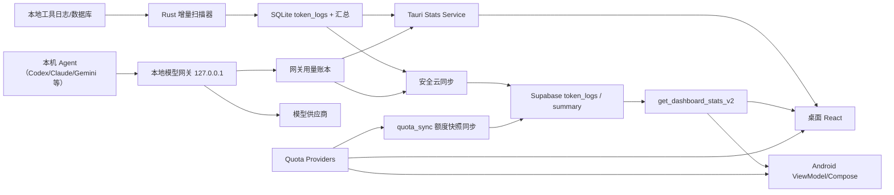

# TokenLedger · 开发设计

> 需求语义见 `REQUIREMENTS.md`，公共边界/ADR 见 `PROJECT.md`；看板与额度跨端 JSON 分别见 `contracts/dashboard-stats-v2.md`、`contracts/quota-provider-v1.md`。

## 1. 架构与数据流



`src-tauri/src/` 模块地图：`scanner/`（按工具拆分的日志扫描，`runner.rs` 调度）、`db.rs`（SQLite 与 schema 迁移，当前 v16）、`commands/`（Tauri IPC、统计聚合、云同步）、`stats_query.rs`（查询下推）、`quota/` 与 `quota_sync.rs`（额度 Provider、供应商余额与跨设备同步，§5）、`gateway/`（本地 OpenAI 兼容网关、Agent 配置写入、路由与用量账本，§4.15～4.17）、`project_index/`（本机项目维度，默认关闭，§4.9）、`session_analysis/`（按需会话元数据，不进 Stats v2 与云同步）、`cost_profile/`（订阅设置，§4.14）、`widget_window.rs`（桌面挂件，§4.10）、`wallpaper.rs`（壁纸，§4.5）。前端 `src/components/` 放看板与设置，`src/features/gateway/` 放模型接入界面。

现有栈不重写。近期改造以统一 Stats Service、数据下推、latest-wins 状态和视图组件复用为主。

## 2. 统计契约 v2

### 2.1 兼容策略

- 保留现有 `summary/tools/models/trends/heatmap/history/machines/meta`。
- 新增字段全部可选；客户端从缺失字段推导或显示“不支持”，不把缺失当 0。
- 本地和云端返回同一形状；Android DTO 与 TypeScript 类型各有契约解析测试。
- `meta.contractVersion = 2`。旧响应无版本时视为 v1。

### 2.2 上一期

新增 `comparison`：

- `current`: 当前窗口的总量摘要和单一聚合序列。
- `previous`: 上一等长窗口摘要和序列。
- `delta`: 绝对值、可空百分比与方向字段 `direction`（`new/flat/up/down`）。
- `window`: 当前/基期起止、时区、桶粒度和 `alignedThrough`。

主趋势继续保留按工具拆分的 `trends`；比较图优先读取 `comparison.current.series` / `previous.series`，避免把工具键与系统保留键混在一起。

### 2.3 下钻

T1.5 完成后的规范化查询上下文统一为：

```text
range + timezone + machines[] + tools[] + models[] + search? + tokenMode
```

空数组表示该维度不受限；同一维度内 OR、不同维度间 AND。每个数组最多 32 项；元素只去除首尾 ASCII TAB/LF/CR/SPACE 后不得为空、不得超过 256 UTF-8 bytes，按 unsigned UTF-8 bytes 排序并精确去重。设备数组不能包含旧入口哨兵 `all/all_cloud`。`search` 使用同一 ASCII trim，空串等于 null，最长 256 UTF-8 bytes；全 ASCII 查询对 `tool/model/machine_id/session_id` 做 ASCII 大小写不敏感的字面子串匹配，含非 ASCII 时做大小写敏感的字面子串匹配，`%`、`_`、反斜线没有通配符语义。

旧 `machine/tool/model` 单值参数只在 Tauri/RPC 兼容入口接受并转换为单元素数组，新请求生产者只发送数组。plural 与 singular 同时存在时，规范化结果必须等价，否则拒绝请求；不得静默选择其中一份。新读者继续接受旧 v2 singular-only echo；新响应在数组为 0/1 项时同时给出等价 singular 兼容 echo，多项时 singular 缺失。数组顺序不同但集合相同必须形成同一缓存键，search 不同必须隔离缓存与游标会话；v2 游标绑定 canonical query 指纹，实体明细还绑定 entity selector，不能在筛选变化后复用。

本地 Rust 与云端 RPC 都在数据源层应用同一查询 helper；比较、明细、实体看板与 filtered summary 不得各自改写筛选。明细表不得只对 `history` 最近 200 条做客户端过滤。facet 计算采用“自身维度排除、其他维度与 search 保留”，使用户能继续追加同维度选项。

实体 selector 与查询上下文分离：新请求使用 `entity={kind: tool|model, id}`，相同实体维度的数组必须为空；例如从 Codex 工具看板进入 GPT 模型看板时使用 `entity={kind:model,id:gpt}` 与 `query.tools=[codex]`。实体看板的完整请求身份固定为 `canonical query + entity.kind + normalized entity.id`；缓存键、latest-wins、响应 echo 与实体游标都必须使用这份身份，不能让两个实体共享只含 query 的键。旧 `tool+model` 调用兼容为 model 实体 + tool 上下文，旧单独 tool/model 兼容为对应实体。云端新增明确命名的 v2 RPC 或 `p_query jsonb` 签名，保留旧 `_v1`；新 RPC 缺失时按 endpoint fallback matrix 仅降级旧签名真正能表达的 0/1 项、无 search 查询，其他情况返回 unavailable。

主看板可选返回 `machineDistribution`，其每项复用 composition 结构并在完整 canonical query 上按设备聚合，`tokens` 固定为输入加输出，缓存单列。桌面仅在云端、未限定设备且至少有两台设备时展示横向排行；有效/含缓存展示开关只在已有缓存字段上切换数值。字段缺失表示旧云端不支持，字段为空表示当前查询无设备数据；两者都不从 `history` 预览补算。

### 2.4 分页明细接口

建议请求：`query, cursor, limit, sort=timestamp_desc`，其中 `query` 复用 2.3 的规范化结构。

返回：`items, nextCursor, totalCount, filteredSummary, availableFilters, meta`。游标由 `(timestamp,id)` 组成，避免 offset 在同步写入时跳行/重复。

### 2.5 云端覆盖与同步结果

当前 Stats v2 的上一周期摘要尚未携带独立 coverage 字段，因此桌面端采用保守兼容策略：云端上一周期同时为 `totalRequests=0`、`totalTokens=0` 时将其视为“未验证基线”，隐藏上一周期零线和所有派生 delta，并显示“不按 0 计算”。本地数据仍按真实零处理。后续契约升级应增加 `meta.coverage.state=complete|partial|unknown` 与窗口级 `hasRecords`，再替换该兼容判断。

客户端在云端 scope 展示本地 `unsyncedRecords`；只要大于零，就明确提示云端趋势可能不完整。同步后端在聚合上传/历史清理提交完成后立即清除 cloud cache，再单独请求汇总刷新。返回值区分 `synced_count`、`purged_count`、`summary_refreshed` 与 `warning`；汇总刷新失败不得把已上传批次回滚成失败，也不得显示无条件绿色成功。

预估费用的价格基准（T10.168）：

- **单价口径**：
  - 内置价格表每个模型只存一档价格。
  - 按输入长度分档的模型：分档阈值在 128K 及以上的取首档；从 32K 起分档的（GLM-5.x、qwen3-max、豆包 Seed 2.0、ERNIE 5.x）取 32K–128K 档（用户决定，规则 B'）。
  - DeepSeek 取北京时间工作日高峰价（用户决定）。
  - 人民币按 7.2 折算。
  - 带截止日的限时价计入，并登记切换日；没有截止日的限时优惠不计入。
  - 千问缓存命中按隐式缓存（输入 × 20%）计；缓存写入缺省时按输入 × 1.25 兜底。
  - 完整约定与已知偏差见 `MODEL_PRICING.md`「取值约定」与「分档与生效日」。
- **哪些记录入库时没有金额**：14 个纯估算工具（claude、codex、trae、zcode、gemini、antigravity、grok、kimi、kimidesktop、pi、dsh、deepseek、marvis、minimax；minimax 来源报的 0 视为不可得，见 `commands/price_repricing.rs`）的记录，以及其他工具中来源没给金额的记录，入库时 `cost_usd` 为空。MiniMax Code 产生的记录一律按产生它的应用记为 `minimax`（即使运行的是第三方模型），来源报的金额不采用，按估算重算（`scanner/minimax.rs`、`commands/price_repricing.rs`）。
- **未登录云端**：统计按本机当前价格表（内置表加上用户覆盖与自动发现项）现算，内置表更新后，历史金额随之变化。
- **登录后**：每次有待同步记录时，同步先把所有 `cost_usd` 为空的行按当时的价格表写入本机，再按（设备、工具、模型、小时）整桶上传。此后本机与云端都保持回填时的金额。
- **重算**：升级应用、内置价格表变化，或升级后覆盖文件的自动迁移（§2.6），都不会重算已写入金额的记录。能重算的只有两类：
  1. 保存价格表（含从 models.dev 导入）或「恢复默认」使生效费率确有变化时，把 14 个纯估算工具的全部记录置空、按新价回填并整桶重传。没有自定义价格时，「恢复默认」不改变费率，因而不会重算。
  2. 一次性本机迁移：schema v2、v4、v9、v10、v12 会把相关工具的记录置空，或删除后重扫，再按当时的价格表回填。v9 是 Codex 的分阶段重建：旧行在下一次完整扫描原子替换之前保持有效。

  其他工具被回填过的记录与来源金额无法区分，不会重算。
- **云端金额的含义**：云端 `cost_usd` 是各上传设备在最近一次上传时、按当时价格表得出的估算。同一账号的不同设备、不同时段，可能对应不同版本的价格表。
- **已同步历史的更正**（用户决定，三步走）：A 在 `MODEL_PRICING.md` 与发布说明写清口径（已完成）。B 一次性本机迁移只重算更正项：14 个纯估算工具中命中更正集合的记录（Sonnet 5、Fable 5.1 缓存读、o3 只处理 2025-06-10 之后的记录、MiniMax-M3 暂按 2026-06-15 起、待 MiniMax 确认）置空并重新上传，来源自带金额的工具不纳入；迁移编号在登记实施任务时由 root 分配。D 带生效日期的价格表与 `cost_source` 列，处理现价调整类型号（GPT-5.6、DeepSeek V4、MiMo V2.5 等）生效日前后的差异。B、D 尚未实现。

T10.305：本机 schema v14 以 `sync_revision` 对可变账本行的上传确认做条件更新。触发器覆盖扫描修正、费用变更及显式同步重置；普通整桶与网关合并整桶均记录读取时的 `(id, revision)`，仅对应修订仍相同才标为已同步。修订元数据在请求构造时移除，不上传云端、不进入 Stats DTO。旧回执不影响新修订，后续同步重新读取完整小时；用户会话 lease 继续防止切号后写回。该修改不解决工具/模型/时间改变后旧聚合键的删除，也不改变网关历史保留或已上传费用冻结规则，后续分别收口。

T10.306c：本机 schema v15 在网络发送前持久登记扫描行的账号、来源键及聚合身份；原行换工具、模型、小时、设备或被删除时，触发器将旧桶写入持久修复队列。同步重新聚合旧桶，仍有成员则覆盖更新，无成员则删除；网关覆盖时使用合并成员。回执仅确认本次捕获的事件 ID，后来产生的修复仍保留。旧空设备身份在查询成员前统一到当前设备，避免上传部分总量。累计计数器重置采用持久代次，差额写入与水位推进在同一事务中，重复累计值不再吞掉新代次用量。

T10.307：本机 schema v16 给 `token_logs` 增加 `usage_provenance`（`reported`/`estimated`）与 `cache_write_known`。目前只有 Antigravity 写入；`cache_write_known = 0` 表示缓存写入未知，统计、云端聚合与界面都不得把它当作 0，旧版估算行标为 `estimated` 并重新排队上传。

价格保存（T10.306c）：先落盘包含新旧文件摘要的重算意图，再原子替换价格文件；数据库暂时失败时返回“价格已保存、历史重算待恢复”，界面明确提示。后续读取、再次保存或恢复默认重试意图，数据库回执保证清理意图失败后也不重复重算。重算范围仍限定既定扫描工具，网关已冻结成本不随之变化；不覆盖外部后来替换的价格文件。

### 2.6 价格表与用户覆盖（T10.171）

- 生效价格表 = 内置表 `src-tauri/prices.json`，逐字段叠加用户覆盖 `<app_data_dir>/prices.json`（覆盖优先），再为表中没有的自动发现型号按工具兜底键补「待核价」行。
- 覆盖文件只存用户改过的字段：
  - 内置型号存与内置值不同的字段；
  - 自动发现型号存与兜底估算不同的字段，并记 `_meta.fallback_key`，其余字段读取时按兜底补齐；`user_edited` 行全部等于兜底时只存 `_meta`，读取时补齐，状态仍为已修改；
  - `models_dev_imported` 行保存导入的字段，不与兜底比较；`_meta.estimated_fields` 列出的估算字段按上一条处理；
  - 用户新增型号整条保存；结果为空时删除文件。
- 费率比较按数值（`3` 与 `3.0` 相等），并容许末位浮点误差（相对 1e-12）：兜底估算如 0.29 × 0.1 经 JSON 文本往返会变一位。
- `prices.overrides-state.json` 记录格式版本与覆盖文件 SHA-256。缺失或不符时：
  - 只有带旧版特征的文件才按旧格式迁移一次。旧版特征指：含 `auto_discovered` 行，含等于当前内置值的内置型号费率，或含只由历史内置值组成的非内置键。
  - 迁移前先备份为 `prices.legacy-backup-<SHA-256 前 12 位>.json`，同名内容不同则加 `-2` 等后缀；其余文件只重新记录哈希。
  - 状态文件写失败只告警，保存仍算成功。
  - 规则与边界见 `MODEL_PRICING.md`「自定义价格覆盖」。
- 迁移不重算，不改已存金额与同步状态，但会失效统计缓存。备份已写好、迁移结果写不进去时，本次按迁移结果计价、下次读取再迁移，本进程只告警一次。原文件备份不了时本次运行不迁移：按原文件计价，原文件一字节不改；按「目录 + 原文件 SHA-256」记在进程内，本次运行不再重试，每个文件告警一次；`save_prices` 与 `reset_prices` 在锁内发现后拒绝，返回固定中文原因，不碰文件；下次启动先备份再迁移（T10.202）。
- 迁移删掉了价格时，在同目录写 `prices.migration-notice.json`（`format` 1）：最近一次迁移的提示（编号 = 原文件 SHA-256、时间、备份名、删掉的型号与字段、删后生效单价变化的项，不再有自身价格的记 `null`）与用户关闭过的编号（最多 32 个）。`get_price_migration_notice` 先让待跑的迁移跑完，已关闭的返回 `null`；`dismiss_price_migration_notice` 按编号关闭。写失败只告警，不影响计价，也不补写；只保留最近一次迁移的提示；备份写不进时不迁移，也不写提示（T10.202）；`cleared`、`changed` 与两项计数只算数字价格，非数字费率随行删除但不计入（T10.202）；备份目录在读取时现算，不存进记录；「恢复默认」不删它（T10.189）。设置页提示标题为「已整理你保存过的价格」，正文不假定由升级引起；前端校验计数与清单一致，对不上按没有提示处理；提示开着时设置目录「模型价格」挂「已整理」（T10.202）。
- 设置页保存或恢复默认只在生效单价变化时，置空纯估算工具的金额并重传。

## 3. 周期对齐算法

所有边界在用户 IANA 时区计算，再映射到当前存储口径。

| 范围 | 当前 | 上一期 | 桶 |
|---|---|---|---|
| today | 今日 00:00 → 当前时刻 | 昨日 00:00 → 昨日相同时刻 | 小时 |
| week | 本周一 00:00 → 当前时刻 | 上周一 00:00 → 上周等长时刻 | 日；今日可选小时 |
| month | 本月 1 日 → 当前时刻 | 上月 1 日 → 上月共同日序/等长时刻 | 日 |

百分比：`previous > 0` 时 `(current-previous)/previous`；两者均 0 为 `flat`；previous=0/current>0 为 `new` 且 percent=null。

## 4. 桌面信息架构

**顶栏导航（2026-10-23，取代 U-101 侧栏与面包屑）**：桌面不再有左侧栏。一级入口是窗口顶栏中间的分段（`nav`，可访问名称「主要页面导航」），顺序为 Agent、供应商、网关、路由、用量；模型接入总开关关闭时（U-112）只剩「用量」一段。当前页的分段带 `aria-current="page"`，四个用量子页都算「用量」；在用量页再点「用量」不切换子页，从其他页点回落到概览。设置是顶栏右侧的齿轮（「设置与云端」，设置页时由它标当前页）；扫描、同步、战报、壁纸等快捷工具与本机/云端状态也在右侧。用量的概览、请求、会话、额度四个子页由页头的二级分段切换（`nav`，可访问名称「用量子页」，当前项 `aria-current="page"`），取代侧栏二级入口、窄栏三项菜单与「用量 · 子页」面包屑；页内工具行规则不变。窄窗口：≤860px 隐藏顶栏标题、状态文字与分隔线；≤600px 再隐藏快捷工具、状态与恢复链接（云端按钮的原因留在 tooltip，恢复入口留在设置），两级分段始终保留。所有可点控件保持 44px 命中区（GLB-03）。本节及 §4.15 中关于侧栏、窄栏菜单、侧栏分组标题、侧栏底色与面包屑的旧描述，凡与本段冲突的一律以本段为准。

**用量页（T10.268，U-89；T10.274，U-100；T10.277，U-101）**：侧栏一级入口依次为「用量」「活动明细」、「模型接入」组（Agent、供应商、网关、路由，见 §4.15）、「设置与云端」。「用量」下常驻展开概览、记录、行为分析三个二级入口，这是子页唯一的切换入口（U-101：页内子标签已删除，避免侧栏与页内两套切页互相冲突）。二级入口 44px 实际命中区（T10.300e，统一 GLB-03），选中态与一级入口同源（同一滑动底色、品牌色竖条与圆角），只靠缩进（文字对齐一级入口标签列）、略小字号与略淡的未选中色区分层级，不画导引竖线（T10.277）；当前子页的二级入口带 `aria-current="page"`（「用量」行在宽侧栏的呈现以下文 T10.306f 为准）。窄栏（≤860px）只剩图标时二级入口收起，高亮回落「用量」图标；点该图标弹出概览、记录、行为分析三项菜单（`role=menu`，`menuitemradio` 标出当前子页并带勾选标记，打开时焦点进入当前项，方向键/Home/End 移动、Enter 选择、Esc 或 Tab 关闭并把焦点还给图标，点外部关闭）。分组标题（「模型接入」「快捷工具与战报」）共用一种字号、字重、字色与 12px 组间距，窄栏里变成组间分隔线。侧栏底色（T10.277）：`--color-bg-sidebar` 半透明只给真实 macOS Tauri 窗口的原生毛玻璃（Sidebar 检测到 Tauri 窗口元数据才标 `data-vibrancy="native"`）；浏览器、Windows 与 mac 浏览器标签页一律用不透明的 `--sidebar-fill`（当前主题 app 色与 page 色各半），浅色、深色都与主内容区同一色系。侧栏紧凑布局（T10.275）：1200×800 与 1280×860 保证全部入口可达；空间不足时列表滚动，底部状态卡保持固定——一级入口与扫描、同步、恢复按钮仍为 44px；「快捷工具与战报」在宽于 860px 时并排成一行等宽按钮（可见文字缩为「分享战报」「桌面壁纸」「锁屏壁纸」，读屏名称与 title 不变；Windows 三个按钮时只留图标）；状态卡的「同步暂不可用…」原因只留给读屏（经 `aria-describedby` 关联同步按钮），状态行与恢复按钮仍可见；滚动提示改为遮罩：列表只在藏着行的一端渐隐 20px（`mask-image`，由滚动位置标 `data-fade-top`/`data-fade-bottom`），不再在底色上叠半透明遮盖层，深色横带根除；更矮窗口只滚动列表、状态卡固定在底部。「用量」是 `UsagePage` 外壳，概览 / 记录 / 行为分析分别对应 `Tab` 的 `dashboard` / `records` / `behavior`（内部子页 id 仍为 `sessions`，用户可见文案与可访问名称一律为「行为分析」）；锚点 `#dashboard`/`#overview`、`#records`、`#behavior`/`#sessions` 直达对应子页。概览包住原 `DashboardTab`，行为分析包住原 `BehaviorAnalysisView`，记录是新的 `UsageRecordsPanel`（复用 `get_usage_details` 分页，沿用活动明细的筛选状态，并给出「筛选与搜索」跳转）。三面共用一个固定顶栏（T10.276）：标题是面包屑「用量 · 子页名」（T10.277，子页名部分对读屏隐藏，内容区 `section` 以只给读屏的子页名作 `aria-labelledby`，两处不重复朗读）、登录后的邮箱、数据健康胶囊（说的是看板/明细读到的统计数据）、本机/云端切换与主题，切换子页时元素、位置与高度都不变（`data-surface='usage'`）。子页专属控件在内容区第一行：概览工具行是全局范围（五个预设 + 自定义弹层）、云端时的设备筛选、靠右的「概览有效 / 概览含缓存」与「战报」；记录工具行只有同一全局范围与云端设备筛选（记录经 `useUsageDetails` 读同一 `range/customRange/deviceFilter`）；行为分析的第一行是它自带的范围栏（今日、近 3/7/30 天、自定义；仅选择自定义时展示双日期与“分析区间”，显示已返回结果的应用日期，仍写回全局范围）。三者都是内容区第一行、位置相同（U-101 删掉子标签后，T10.277）。概览的结论句与「预估费用」同在工具行下一行；记录、行为分析不再显示外壳的预估费用（记录汇总行已含费用）。页内不再显示与子页同名的可见大标题（概览「Token 使用看板」、行为分析「行为分析」降为仅读屏的 `h1`），保留各页说明行。活动明细的顶栏不变，仍带范围、口径、设备与战报；`#agents`、`#providers`、`#gateway`、`#routing` 与用量锚点一样在页面打开后响应 hashchange。外壳只加一行确定性结论句（有效 Token、同期变化、领先工具占比、缓存复用率 = 缓存读 ÷（输入 + 缓存读））与本期预估费用，不新增 Stats v2 字段。本机统计连接在网关账本存在时用 TEMP 视图遮蔽 `token_logs`（`commands/gateway_overlay.rs`），按 Stats v2 §2.5 剔除被网关取代的扫描行并并入网关行；扫描原始行不变，明细项附可选 `source`/`provider`，`meta.capabilities.gatewayLedger` 标明已并入。云同步（T10.273，`commands/gateway_cloud.rs`）对受网关影响的小时改用合并后的行重算聚合并 upsert，合并后消失的旧键从云端删除，载荷多一个 `gateway_requests` 来源计数；每小时上次上传的指纹记在 `app_data/gateway/cloud-sync-v1.json`，未变化不重传；有待执行的 Codex 重建清理时本轮暂缓。方案依据见 `docs/design/gateway-cloud-sync-v1.md`。

**用量页对齐 magpie（2026-10-23，方案 `docs/design/usage-analysis-magpie-v1.md`）**：上段的三项划分与「活动明细」一级入口由四个子页取代：概览 / 请求 / 会话 / 额度分别对应 `Tab` 的 `dashboard` / `logs` / `behavior` / `allowances`（`usageSubForTab` 与 `USAGE_SUB_TABS` 是唯一映射；`records` 不再是 `Tab`，`UsageRecordsPanel` 删除）。请求子页在 `UsagePage` 内渲染 `LogsTable hasPageTitle`（可见标题由外壳给出，`#details-page-title` 降为只给读屏的 `h2`，焦点落点不变），工具行为 `UsageToolbar variant="requests"`；顶栏不再托管范围、口径、设备与战报（`AppHeader` 去掉这些属性），四面顶栏元素完全一致。额度子页是 `UsageAllowancesView`（`QuotaPanel` 自带恢复动作，来源顺序与隐藏沿用概览的显示偏好）；`DashboardTab` 收到 `onOpenAllowances` 时不再渲染完整额度面板与恢复提示，额度要点的「查看全部额度」改为切到额度子页。窄栏「用量」菜单随之为四项。概览的分布模块（显示偏好 id 仍为 `distribution`）由用量拆分 `UsageSplitPanel` 取代原工具环形图、设备分布与模型排行：维度 Agent / 模型 / 设备，指标 Token / 记录数 / 费用，Token 跟随概览的有效 / 含缓存口径；点一行即焦点（再点或「显示全部」取消），切到其他维度时列表收窄（Agent ↔ 模型经 `tools[].models` 交叉，交叉只有有效 Token，记录数与费用按钮禁用并说明），设备只在原设备分布可见的条件下可选且不与其他维度交叉；焦点同时决定热力图画该 Agent 或模型自己的 `heatmap`，没有逐日数据时画整体并写明；热力图也跟随拆分指标，本机统计带逐日记录数与费用（契约 §2.6），选「记录数」「费用」时画对应日历，云端与旧缓存没有时退回有效 Token 并写明。行旁「看板」按钮打开原专属看板；第二个指标按 GLB-02 叫「记录数」（契约字段仍是 `requests`）；费用占比以同范围 `summary.totalCost` 为分母；缓存命中率只在读写之和等于缓存合计时给出（与 `splitModelCacheRead` 同口径）；只看某项时点热力图的某天，单日明细同时按这一项筛选。纯函数在 `src/utils/usageSplit.ts`。请求子页的明细面板头有「导出 CSV」：`useUsageDetails.exportDetailsCsv` 沿当前筛选的游标取完全部行（`src/utils/requestsCsv.ts`，单次上限 50,000 行），由 `export_usage_csv` 写到应用数据目录的固定文件；汇总条与展开行在缓存读写拆分可证明时显示缓存命中率（缓存读 ÷（输入 + 缓存读）），否则写不可得。输出速度只用网关与导入记录带的整次请求耗时（契约 §2.5 可选 `latencyMs`）：展开行显示「耗时」与「输出速度」（输出 Token ÷ 耗时，含首字等待），CSV 末尾追加 `latency_ms` 与 `output_tokens_per_sec`；扫描记录与小时聚合没有耗时，不显示、写空，不按时间间隔推算。筛选范围内有带耗时的行时，汇总条多一张「输出速度」卡（这些行的输出合计 ÷ 耗时合计，契约 §2.5 `filteredSummary.timed*`），没有时不出现这张卡。

**PC 一致性修复（T10.306f，用户 2026-10-05 专项授权）**：宽侧栏把「用量」显示为与「模型接入」一致的分组标题，概览、记录、行为分析用同级图标/14px文字/44px命中区，只当前页面选中；取消重复的父入口。窄栏保留用量图标和三项键盘菜单，页内仍无标签。三页补可见20px标题，与模型页面同一标题字体；摘要/表格为13px，辅助说明12px、徽标最小11px，旧10/10.5px令牌归一到11px。这里只统一呈现，不改三页统计范围和功能。

**报表文本密度（U-102，T10.278）**：概览、记录、行为分析与网关、路由页的表格和卡片少放字、多留白。每个区块只留一个标题加一个主数字或一张图；解释、口径、公式与判定规则收进标题旁的 ⓘ（`InfoTip`）；指标卡最多一行副标题，补充数字放进 `title`；顶栏或工具行已有的更新时间、范围不再在区块内重复；去掉与标题或相邻文字重复的徽章和胶囊（工具来源、视角、复用率、路由决策原因与详情相同时只留一个）。「缓存单列、不计入有效 Token」每页只在一处可见：概览在外壳结论句，网关在「最近请求」标题行，其余进 ⓘ。项目维度入口只留一句（「按项目查看用量，默认关闭。」），隐私与归并说明进 ⓘ。区块间距只用 `--space-*` 令牌（概览与行为分析纵向 `--space-6`）。数字、图表与数据不删，有效 Token = 输入 + 输出的计算不变。

### 4.1 明细页

- 顶部：范围、工具、模型、设备、搜索、清除；显示结果数与筛选后总量。
- 表格内工具/模型/设备是可聚焦按钮或 chip；点击更新筛选。
- 从总览年度日历或突增卡进入的单日复盘，在页标题下显示复盘条（`role=group`）：「正在查看 M月D日 · 来自总览」与 44px「返回<原范围>」按钮；进入时焦点落到页标题，返回后落到主区域；用户修改范围或筛选后复盘条消失（T10.158，规则见 §4.8「突增侦测」）。
- 行详情使用具备 `role=dialog`、焦点陷阱、Escape、关闭后焦点恢复的抽屉/弹窗。
- 大数据量使用服务端/本地分页和虚拟化，不一次渲染全历史。

### 4.2 同期趋势

- 当前期实线、上一期虚线；颜色不承担唯一语义。
- 总量比较与工具分布分开，避免多工具 × 两期导致图例爆炸。
- 范围变化触发同一个请求控制器；旧请求取消或被序列号丢弃。

总量与总量变化只在核心指标卡回答一次（`MetricsGrid` 读 `comparison.delta`，变化胶囊中性色）。趋势卡只回答核心指标卡没有回答的两个问题：日均与单位费用。总览只有一种日均：只平均已结束的桶，与日均基准虚线是同一个数（`insightRules.completedBucketAverage`），也与周期末预测的典型日、突增基线同一截止点；其它卡片不再给含进行中今天的第二种日均。单位费用 = 预估费用 ÷ 有效 Token × 1,000,000；大于 0 但不到 $0.01 时写“<$0.01/百万 Token”，算不出时写“不可得”（`src/utils/unitCost.ts`）。所有日桶对比都能切累计走势；本月、本周与多日自定义区间在累计视图叠加预测线与粗略范围色带（§4.13），双轨只显示文字行。总览本机“全部”走势标注最近 31 天观察窗，云端标注按全部历史逐日绘制。月末同期截短时（本期对比窗口止于对齐日，`insightRules.comparisonClip`），核心指标的同期变化与趋势卡的日均、单位费用写明“截至 {对齐日}”，趋势卡用一行不带数字的原因说明不预测。云端作用域下，`dailyCosts` 缺失或覆盖不完整时，日均预估费用与单位费用写“不可得”，不按 $0 计算。T10.223 起，趋势卡头把指标（Token／费用／双轴）与呈现方式（逐小时／逐日／累计）分列，图旁用一行口径文字就近说明同期截断、未完成桶与不可比基期；模型费用排行仅在出现例外时汇总“已知正费用／已知为 0／费用不可得”，0 保留 `≈$0.00`，不可得仍不参与金额排名或数据条。指标卡以稳定身份作 key，切换口径只更新内容，不重播入场动画（T10.159）。

主看板贡献分析区按“工具排行、模型排行”组织，云端全部设备查询时再加设备排行。三者共用同一个排行组件：每行 44px，含名次、名称（两行截断）、单色数据条、主值、占比与次要值（设备排行的次要值是记录数）；可在“Token／费用／单位费用”间切换，设备只有前两档；默认 8 行，其余合成“其余 N 个”合计行；行按钮进入专属看板，展开按钮显示缓存构成。容器变窄时依次隐藏复用率、次要值与数据条；单设备筛选时不显示设备排行。单位费用档只表达规模与费用，不得命名为「效益」或推断任务质量；用量过小或单位费用不可得的行排在末尾并注明，不静默消失。

以上排行组件是信息架构 v2（T10.156）的目标，未实现。现行贡献区在云端全部设备查询中按“工具分布、设备分布、模型排行”组织；设备分布使用横向数据条，显示设备名、Token、占比和记录数（GLB-02）；宽度不足时设备与工具并排、模型排行跨整行，再在窄屏降为单列；单设备筛选时不保留无意义的 100% 设备图。

### 4.3 专属看板

模型、工具与组合看板共用 `EntityDashboardModal`（原 `ToolModal` / `ModelModal` 已合并删除）：

- `entity={kind,id,displayName,isEstimated}`；
- 共享指标、比较趋势、构成、设备、活跃、明细组件；
- 工具/模型差异由 composition slots 提供；
- 桌面宽屏可用详情路由/大面板，小窗口使用全屏 dialog；上下文可恢复。
- 关闭后焦点回到打开它的元素；该元素在打开期间已脱离文档时（例如行为页越过预设窗口后从工具行下钻，先切范围、排行列表重建），焦点退回主内容区 `#main-content`，不落到 body（T10.164 评审 N2，T10.179）。
- 分布卡片的对比口径（T10.111）：`CompositionMetric = 'tokens' | 'cost'` 由模态内一个分段控件统一切换三张分布卡片；`describeCompositionItem` 把所选口径放在首位并附占比（分母为该卡片所有项之和），条形宽度与排序同样按所选口径；最近明细右列在 Token 下补 `≈$` 预估费用。金额仍来自 Stats v2 `composition[].cost` 与 `historyPage.items[].cost`，不新增契约字段。
- 占比与单位费用（T10.163，桌面已实现，`EntityDashboardModal`、`src/utils/unitCost.ts`）：洞察条给出「占总预估费用」与「单位费用」。占比只在分子分母可比时出现：作用域相同，canonical 查询逐字段相同（范围、自定义起止、时区、设备/工具/模型与搜索），两侧 `meta.generatedAt` 相差不超过 5 分钟（对齐后端统计缓存的 TTL）且在查询时区下属于同一自然日；任一条件不满足时整项隐藏，不显示 0，也不用“不可得”掩盖不可比。可比时，全局费用未知或为 0、实体费用未知或算出超过 100% 显示「不可得」，0 < 占比 < 1% 写「<1%」，其余四舍五入为整数百分比。单位费用 = 实体预估费用（含缓存读写费用）÷ 有效 Token × 1,000,000，与总览趋势卡共用 `computeUnitCostUsd` / `formatUnitCost`：费用未知、有效 Token 不为正或输入/输出任一不可得时显示「不可得」，大于 0 但不到 $0.01 写「<$0.01/百万 Token」，其余写「≈$x.xx/百万 Token」；有同期比较时单位费用只在趋势卡显示一格，洞察条不重复。

### 4.4 视觉系统、主题与浮层

- 四档纵深（T10.150，取值见[视觉焕新 v2](design/desktop-visual-refresh-v2.md)，令牌集中在 `src/styles/tokens.css`）：窗口与侧栏 `--color-bg-app` → 页面 `--color-bg-page`（叠加 `--color-ambient` 环境光）→ 卡片 `--color-bg-panel` + 1px `--color-border` + `--shadow-card` → 浮起层 `--color-bg-popover` + `--shadow-float`；深色偏海军蓝，不用中性灰。品牌渐变只用于身份：Logo、导航选中指示条、主 KPI 点缀与主按钮；主色承担选择、焦点与图表当前期；数据系列用 `--chart-1…8`；成功、警告、危险只表达状态。
- 顶栏和正文使用相同的 24px 水平基线。导航行、分段选项、图标命令、设置输入与按钮等可点控件最小 44px 高（GLB-03）。分段控件是无边框浅色轨道，选中项由 `useSegmentedIndicator` 驱动的 `.tl-seg::before` 胶囊滑过去（用 `--seg-inset-x/y` 内缩），DOM 与读屏树不变。侧栏选中态是左侧 3px 渐变指示条、滑动底色和主文字色，不用整块高饱和色卡片。字重分三档：正文 400；标签、导航、按钮与分段选项 500；标题与数字 600。Windows 中文 UI 字体遇到 600 及以上一律渲染为粗体，所以其余位置不加粗。
- T10.223 的主看板上下文（数据来源、统计周期、Stats 回显时区与快照时间/新旧状态）自 T10.278（U-102）起收进页首的 ⓘ，卡面只在数据过期等警示时露出一个短状态词。范围和设备优先取 `meta.query` 的 canonical 回显；切到未缓存范围时，有回显就继续标真实旧范围，无回显只把新范围称为“当前选择（数据未更新）”，不把界面操作完成时间冒充数据生成/刷新时间。
- ⓘ 说明（`src/components/InfoTip.tsx`，T10.278）：18px 圆形按钮、命中区扩到 44px，`aria-label` 写说明主题，`aria-describedby` 指向 `role="tooltip"` 的气泡，读屏不展开也能读到。悬停、键盘聚焦或点击时显示，失焦、移开、Escape、滚动或窗口缩放时收起；收起时气泡带 `hidden`。气泡为固定定位的不透明浮层（`--color-bg-popover`），宽不超过 320px，位置沿用 `CostHelpButton` 的视口约束，系统高对比度下用 ButtonText 描边。
- `useTheme` 是进程内唯一主题状态源，基于 `useSyncExternalStore` 同步所有订阅组件。启动渲染前先设置 `data-theme`、`color-scheme` 与 Tauri 原生窗口主题；Auto 只监听系统媒体查询，跨窗口通过 storage 事件同步。图表在主题变化时重算语义色，但保留 ECharts 实例。
- 筛选 popover 使用 `--color-bg-popover` 的不透明表面、强边框和浮层阴影；根据触发器到视口右边的空间选择左/右对齐。modal scrim、toast 与 focus ring 全部来自主题令牌，不硬编码浅色或深色残值。
- T10.134：主题与日期弹层同样使用不透明表面；键盘焦点移出时关闭，Escape 关闭并返回触发器，日期仅在“应用”后生效。模型导入候选用 `aria-pressed` 暴露当前选择。Tailwind 默认值在 `@theme` 中单一定义、明暗主题覆盖，禁止同名变量自引用；编译回归校验圆角和运行时语义色。1200/1280 桌面宽度将范围上下文与操作分行，侧栏壁纸动作完整显示；设置状态与标题同行，说明占完整下一行。
- 640×520 最小窗口内保留横向命令滚动提示；主题/日期弹层挂载到滚动容器外，按视口约束位置，Tab 离开时关闭并继续后续控件。
- 系统高对比度下，选中与悬停导航/分段按钮使用系统 Highlight/HighlightText 配对，后代文字继承同一前景且保留透明背景，避免系统文字底板遮挡；设置行图标使用 Canvas/CanvasText。此规则仅作用于系统高对比度状态，正常明暗主题不受影响。
- 动效（2026-09-04 修订，应产品要求把总览做成"带动效的图形"）：揭示类动画只在挂载时播放一次——KPI 卡片以 ≤ 45ms 的逐卡延迟做 480ms 上浮淡入，额度环从空环扫入、进度条从 0 生长（≤ 900ms），数据刷新不重播；数值只在真实变化时做 ≤ 720ms 的补间，首次渲染直接显示真实值，不从 0 假装增长。所有关键帧使用 `backwards` 填充，结束后不持有 transform，悬停位移照常生效。系统 reduced-motion 由全局 1ms 覆盖与 `prefersReducedMotion()` 同时关闭以上全部；图表仍只在数据真实变化时更新。
- 动效原语（T10.150，`src/styles/motion.css`）：切页 `tl-enter-up`；弹窗与抽屉 `tl-enter-scale`；菜单与弹层 `tl-pop-in`；进度条与数据条 `tl-grow-x`；扫描、同步进行中的状态点 `.tl-live-dot`；刷新图标 `.tl-spin`；按压 `.tl-press`。都只在挂载时播放一次，数据刷新不重播；选中态滑过去而不是跳过去。reduced-motion 全局块放在样式表最后（在 forced-colors 块之后），并清零 delay。不使用 `@starting-style`、CSS anchor positioning 与 View Transitions，因为 WKWebView 的目标是 Safari 15。
- 图表样式的单一来源是 `src/utils/chartTheme.ts`：系列色、网格、坐标文字、tooltip、柱顶圆角、线下面积渐隐，以及 `getChartAnimation(reduceMotion)`（首次 700ms，更新 450ms，reduced-motion 时关闭）。组件不自带图表配色。
- 工具身份色（GLB-05，T10.178 实施分槽，T10.187 换用色弱方案 B）：
  - **分槽**：桌面 `colorsForToolsInView` / `toolColorMap`、桌面静态壁纸与 Android `toolChartSlot` 用同一张「工具 → 图表槽位」表（`design/android-visual-refresh-v2.md` §3.8）：名字按 ECMAScript `trim()` 的字符集去首尾空白（Rust 壁纸与 Android 同一字符表）、转小写；别名同槽（deepseekgui、dsh → deepseek，kimidesktop → kimi，mavis → marvis）；未登记的工具按名字的 FNV-1a 32 位哈希（UTF-16 码元）落槽。同一视图里撞槽时，排名靠后的顺延到下一个空槽，8 之后回到 1。同一视图第 9 名起统一用「其他」`--color-text-muted`，不借用任何槽位。Android 各屏调用点随 A2/A5 从旧的 `stableToolColorIndex` 切到 `toolChartSlot`。
  - **颜色**：槽位 1–8 取图表系列色 `--chart-1…8`，即色弱方案 B（用户决定 U-4）：深色 `#6b9dff #907adc #2dd4bf #fbbf24 #fb7185 #3fe480 #3dbdf7 #fb923c`，浅色 `#2f6be6 #8972fe #0d9488 #d57501 #d41340 #16a34a #1d85c3 #d34c04`；「其他」深色 `#a5acb9`、浅色 `#586273`；与 Android `LedgerTokens` 同值同序。桌面静态壁纸（`src-tauri/src/wallpaper.rs`）用同一张槽位表与同一分配规则，只取深色一套。
  - **色差**：同一视图 8 个槽位两两之间，在 Machado 2009 严重度 1.0 模拟下的 CIEDE2000 最小值为深色 deutan 6.38、protan 8.02、tritan 3.63，浅色 6.38、5.97、4.25，均高于 5.8 / 5.4 / 3.3（`src/types.test.ts` 锁定）。
  - **对比度**：深色 8 色在面板、页面、浮层与 elevated 层上都不低于 4.2:1。浅色 8 色在白卡上不低于 3.29:1，在页面底 `#f4f5f7` 上不低于 3.02:1；浅色身份色柱状图用 1 / 0.96 透明度（R-9），不低于 3.12:1。系列色不画在比页面更深的浅色填充上（桌面工具条悬停底已改为不透明面板底加 3% 叠色，槽位色达 3:1，T10.206；Android `raised` 上槽位 4、6 不足 3:1，另行处理）。名次色板（行为页日柱、时柱与模型系列，`PALETTE_DARK`、`PALETTE_LIGHT`）按柱形渐变最淡处 0.74 透明度叠在面板上也不低于 3:1，浅色 p4、p5 在绿色弱模拟下可分：深色 p3 改为 `#9290ee`，浅色 p5 改为 `#a5370a`、p7 改为 `#02689d`，色相与饱和度不变、只调明度（T10.206）；浅色 p2、p6 的色弱可分性仍有缺口，待办记录在维护方的内部台账（本仓库不发布，见 [`internal-collaboration-materials.md`](internal-collaboration-materials.md)）。
  - **一致性**：分槽测试向量在共享夹具 `fixtures/tool-chart-slots-v1/slots.json`，色值在同目录 `palette-b.json`；桌面 `tokens.css`、`types.ts`、`chartTheme.ts` 兜底、壁纸 `wallpaper.rs` 与 Android `LedgerTokens.kt` 各自与夹具逐值比对（R-30、R-39），任一份漂移即测试失败。
  - 工具颜色不作为唯一线索，必须同时显示工具名。
  - **壁纸与锁屏的非工具强调色**（T10.195）：走势「昨天」虚线、网格与刻度、排行条与标题点、光晕等非工具元素不借用槽位色，只用 `wallpaper.rs` 里三个独立常量：主色 `ACCENT_PRIMARY` `#6b9dff`（与槽位 1 同值，U-4 接受的唯一例外；今日走势线、排行条与标题点）、坐标轴色 `ACCENT_AXIS` `#8f97a5`（昨日虚线 alpha 170、网格与刻度）、中性色 `ACCENT_NEUTRAL` 取「其他」的 `#a5acb9`（变化胶囊底 alpha 143，昨日面积 alpha 30 / 27）。涨跌只由箭头与正负号表达，不用颜色区分。
  - **壁纸活跃度热力图与变化胶囊**（T10.210）：热力图与看板 `YearHeatmap` 同一 `rhythmLevel` 分档与主色单色相，1–2 档加与年度日历相同的非主色内框；死代码里的锁屏热力图（`draw_lockscreen_activity_panel`）已删；读不到的日子还没有单独的未知态，待办记录在维护方的内部台账（本仓库不发布，见 [`internal-collaboration-materials.md`](internal-collaboration-materials.md)）。云端「较昨日同期」上期读回 0/0 时写「基线缺失」（`STAT_BASELINE_MISSING`），与读取失败的「不可得」（`STAT_UNKNOWN`）是两个状态，不画箭头与百分比；本机路径不变。`draw_card` 在缩放 1.0、圆角半径等于高度一半时照常描边与填充。
- KPI 卡数值永不换行（T10.105b）：`.metric-value` 固定 `white-space: nowrap` 与等宽数字，组件按格式化后字符数给出 `is-long`（≥9 字符）/`is-longer`（≥11 字符）/`is-longest`（≥13 字符）三级降字号（30 → 24 → 20 → 17px，1280 窗口下 149px 数值列实测最宽 132px），默认 1280×860 窗口下 `≈$1,422.78` 一类四位数金额与四张卡保持同高；不得靠 `overflow-wrap` 让数字折行。页标题区收成一行：`h1` 22px（T10.150 起，原 20px）与“调整显示 / 刷新扫描”两个动作按钮同行（44px 高），完成时间换行到按钮下方，总览页不再重复副标题。
- Token 量级（`formatTokens`，T10.161）：K 从 1e3、M 从 1e6、B 从 1e9 起，K 保留 1 位小数，M、B 保留 2 位；四舍五入后达到 1000 就进位到下一单位，B 为最高单位；负数按绝对值选单位再加负号；缺失或非有限值显示「—」，不显示 0（GLB-01），四舍五入为 0 时不带负号。Android 应用、摆件与分享海报按同一单位与进位规则，小组件的 Token 保留一位小数（用户决定，T10.172 Q1，见 §6.2 数字格式；T10.207 实施，唯一实现是 `LedgerUiLogic.kt` 的 `formatTokenMagnitude`）。Android 的 Token 与记录数差值写 `+` / `−`（U+2212）加同一缩写（`formatSignedTokens`、`formatSignedInteger`），与桌面 `describeMetricChange` 相同。托盘悬停提示与 macOS 菜单栏标题的 Token（Rust `widget_window::format_tokens`）与 `formatTokens` 逐字相同，前端、托盘与 Android 三端共用黄金用例 `fixtures/token-format-v1/cases.json`（T10.191；Android 的 JVM 测试直接读这份文件，T10.204 合入时 root 对齐）；改其中一端必须同时改用例与另两端。小数位按显示值十进制四舍五入、半数远离 0（1,150 写 `1.2K`，1,005,000 写 `1.01M`，1,250 写 `1.3K`），整数用整数运算，不再用 `toFixed` 对二进制值舍入；`formatTokens(-0.5)` 写 `-1`，不再出现 `-0`（T10.204，R-52）。坐标轴的 Token 刻度统一用 `formatAxisTokens`，不再写死小数位（T10.201、T10.204）；界面上的「有效 Tokens」统一为「有效 Token」，由前端契约守卫防回退（T10.204）。
- 设置页的模型价格编辑器默认折叠，只展示模型总数、待确认数量与价格来源状态；用户展开后才显示导入、重置、搜索与逐模型编辑。校验失败自动展开，避免错误被隐藏，同时不让长列表侵占常用设置导航。
- 可访问性与强制色彩细则（T10.150 视觉验收修复）：
  - 状态文字档令牌：落在 6–12% 同色调底或选中行底上的小号状态文字（≤13px）用 `--color-success-text` / `--color-warning-text`，浅色 #166534 / #8a4b00，深色沿用状态色 #4ade80 / #fbbf24，forced colors 下分别为 LinkText / CanvasText；状态点、进度条等图形仍用 `--color-success` / `--color-warning`。
  - forced colors：`--color-primary-fill(-hover)` 映射为 Highlight；文字落在 Highlight 填充上的控件（主按钮、跳转链接、选中项）必须设 `forced-color-adjust: none` 并显式写 Highlight / HighlightText，否则 UA 垫的 Canvas 底板会让文字不可见；未选中的色调按钮回落为 ButtonFace / ButtonText 加 1px ButtonText 边框；MarkText 在 Chromium 各套主题下都是黑色，不能用作 Canvas 上的文字色。T10.181 补充：
    - 警示与危险令牌（`--color-warning*`、`--color-danger*`、`--color-text-danger`、`--color-orange`）在 forced colors 下的前景（文字、图标、边框、状态点）一律 CanvasText。
    - 价格导入按钮、云端横幅里的「立即同步」与侧栏「检查状态」一样，回落为 ButtonFace / ButtonText 加 1px ButtonText 边框。
    - 图形与底都会映射到 Highlight 的装饰标记（额度面板的 tone-primary 图标、badge-subtle 徽标）改用 Canvas 底、CanvasText 图形。
    - SVG 的 currentColor 在 forced colors 下仍取作者写的颜色，压在渐变上的白色标记（侧栏 logo）要显式给系统色。
  - 44px 豁免：行为分析「日期 × 小时热力」格（22×23，列距 25、行距 26）是数据网格单元，满足 WCAG 2.5.8 的间距例外（中心距 ≥24px），同样的选择也能经「选择下钻日期」下拉与模型时段图完成；总览节奏条格（36×38，`role="img"`）只承载提示，不是操作目标。其余可点控件一律 ≥44px，需要保持外观尺寸时用透明伪元素把命中区扩到 44px（如额度「展开」与专属看板口径切换）。
  - 入场动效：页面入场（`tl-enter-up`）与首屏揭示（指标上浮、条形生长）只在切页时播放；同一页内因切换范围或口径重新加载时不重播，看板给重新挂载的内容加 `data-entrance="settled"`，由 `motion.css` 关掉这些动画；切到未缓存的范围时，已显示的内容保留到新数据到达（T10.181，见 `design/analytics-ia-v2.md` §6.5），挂进保留内容的新行同样不重播；懒加载页的 Suspense 占位不播入场。
  - 占位符：`::placeholder` 统一用 `--color-text-tertiary`（浅色 ≥4.8:1，深色 ≥5.5:1），forced colors 下为 GrayText。
  - 字号下限：说明与徽标文字 ≥11px（`--font-size-xs`）；可点提示行 ≥12px（`--font-size-sm`），如突增卡的下钻提示与不可用提示；明细筛选的值与占位符为 13px/500。
  - 筛选弹层：高度不超过所在一侧的可视空间；两侧都放不下「搜索 + 3 个候选 + 页脚」时先滚动内容区，直到能放下为止，同时让触发块留在可视区内，再向空间较大的一侧展开，多出的候选在列表内滚动。
  - 窄屏侧栏：滚动区用滚动阴影提示上下还有内容，阴影层钉在滚动区边缘，覆盖层随内容走、到头时遮住阴影；forced colors 下去掉。
  - `forced-color-adjust` 分层：全局的 `forced-color-adjust: auto` 复位只能放在 `@layer base`；组件需要保留自己的配色时在自己的规则里写 `forced-color-adjust: none`，并且只用系统色，非系统色会在 forced colors 下原样露出。

T10.112 桌面样式收束：KPI 取消多色光晕与悬停位移，语义图标统一采用现有 Lucide；次级指标保持中性，仅主指标强调。T10.150 起，主指标卡在顶部叠一层品牌软渐变光晕，其余 KPI 保持中性；可点击的卡片悬停时只加强边框与阴影，不位移。单指标趋势使用 DOM 同期图例，双轨保留四序列图例。趋势面板使用内容高度，图表保留 280px 独立空间，防止窄桌面固定高度压缩比较摘要或使图表覆盖下一面板。实体金额先验证有限非负数，未知显示不可得并后排；真实 0 与未知数据条宽度均为 0，费用占比说明只统计已知费用。

#### 品牌图标（T10.222）

- `src/assets/brand/tokenledger-mark.svg` 是品牌几何的唯一编辑源：账本竖脊与记录条，24×24 坐标、圆端圆角；不使用位图生成模型或霓虹叠层。`npm run icons:generate` 派生 React/Canvas 与 Android 的路径常量、安装图标和平台资源；`icons:check` 与故障回归接入 `npm run check`，生成失败不得报告成功或留下半套资源。旧 Python 入口只转交 Node 生成器，修改源图后必须重新生成并提交派生资源。
- 界面 SVG 继承 `currentColor`：侧栏与分享弹窗使用明暗主题的 `--color-primary`，系统高对比度使用 CanvasText；侧栏不再叠加渐变底板。桌面首次绘制的背景/文字与主题令牌一致，提前设置 `color-scheme`。桌面与 Android 海报页脚直接绘制同一路径、沿用各布局的前景色，不加载应用位图。
- 安装图标采用稳定蓝底白色符号，macOS 托盘使用透明单色模板，由系统按菜单栏外观着色。Android 保留五密度传统图标，并为 API 26+ 提供全幅蓝色背景和仅含符号的自适应前景，API 33+ 另有 monochrome 层；系统负责外部遮罩，前景不自带圆角底板。自适应层使用 108dp 画布与 66dp 安全区。
- 图标资源不改变版本号、主题偏好、统计或分享数据。Android 启动窗口当前仍固定深色；应用内浅/深/E-ink、Launcher 主题图标和启动窗口外观分别验收，不能互相替代。

### 4.5 壁纸授权与云端恢复状态

`AppSettings.wallpaper_consent_version` 是壁纸系统副作用的授权代次。新设置默认代次为 `1` 且桌面、锁屏、动态背景全部关闭；旧文件缺字段时反序列化为 `0`。若代次为 `0` 且任一壁纸目标开启，启动调度器和 macOS 动态壁纸窗口都必须早退，React 显示一次性确认卡。保留会写入代次 `1` 并沿用旧目标，关闭会清空目标并写入代次 `1`；旧配置本来全部关闭时可无提示规范化为当前代次。

云端 onboarding 不增加 Stats RPC：连接配置来自已保存设置，登录来自会话状态，Stats v2 能力在第一次成功解析 cloud envelope 后确认，首次同步使用既有同步结果。失败状态保留 dataScope 与合格 LKG，只附加分类错误和恢复动作（分类按 Rust 原文逐句，`classifyCloudFailure`，契约测试从 Rust 源码锁定，R-60、T10.200）；“查看本地”通过用户动作进入临时本地视图，不能改写云端偏好。任何密码只存在于表单局部状态，提交结束与卸载时清空。

T10.134：状态检查和能力验证共享请求代次，配置切换与退出开始时失效旧读取，迟到成功/失败不能写回状态或提示。额度刷新沿用当前绑定最近一次成功的本地/远端合并模式，冷启动仍只读本地；退出成功或绑定变化后清空旧额度并重置本地模式。额度同步事件独立刷新设置和同步状态，任一读取失败不阻止另一项。

T10.308c：桌面登录与注册使用独立请求预算：连接5秒、单次12秒、总计25秒（含退避与响应读取）；成功响应64 KiB、错误响应8 KiB，禁止重定向与原始错误正文回显。注册不自动重试；登录仅对非超时的连接建立失败重试一次。退出、真实切换连接绑定或卸载立即释放界面忙碌并清密码，迟到请求不覆盖新请求；HTTP完成与持久化前继续校验会话generation及持久epoch，无会话的注册确认也须校验。

T10.311：每次桌面认证提交在后端提交锁内取得独立的本进程generation，隔离更早的登录/注册；不因此改变账户或持久epoch，并保留同epoch会话缓存与安全存储失败抑制。保存相同连接配置只使状态读取失效，保留在途认证及其忙碌归属；保存期间禁用新的账户操作。旧配置加载被代次淘汰不触发安全故障收尾，真实安全存储故障也只有在所捕获代次仍当前时才能停止同步并隔离会话。额度启用失败的claim检查与本机回滚处于同一协调器临界区，过期失败不得修改新绑定、设置或停止标记。清空已确认成功后，设置和来源回读显式返回结果；刷新失败提示删除已确认、同步已关闭且不要重复删除，被新额度读取替代则提示刷新结果尚未确认，不报完整成功，也不把刷新异常混淆为云端删除失败。

### 4.6 模型费用分布报表（REQ-DRILL-04）

`StatsData.models[]` 已携带 `cost`（预估费用）与 `cached`（读+写合计）、`cacheWrite`（可选），因此本报表**不新增契约字段**，纯呈现层实现，四端零迁移。命中缓存读 = `cached - cacheWrite`；`cacheWrite` 缺失时整行降级为“缓存合计”，不得把合计伪造成命中缓存。

**两级信息架构（桌面与 Android 共用）**

1. **分布总览**：在数据洞察的“来源”区增加“模型费用分布”视图（与既有工具/模型 Token 排行并列，可在 Token/费用口径间切换）。全部模型按 `cost` 降序（输入为当前范围完整的 `models[]`，桌面经 `useStats().allModels` 传入，不得复用 Token 排行的前 8；默认显示前 8 行，「展开全部（N）」原地展开、44px 触控目标，收起时写「其余 N 个模型合计 ≈$X（Y%）」；T10.158），复用既有单序列行内数据条 Modifier：每条 = 模型名 + 预估费用（桌面 `≈$`，Android 人民币）+ 费用占比 + 有效 Token + 命中缓存复用率 + 记录数（现行面板写“请求 N 次”，随信息架构 v2 改名），数据条宽度按该视图最大费用归一、按实际行宽绘制，保留精确值与排序语义。隐藏费用开启时金额与占比显示 `$***.*`/`¥***.*`，数据条与其余数值不受影响。
2. **单模型下钻**：点击模型行进入该模型的“命中缓存消耗分布”——未命中输入、输出、命中缓存读、缓存写四段的 Token 构成（堆叠条 + 图例）、该模型预估费用与复用率 `cacheRead / (input + cacheRead)`。契约只有模型级 `cost`、无按段定价，故费用仅在模型级呈现、不按段拆分。下钻继承范围/设备/工具/模型组合筛选与 Token 口径，返回时恢复列表滚动与筛选；旧云端无读写拆分时只显示“未命中输入 / 输出 / 缓存合计”三段。

**平台呈现**

- 桌面：作为 `EntityDashboard` 的模型 composition slot，或洞察区独立面板；宽屏并排“费用排行 + 构成环形/堆叠条”，窄屏降为单列。金额统一 USD，按预估费用格式显示（`≈$`、千分位，未知显示不可得）。信息架构 v2 实现后，桌面改由 §4.2 模型排行的费用档与行展开承载本报表，独立面板随之移除（T10.156，未实现）。
- Android：在复盘“来源”子页内作为模型排行的费用切换态，下钻走既有模型专属看板路由；金额为人民币、遵守隐藏费用与千分位/大数 compact 规则，复用 TalkBack 合并描述（模型名、金额、占比、复用率、下钻语义）。
- 可访问性：费用分布不得只靠颜色；数据条是视觉辅助，精确数值始终可读；下钻行暴露 `role=button` 与键盘 Enter/Space 触发。

### 4.7 周期总结海报（REQ-SHARE-01）

分享功能是 `StatsData` 的确定性呈现层，不扩展 `dashboard-stats-v2`、RPC、SQLite 或 Supabase。桌面 `ShareSummary` 与 Android 对等模型只抽取当前范围、时间窗口、有效 Token、输入/输出/缓存、记录数（现行海报写“请求”，随信息架构 v2 改名）、预估费用、上一周期 delta、趋势/热力图、主力工具/模型和数据元信息；任一字段缺失时按 REQUIREMENTS 的诚实降级规则省略，禁止从总量反推不存在的分桶或同比。

活跃天、连续天数与峰值必须与看板洞察共用数据源时区和截止点：优先 `comparison.window.currentEnd`，其次是带 `meta.timezone` 来源证明的 `meta.generatedAt`。热力图中晚于截止日的正数脏值必须剔除；日报峰值只能从截止小时内的小时趋势或匹配的同期序列选取，不得回退到跨日热力图。时区/截止无法证明时，这些指标返回不可得，不借用宿主时区猜测。同样，只有显式且加总一致的缓存读写拆分才能进入海报复用率与缓存净节省；缓存净节省只在为正时作为海报事实，不画读取节省（毛值）或负值；合并缓存只展示总量（T10.162；Android 海报已按此实现（T10.184），含兜底单价时不画，不足 ¥0.01 写「<¥0.01」，云端 B 期前 Android 响应没有该对象；桌面海报由 T10.253 改为读取契约中可证明的正净节省，不重算底层金额）。

`ShareLayoutKey` 固定五个稳定值：`scorecard`（数据海报）、`journal`（协作手记）、`achievement`（连续成就）、`receipt`（协作结算单）、`signal`（极简信号）。五套绘制器共享 1080×1920 设计坐标、安全边距、字号下限、品牌页脚、隐私投影和格式化函数，但各自拥有独立的信息层级；布局不能退化为仅换配色。桌面仍输出固定 1080×1920；Android 可把同一设计坐标等比居中到设备物理像素画布并铺满背景。预览使用同一绘制结果按比例缩放，不维护第二套 HTML 仿制稿。Android 极简信号光带下段的“输出”“缓存”两段直立竖排放不下时两段同比收紧，不相叠、不压到事实行（T10.207 临时处理，字号可能低于共享下限；最终做法随 A8）。

T10.224 在**不改变上述五个稳定 ID 与语义类别**的前提下，把桌面选择器和 Canvas 视觉原位升级为五套已确认方向：`scorecard`「编辑宣言 / 数据海报 · 赤黑大字」、`journal`「AI 搭子 / 协作手记 · 彩色几何」、`achievement`「流光档案 / 连续成就 · 深蓝液态」、`receipt`「月度通行证 / 协作结算单 · 热粉票根」、`signal`「像素存档 / 极简信号 · 鼠尾草像素」。因此旧存储值、下载文件名和调用方无需迁移；所有日期、数字、占比、工具/模型名、source/stale/boundary 与隐私投影仍由同一 `ShareSummary` 动态绘制，不得把概念海报整图当背景。只有流光档案使用一张无字液态艺术底图，另外四套的几何、票根和像素地景由 Canvas 矢量生成；超长身份文本确定性省略并限制在自己的文字盒，产品字体缺字时走 CJK fallback，不声称内置子集覆盖所有用户模型名。T10.224 只完成桌面 React Canvas；Android 原生 `SharePosterRenderer` 仍保持现状，待后续独立任务按同一映射移植并补原生截图/真机证据。公开账本分享网页不在当前代码包内，未新增公网数据服务。

周期摘要规则：`today` 使用小时分桶并优先峰值小时；`week` 使用周一开始的日分桶并计算已发生的活跃日/峰值日；`month` 只在日分桶可靠时显示活跃日与日均；`year` 展示年内活跃记录但不自动同比；`all` 标为“AI 协作里程碑”且不声称年度覆盖。上一周期百分比只接受同筛选、同口径且非缺失基线的 `comparison.delta.tokens`。隐藏费用在构建 `ShareSummary` 前投影为不可见，绘制器不接收原始金额。

桌面 Canvas 输出为真实 1080×1920 PNG。测试不再仅断言 jsdom 中的 Canvas 对象存在：摘要规则与布局场景先形成可测试的纯数据/绘制命令，覆盖五布局边界、文本越界、未知字段降级和 9:16 尺寸；浏览器再对真实 Canvas 截图做设计源对照。复制能力不可用时保留“保存图片”作为恢复路径。

T10.253 离线 HTML 延续所选五款海报的配色与封面语言，阅读区保持浅色纸面；有效 Token 为大字主指标，辅助指标在窄屏改为单列。单文件内嵌 CSS，无脚本、远程字体或图片依赖，CSP 限制外部请求；不发布或生成公网链接。工具与模型表保留可换行名称、局部横向滚动、列标题语义与独立浅色打印样式。期间、来源时间、导出时间、时区和费用状态分别写明；净节省直接读 cacheSavings，旧对象缺失时只标读取节省与净节省不可得。Canvas 字形以 font size 同比缩放约束宽高，测宽同时覆盖 advance 与 ink bounds，以防字体回退给出过短包围框；不得水平压缩。缺失期间不借导出当天，畸形核心统计拒绝导出。

### 4.8 提醒与异常、排行与节奏去向（T10.86，T10.156 重构）

看板在趋势之后提供「提醒与异常」，规则集中在无 React 依赖的 `src/utils/alertRules.ts`：用量突增、待核价模型、缓存复用率骤降、额度告急、照此速度提前用完（预测）、周期末预测偏高（预测）；只在触发时列出，无事时用一行说明检查结果。原「缓存与模型经济」并入核心指标的缓存卡与排行的展开区，原「时段行为」迁到行为分析页，其中突增并入提醒。全部内容是 `StatsData`、额度信封与本机价格状态的确定性呈现层，不新增 Stats v2 字段。额度与速度条位于趋势之前，其失败态就是额度错误恢复入口；完整额度面板在条带下方展开。

以上为信息架构 v2 的目标，未实现。现行看板仍在贡献区之后提供两组洞察面板，叙事顺序由契约测试锁定：「缓存与模型经济」（Prompt 缓存概览与节省 → 模型费用分布 → 模型用量与费用分布）与「时段行为」（消耗节奏 → 突增侦测）；完整额度面板位于核心趋势之后，额度错误恢复入口仍可在趋势前就近出现。

**数据派生单一事实源**：`trends[]` 每点是 `{date, <工具名>: tokens, <__保留键>: metadata}`，没有总量字段；`date` 与 `__*` 都不参与 Token 求和。桶格式随范围变化（today→`HH:00`、week/month/all→`YYYY-MM-DD`、year→`YYYY-MM`；读者兼容历史 `M`/`M月`）。桶总量、粒度识别与 UTC civil-date 星期解析只在 `src/utils/trendsAggregate.ts` 实现一次；Rust 壁纸聚合执行相同的保留键过滤。节奏与突增的判定规则只在无 React 依赖的 `src/utils/insightRules.ts` 实现一次，看板面板与 HTML 简报共用，禁止两套实现漂移。

**诚实边界**（以下边界随内容迁移继续有效：消耗节奏 → 行为分析页与云端降级页；突增侦测 → 提醒；缓存流向 → 核心指标缓存卡与排行展开；模型费用 → 模型排行费用档）：

- 消耗节奏：只有真实小时桶（today）才画 24 格分时段节奏；当前小时标为进行中、未来小时不计入。日桶聚合为「星期节奏」并明确标注是完整日的日均，今天进行中与未来占位日均不计入；绝不把日值按工作时段等分伪造小时分布。月桶（year）无时段语义，面板与其组标题整体不渲染；全零显示「色阶留空」而不是伪装活跃。`all` 必须同时标明本地最近 31 日或云端全部历史的观察窗差异。云端 `trends` 只列有记录的日子，先按范围日历补零，再与本机稠密日桶同口径计算；任一星期几的完整日少于 2 天时不按星期聚合，面板与 HTML 简报只说明原因。突增只有 `insightRules` 一套规则；趋势卡不再给 1.8 倍尖峰、活跃波峰 / 波谷与工作日 / 周末文字条（T10.159）。
- 突增侦测：确定性稳健统计（阈值 = 中位数 + max(3×1.4826×MAD, 1.5×中位数)），只用已完成桶建立基线；进行中桶可作为候选，但不得改变中位数/MAD，命中时必须标注进行中；未来桶排除。阈值倍数如实写进界面文案，不调用生成式 AI。多数已完成时段为零时声明「缺少稳定基线，不评估突增」；未命中只能陈述「没有单桶超过阈值」，不得泛化为速率平稳。只有完整日桶提供明细下钻，小时/月桶不给假链接。突增卡与年度日历的下钻进入明细页的单日复盘：切到该日的单日自定义范围并清空筛选，记住原范围、筛选与来源页；明细页头显示「正在查看 M月D日 · 来自总览」与「返回<原范围>」，返回后恢复原范围、筛选与页面滚动，用户改范围或任一筛选即放弃返回点。不得把日期写进文本搜索（搜索只匹配工具/模型/设备/会话）。本机与云端作用域都可单日复盘（桌面云端自 T10.185 起）：突增项与年度日历格在两个作用域都可点；下钻中切换作用域时复盘保留，返回时设备筛选不跨作用域恢复。云端未部署日期迁移时，明细页显示「明细暂时不可用 · 云端范围受限：…」并保留「返回<原范围>」，不退出复盘、不显示 0（T10.158、T10.185）。
- 缓存流向与缓存净节省（T10.162）：复用率与 `summary.cacheSavings` 只在汇总读写拆分可证明时呈现；合计缓存降级为「缓存合计 · 未拆分」，不冒充命中，也不显示流向、能效或节省金额。主值为「缓存净节省」= 缓存读取节省 − 缓存写入溢价（`netSavedUsd`），可为负；负值带符号显示（≈−$x），并中性注明「写入溢价高于读取节省」，不评价用户的缓存效率。帮助弹层或面板列出读取节省与写入溢价，并注明「各项分别四舍五入，合计可能相差 $0.01」；有兜底单价时标注「含兜底单价」并注明涉及的 Token 数。对象缺失或非法时显示「不可得」，不按 `$0.00` 呈现，也不拿读取节省（毛值）冒充净值；口径文案为「当前范围」，不写「累计」。`summary.cacheSavings` 已进入 Stats v2 契约 §2.4，本机统计与桌面对旧云端的桥接已生产（T10.183）；桌面面板仍用 `cacheSavedUsd`（读取节省），呈现待 A2，云端 RPC 待 B 期。
- 模型用量与费用分布（信息架构 v2 删除本面板，“不得命名为效益、不推断任务质量”的约束已并入 §4.2 的单位费用档；删除前本条继续有效）：记录数只驱动圆点大小，0 条记录不伪称 1 条（现行面板写“请求次数”，随信息架构 v2 改名）；输入为全部模型，不得复用 Token 排行前 8；缺输入/输出拆分、费用不可得或本期没有有效 Token 与费用的模型不进图，脚注写「本期 N 个模型中 M 个进图；未纳入：…」并按原因分别计数（全部进图时写「本期 N 个模型全部进图。」），不静默消失；可进图模型少于 2 个时显示空态说明与未纳入原因，不整卡消失（T10.158）。横轴与纵轴只能表达规模和预估费用，不能命名为「效益」或推断任务质量；「支出」专指按量付费部分（T10.154），不用于本图；窄屏隐藏坐标图并展示同源的精简文字摘要。
- 模型费用：费用不可得与真实 `≈$0.00` 必须区分，费用占比以同范围汇总的预估费用为优先分母；「无法归属」只描述汇总预估费用超出全部模型已知费用之和且不少于 $0.01 的余额，存在费用不可得的模型时改写为「未能归属到已知费用的模型，可能来自 M 个预估费用不可得的模型」；折叠行以「其余 N 个模型合计」呈现，不得算作无法归属；不得按硬编码折扣比例伪造单模型缓存读取节省。费用不可得的行不画数据条（改为虚线空槽），也不占费用名次（T10.158）。

**视觉与主题**：图表的语义色读取、tooltip 浮层、坐标区留白与 hover 阴影统一来自 `src/utils/chartTheme.ts`（按生效 `data-theme` 缓存、切主题同步失效），面板不得再各自内联一份。USD 金额统一经预估费用格式化函数（`≈$`、千分位、`<$0.01`、未知显示不可得）；坐标刻度用不带 `≈` 的 `formatUsd`。规则见 `design/cost-naming-subscription-v1.md` §4.1（T10.154 A 期，桌面已实现（T10.186）：`src/utils/format.ts` 的 `formatEstimatedUsd(value, 'summary' | 'record')`、`formatSignedUsd`；`formatUsd` 只用于坐标刻度，`formatUsdApprox` 是弃用别名）。HTML 简报（§4.7 同源数据）新增「时段节奏与突增」节，复用同一规则层并做同样降级。

**多维行为预览（T10.146）**：首页新增可排序/隐藏的 `analytics` 模块。工具与会话、24 小时时段、记录大小分位数及模型分时用量只从当前 `history` 返回行计算；本地最多 200 行、云端最多 100 行，必须标为样本，云端的小时聚合记录不得当作单条账本记录。工具使用已有 `tool` 字段，会话使用已有 `sessionId`，不解析不透明 ID 为工作空间。每日模型用量改用同范围 `models[*].heatmap`，与明细样本分开标注。活跃日均也只在模型日桶合计与当前范围总量相符时呈现；年度背景 `heatmap` 不得作为分母。缓存合计未知读写拆分时保持「当前数据仅提供缓存合计」，不展示命中率。冷启动只读取公开云端配置，系统安全存储只在用户显式检查状态、登录或同步时读取；能力验证与首次同步标志以项目 origin + 已确认用户 ID 为键持久化，不跨账号恢复。

**独立行为分析（T10.149）**：上段 `analytics` 首页模块迁出为一级导航；历史模块偏好加载时移除该 ID，首页「调整显示」只管理仍在首页的模块。独立页复用全局时间范围和本机/云端作用域；快捷的近 3/7/30 天通过自定义日期闭区间实现，不改变 Stats v2 的已有预设含义。`get_local_behavior_analysis` 直接从本机 `token_logs` 按选定时区和筛选聚合，使用 `contracts/behavior-analysis-local-v1.md`，不改云端 Stats v2 与 Android。日期×小时热力、工具/会话排行、模型时段与每日模型用量均使用完整本机聚合；记录大小分布显示本机账本行的分位数，注明部分来源按会话记录，不能一律解释为单次请求。会话仍以不透明 ID 标识，排行附预估费用（不可得显示“不可得”）、区间内起止时间与主模型；缺少会话 ID 的记录不计为会话，界面注明条数；工具行同样注明缺少会话 ID 的记录；整源缺失时显示“会话未知”，不显示 0 会话。前 100 排行截断与本机账本时间覆盖明确标注。继承看板的今日/本周/本月/今年按本地日历解析（与 Stats v2 同义）并在页内写明范围名称；“全部”只分析最近 731 天，截断时注明。行为页激活时随扫描或同步完成自动刷新；窗口重新可见只在隐藏期间有更新或已跨日时重算，进行中的重算不叠加；同一查询刷新保留当前图表并标注更新时间（T10.151）；换范围时保留上一帧并在页头说明正在加载哪一段，全 0 数据的 Token 轴不出现小数刻度（T10.201）。今日使用 24 小时轴，多日范围可按每页 14 天遍历完整日期区间，图例与详情和日期下钻共享同一筛选上下文。行为分析页与总览共用顶栏的范围控件（行为页主分段为今日、近 3/7/30 天，其余在“更多”中），不再保留页内时间栏；Token 口径控件只出现在总览的“调整显示”中；图表标题与操作提示分层排版，坐标使用紧凑日期/Token 单位（Token 轴与 `formatTokens` 同一 K/M/B 阶梯与进位，去掉尾随 0，≥10 亿写 `2B` 而不是 `2000M`，T10.179）与双主题语义色，小时与模型时段采用可点击柱形。云端模式显示缺少完整来源的状态，不使用有限 `history` 生成“全量”行为图。行为分析结果的时间只在页内显示「正在刷新…」或「更新于 HH:mm」，只取行为请求的 `refreshing/updatedAt`，不借用看板统计的刷新时间（T10.164 界面评审 F6 方案 (a)，T10.179 实现）；顶栏数据健康胶囊自 T10.276 起在用量三个子页一致显示，它说的是本机/云端统计数据的新鲜度，不是行为结果的时间（用户要求顶栏三页一致）。页内隐藏播报区只播报用户按下的刷新：成功播报「已刷新，更新于 HH:mm」；首次失败由「读取失败」横幅（`role="alert"`）播报，播报区清空；横幅在刷新前后一直在且屏上仍有结果时再次失败，播报「刷新失败，仍显示 HH:mm 的结果」，否则清空；扫描或同步后的后台刷新不播报（T10.164 评审 F4、N1，T10.179 及其评审 P3-1）。

T10.151 的聚合、字段与刷新规则由后端与 `useBehaviorAnalysis` 提供，界面呈现（缺失会话注明、会话费用列、范围名称、731 天截断与刷新状态）由 T10.164 实现。现行页面仍由页内时间栏选择区间，顶栏保留作用域与主题，共用顶栏范围控件由信息架构 v2 的实施任务负责（方案 T10.156）。

**分时段节奏的详情卡与相对色阶（T10.111）**：`buildRhythm(trends, context, comparison?)` 在小时桶对比可用时（`comparison.window.bucket === 'hour'`，即 today 与单日自定义区间）按桶标签对齐 `current.series`、按下标对齐 `previous.series`，为每个已开始的小时附加 `RhythmCellDetail`（区间、有效 Token、占本日比例、预估费用、记录数（现行详情卡写“请求”，随信息架构 v2 改名）、昨日/上一周期同时段及变化、贡献最多的工具）；星期模式附加日均、占比与“x/y 天有消耗”。缺来源的字段为 `null`，详情卡不渲染那一行、不写 0；峰值摘要在有费用时追加 `≈$`。`UsageRhythmPanel` 用 `role="tooltip"` 详情卡取代原生 `title`：悬停/聚焦显示、移出或 Escape 关闭、`aria-describedby` 关联当前格子，未来小时不可聚焦，锚点按格子几何计算并夹在面板内。格子颜色改为相对色阶 `data-level 0–5`（`rhythmLevel(value, 本期峰值)`，单色相 `color-mix(primary, elevated)` 由浅到深，附“少→多”图例，强制色彩模式退化为 Canvas/Highlight）：原 `heatLevel` 按 K/M/B 数量级跳色相，会让 900K 的亮蓝格比 5M 的深绿格更抢眼。常规明暗主题下，节奏格与图例的 1–2 档另加 1px 主色内框（对面板 ≥4.5:1），满足非文字对比 3:1；浅色主题的第 3 档（填充对白色面板 2.66:1）同样加，深色第 3 档为 3.06:1，不加；进行中的警示内框优先，强制色彩下沿用形状规则（T10.181）。年度日历 1–2 档与浅色第 3 档加 1px `--color-text-faint` 内框（对两种面板 ≥3:1），不用主色内框，免得 10px 小格被读成第 5 档的空心版（T10.206）。年度热力图（活跃日历，T10.161）改用同一相对色阶 `rhythmLevel(value, 本年已知峰值)` 与同组 `data-level` 选择器，并附“少→多”图例，不再按 K/M/B 数量级跳色相。已查询且为 0 的日期画实心浅格；未查询且无记录的日期画斜纹（斜线对面板 ≥3:1，与实心 0 靠纹理区分），不可点击，读屏读“未查询”；未来日期为淡占位，读“尚未到来”。覆盖终点取这份快照自己的查询截止日，不取本机时钟：刷新失败沿用旧快照时，截止日之后的日期显示“未查询”；截止日无法确认时，没有记录的日期都按未查询显示。自定义范围画区间里最后一个已查询日期所在的年（结束日期晚于今天或快照截止日时先截断）；覆盖不全时，面板与读屏摘要用同一句话说明只查询了哪一段。系统高对比度下各状态只用系统色（0 档 GrayText 描边、1–2 档 CanvasText 描边、3–5 档 Highlight、未查询 GrayText 虚线框、未来 Canvas）。不为此追加查询；全年底图在所有范围常驻、按来源时区计算属于信息架构 v2 的日历目标（审计项 M6，T10.156）。

### 4.9 本机显示偏好与按需分析（T10.102）

首页模块和额度来源按稳定 ID 存储在本机 `tokenledger:dashboard-display-preferences:v1`。载荷 version 2 的模块为 `kpi`、`quota`、`trend`、`alerts`、`distribution`、`subscription`、`calendar`，另存完整额度列表的展开状态、日历折叠状态与排行档位。v1 的 `insights` 在原位置拆为 `alerts` 与 `calendar`，已隐藏的 `insights` 只隐藏 `calendar`；缺失的已知 ID 插到默认顺序中的位置。同窗口通过外部 store 发布，跨窗口通过 storage 事件同步；存储失败时本次会话仍可使用。顺序和隐藏只改变渲染，Provider 授权、采集与同步保持原有职责。调整显示用可访问弹窗提供开关、上下移动与 Token 口径开关，维持连续列表的字号、间距和行内详情。提醒的忽略与稍后状态另存 `tokenledger:alerts-state:v1`（保留 60 天，上限 200 条），同样只在本机。

载荷 version 2 属信息架构 v2（T10.156），未实现；现行载荷的模块为 `kpi`、`trend`、`quota`、`distribution`、`insights`，调整显示只提供开关和上下移动。

`session_analysis` 是 Rust 独立只读模块，按账本 record ID 在受控本地来源中定位并验证完整 unique key，复用 scanner 用量规范化后按可靠用户事件聚合。读取有总预算、单行／候选／轮次上限与显式取消；日志正文通过白名单反序列化丢弃。接口与统计语义见 `contracts/session-analysis-v1.md`，不改 Stats v2、SQLite schema 或云端投影。明细内打开原生 dialog 侧边抽屉，平台模态阻隔背景交互；每轮默认精简行，展开查看模型、工具和缓存拆分。列表每批显示 50 轮，合计仍来自完整返回的已确认轮次。

**本机项目维度（T10.155 方案、T10.165 后端，默认关闭；需求见 REQUIREMENTS GLB-13）**

- **模块与存储**：`project_index` 是独立于扫描器的 Rust 模块，`get_project_dimension_status`、`set_project_dimension`、`rebuild_project_index` 三条命令也实现在 `project_index.rs`。开关、授权版本、代次与回填进度存在本机库状态行 `local_project_index_state`；每个 `(tool, session_id)` 的归属存在 `local_session_projects`（schema v13），只含一个文件夹名或固定分组、结果码、代次与规则版本。开关不放 `AppSettings`，两张表都不同步。
- **读取**：用户经 `set_project_dimension({ enabled: true, consentVersion: 1 })` 开启后，模块按 `unique_key` 前缀判定来源族：17 个来源族取工作目录，另 5 类（含未知前缀）记为来源不支持。工作目录读自来源文件头或来源库的单个字段（字段见 `design/project-dimension-v1.md` §2 与 README「项目维度」）。为找到工作目录，会从日志开头逐行跳过对话内容（有行数与字节上限），跳过的内容不提取、不保留。另外读三类扫描器不打开的元数据文件，只取工作目录字段（用户决定接受，设置中逐一列出）：
  - Gemini CLI `tmp/<项目>/.project_root`，只取首个非空行，最多 4 KiB；
  - Kimi Code 与 Kimi Desktop 的 `state.json`、`session_index.jsonl` 与 `workspaces.json`；
  - DeepSeek GUI 的 `threads/<id>/metadata.jsonl`。
- **读取方式与上限**：JSON 只按白名单键流式读取，其余值跳过、不落为字符串；Kimi `workspaces.json` 在 1 MiB 内按类型白名单解析，只保留工作区键与字符串 `root`。SQLite 用只读连接。每类读取都有字节、行数与目录遍历上限。完整路径只在一次处理的内存中存在（各来源族的定位索引在处理结束时释放），不落盘、不记日志。
- **命名**：项目名取工作目录末级名称；worktree 目录与来源记录的仓库根取仓库文件夹名。以下情形不作项目名，不论来自会话目录、git 探测、来源仓库根还是 worktree 布局：
  - 主目录，包括本机能识别的各种写法、其他账户的常见形态与网络主目录共享；
  - 存放主目录的上级文件夹，以及本机主目录的任一上级；
  - 与本机账户名同名的文件夹名。

  这些情形记“主目录”（git 探测与来源仓库根的结果则丢弃，改走后面的规则）。磁盘根目录、临时目录与工具托管目录归为固定分组。macOS `~/Library` 属托管目录，但 iCloud 云盘 `~/Library/Mobile Documents` 与 `~/Library/CloudStorage` 按普通文件夹处理。能识别的写法包括：本机主目录的长名、短名与物理路径（主目录本身是符号链接或目录联接时），Windows 的 `HOME`、`HOMESHARE` 与 `HOMEDRIVE`+`HOMEPATH`，以及任何账户的常见主目录（含 UNC 共享上的 `Users\<名>`、主目录共享与 WSL 路径）；会话路径或来源仓库根途经的常见主目录，其账户名同样不作项目名。仍认不出的有两种：从别处指向主目录、且被工具按逻辑路径记录的链接；其他账户位于非常见位置的主目录（T10.165 P3 隐私修复轮）。
- **git 探测**：只看 `.git` 位置，只读 `.git` 文件与 `commondir`。已实现，由唯一常量 `GIT_PROBE_ENABLED` 控制，用户决定关闭；开启须另行决定，并把授权版本升为 2、换用含 git 探测的读取说明。该开关与规则版本合成生效规则版本，变更后下一次全量处理自动重算。
- **三种处理**，都在后台线程执行，不阻塞扫描（只有 Windows 把后台线程降为低于正常优先级）：
  - **全量处理**：在开启、重建、规则或开关变更、上次回填未完成时运行。先分批回收孤儿行，再处理代次或规则过期、尚无索引行与结果可重试的会话。全量处理失败时状态为 `failed`，下一次启动重跑全量。
  - **启动维护**：每次启动后的首次扫描运行。分批回收孤儿行；补齐尚无索引行的会话，包括在水位以下原位改名的会话；重试上次尝试已满 7 天的可重试结果（`source_missing`、`source_unreadable`、`field_missing`）。已确定的会话不重算。
  - **增量处理**：由 `run_scan` 在扫描写入新行后触发，只看 `token_logs.id` 水位之后出现行的会话。会话再次活跃时立即重试其可重试结果。回填失败期间照常运行，并保留失败码。
- **写入与清除**：每 200 个会话一个 IMMEDIATE 事务，并复核开关与代次，关闭或重建后迟到的写入会被丢弃。关闭时在一个 IMMEDIATE 事务内以 `secure_delete` 删除全部项目行并重置状态行，提交后再截断 WAL（最多试 5 次，每次间隔 50 ms）。截断受阻（有读者仍在旧快照上）时：
  - 返回 `purge.walTruncated = false`；
  - 状态行记 `lastFailure = purge_pending`，不含名称；
  - 下一次扫描、状态查询、开启或关闭时重试截断，成功后清除标记；开启、重建与处理都不清除该标记，标记存在期间处理失败只体现在 `backfill.status`，`lastFailure` 仍为 `purge_pending`（T10.165 P3）；
  - 界面提示“项目名已删除，数据库日志中的残留将在下次扫描时清除”。

  已知问题：开启时的重试若仍受阻，标记也会被清掉而不再补做，旧 WAL 帧中的名称要等被覆盖或应用退出删除 WAL 时才消失（只影响关闭后很快又开启的情形）。
- **状态对象**：三条命令的返回值，也是 `project-index-updated` 事件的负载，字段为驼峰：
  - `enabled`；
  - `state`：`disabled | consent_required | indexing | ready | failed`；
  - `consentVersion`、`requiredConsentVersion`、`gitProbeEnabled`；
  - `backfill { status, done, total }`，`status` 取 `idle | running | done | cancelled | failed`；
  - `indexedSessions`、`namedProjects`、`unresolvedSessions`；
  - `lastFailure`：`null` 或原因码 `database_error`、`internal_error`、`purge_pending`；
  - `purge { removedSessions, walTruncated }`：只在关闭时返回。

  `project-index-progress` 的负载为 `{ done, total }`。命令错误只返回代码：`consent_version_mismatch`、`project_dimension_disabled`、`database_error`、`project_index_task_failed`。
- **界面（源码已接，真实平台待验）**：设置「数据与帮助」已挂载 `ProjectDimensionCard` 的「按项目统计」卡片；用户打开「按项目统计本机用量」开关、确认「开启并建立索引」后，`useProjectDimension` 才调用 `set_project_dimension`。行为分析的「了解并开启」跳转到同一卡片，不直接开启；开启、索引与隐私显示仍待真实平台验收。读取说明按授权版本 1 列出会读取与不会读取的内容，措辞用“不提取、不保存对话内容”，并逐一点名 Kimi Code 与 Kimi Desktop 等元数据文件（文案草稿见 `task-logs/T10.165/20260924-1746-sub-project-index-backend.md` F 节）。首版提供「隐藏项目名」显示开关（用户决定）：它是前端显示状态，不进项目索引；隐藏时项目名与项目键都不渲染，DOM 文本、`title`、读屏标签、提示框与持久化的筛选状态都要覆盖。
- **不变的部分**：扫描解析、`unique_key` 与去重规则不变。行为分析契约 v1.2（T10.182）只增项目字段：`get_local_behavior_analysis` 新增可选顶层参数 `projects`（不进 `LocalStatsQuery`），响应新增 `meta.projectDimension`，采集中另有 `projects[]`（最多 50 个，其余合并为余量）、`unattributed`（按 `unsupported_source`、`unresolved`、`pending`、`missing_session` 分列）与 `sessions[].project/projectReason`。项目归属只读自本机索引（`project_index/behavior_view.rs`，一次读事务，不写索引；索引读不出来时按不支持项目维度降级）。Stats v2、云同步、Supabase、Android、分享海报、HTML 简报与 CSV 不含项目字段，同步载荷键集合、同步 SQL 与导出表头由测试锁定。

### 4.10 桌面挂件窗口与托盘状态（T10.105a）

统计或扫描失败时，同范围可信快照继续显示，并标明失败及上次成功读取时间；该时间指本机读取时刻，不代表数据生成时间。

`src-tauri/src/widget_window.rs` 负责一个 label 为 `widget` 的 WebviewWindow（`index.html?view=widget`，无边框、置顶、不进任务栏、关闭即隐藏；窗口尺寸按当前板式取 `widget_card_size(surface, layout)`，与 `cardModel.ts` 的 `widgetCardSize` 对齐，T10.193）。窗口按需创建，进程内单实例；托盘单击带点击坐标作为锚点，`place_widget` 把挂件水平居中放在锚点上方（放不下则下方）并夹在该显示器工作区内，无锚点时沿用用户拖动后的位置或贴工作区右下角。所有创建/显示/隐藏都经 `run_on_main_thread` 进入原生主线程。托盘使用固定 id，`refresh_tray_status` 在冷启动扫描后与后台扫描发现统计或价格变化后用本机 today 统计更新 tooltip（跨日、挂件里手动刷新 `refresh_scan` 与切换 macOS 标题开关 `save_settings` 三处都立即调用 `refresh_tray_status` 补一次，不等下一次后台扫描周期，T10.193，R-52）；tooltip 与 macOS 标题里的金额、Token 由 `format_estimated_usd`、`format_tokens` 生成，与看板 `formatEstimatedUsd(…, 'summary')`、`formatTokens` 共用黄金用例 `fixtures/estimated-usd-format-v1/`、`fixtures/token-format-v1/`，金额先取最短往返十进制串再半数进位，与 `Intl.NumberFormat` 相同（T10.191）；macOS 标题文字由 `tray_text_enabled` 控制。桌面小组件窗口 `transparent(true)` + `shadow(false)`，卡片自绘 22px 圆角与 1px 内描边、不画外阴影；托盘挂件窗口保留系统阴影，CSS 圆角按 `data-platform` 对齐系统外观（Windows 8px；macOS 16px，原生 Popover 材质不变）；macOS 桌面小组件另加 `collectionBehavior`（`CanJoinAllSpaces` + `Stationary`），出现在每个 Space（T10.193，方案 §6.5）。

React 端 `WidgetView` 是独立入口（`App` 按 `view=widget` 路由），不挂主看板的 hooks：用 `get_cached_stats(local, range)` 取当前范围与同期对比，用 `get_local_quota_providers` 取本机额度并经 `collectQuotaHighlights` 选出最紧窗口；订阅 `stats-updated`、可见时每五分钟校准。挂件不持有主窗口状态，"打开主窗口"走 `focus_main_window` 命令。T10.123 删除了主窗口侧栏的“桌面挂件”按钮——它只调 `show_widget_window`，与单击托盘图标完全等价，而挂件的用途是主窗口未打开时扫一眼；`show_widget_window` 命令保留给托盘与未来入口，前端不再调用。

T10.110 追加托盘弹层状态机与桌面小组件。`WidgetPopoverState`（原子量 `pinned / tray_hovered / widget_hovered / hide_generation`）由托盘事件线程、IPC 命令线程与延时隐藏线程读写，主线程只做真正的 show/hide：`TrayIconEvent::Enter` 置 `tray_hovered`，并在停留 `tray_hover_delay_ms`（默认 `settings::DEFAULT_TRAY_HOVER_DELAY_MS = 450`，上限 `TRAY_HOVER_DELAY_MAX_MS = 2000`，0 表示立即）之后才 `show(anchor, focus=false)`——先 `set_focusable(false)` 再 `show()`，Windows 对应 `WS_EX_NOACTIVATE`、macOS 对应 `canBecomeKeyWindow=false`，显示不打断用户正在输入的应用；`Leave` 与挂件 Webview 上报的 `widget_pointer_hover(inside=false)` 都走 `schedule_hide`，只有纯函数 `popover_should_hide(pinned, tray_hovered, widget_hovered)` 为真才启动 `HOVER_HIDE_DELAY_MS = 450` 的延时线程，generation 计数让期间任何进入事件作废这次隐藏（指针从图标滑进挂件不会闪断）。托盘单击 `click`：已钉住→隐藏并解除钉住；临时显示中→钉住并 `set_focusable(true) + set_focus`；隐藏中→钉住显示。T10.125 的停留判定与隐藏延时对称：`show_generation` 让 `Leave`、再次 `Enter` 与 `release_pin` 都能作废还没到点的弹出，计时线程醒来后先看 `owns_show`，真正 show 之前再由主线程用纯函数 `popover_should_show(tray_hovered, visible)` 判一次——计时到点与主线程排到之间指针仍可能离开。菜单“显示 / 隐藏托盘挂件”与 `widget_open_at_startup` 都走钉住显示；挂件 `CloseRequested` 与托盘双击分别 `release_pin` / `dismiss`。悬停显示受 `tray_hover_widget_enabled`（默认 true）门控；Linux 托盘不产生 Enter/Leave，退化为仅单击。

桌面小组件是第二个 label 为 `desktop-widget` 的 WebviewWindow（`index.html?view=widget&mode=desktop`，`always_on_bottom(true)`：Windows `HWND_BOTTOM`、macOS `BelowNormalWindowLevel`；无边框、无阴影、不进任务栏、`focused(false)`），`capabilities/default.json` 把它加入窗口白名单。`DesktopWidgetState` 持有托盘 `CheckMenuItem`、拖动去抖计数与退出标记；`sync_desktop_widget(enabled, position)` 是设置页开关（`save_settings` 保存后调用 `sync_desktop_widget_from_settings`）、托盘勾选项与小组件内“从桌面移除”（`set_desktop_widget_enabled` 命令，写盘 + 刷新内存态 + emit `settings-updated`）的唯一收敛点。`WindowEvent::Moved` 去抖 600ms 后把物理像素位置写进 `desktop_widget_position`；重建窗口时 `restore_desktop_position` 只在中心点仍落在某个显示器工作区内时沿用旧位置，否则回到工作区右下角；用户关闭该窗口把开关写回 false 并取消勾选，应用退出时的窗口销毁不算（`mark_exiting`）。前端 `WidgetView` 按 `mode` 分形态：弹层模式用 `onMouseEnter/Leave` 上报悬停，桌面模式把“隐藏托盘挂件”换成“从桌面移除”；两种形态都带“打开设置”（`open_main_settings` 命令拉起主窗口并 emit `open-settings`，`App` 监听后切到设置页 `settings-widget` 分区）；`useSettings` 监听 `settings-updated` 静默重读，避免设置页停在旧值。

T10.123 把两块挂件的三个开关（`tray_hover_widget_enabled`、`widget_open_at_startup`、`desktop_widget_enabled`）从“扫描与启动”迁到独立的 `settings-widget` 分区，`WidgetSection` 按“托盘挂件 / 桌面小组件”两张卡组织，`SettingsCard` 新增可选 `description` 承载“这张卡管的是哪一块挂件”。“扫描与启动”只保留 `tray_text_enabled`（托盘图标自身的菜单栏文字，不是挂件窗口）。这一档只动入口、分组与命名，挂件内容仍是写死的一套。

T10.124 补上内容配置。`AppSettings` 新增八个字段 `widget_{popover,desktop}_{layout,theme,range,provider}`；取值是闭合集合（`settings.rs` 的 `WIDGET_LAYOUTS/THEMES/RANGES` 与 `src/utils/widgetConfig.ts` 逐字相同），`sanitized()` 用 `sanitize_enum` 一次性把写盘的自由字符串收敛到合法值、并把空串来源归一为 `None`，渲染层不再各写一遍兜底。`widgetConfigFromSettings(settings, surface)` 是前端唯一入口；`WidgetView` 开场 `get_settings` 一次并监听 `settings-updated` 重读，改设置不必重开窗口。主题写 `document.documentElement` 的 `data-theme` 与 `colorScheme`，并在 `storage` 与 `prefers-color-scheme` 变化时重新施加（`useTheme` 的全局监听会改写同一个属性，挂件的监听注册在它之后因而总是后执行）。范围按「设置里的默认值 + 本次会话的临时覆盖」两层，`tokenledger:widget-range` 连同 `readStoredWidgetRange` 一并删除——它本身也是个 bug：两块挂件共用一个键。`selectWidgetQuota` 在钉住的来源读不到时返回空集合并置 `pinnedMissing`，界面直说读不到并给换源入口；它不做「回退成全部来源」，Android 的 `widgetLayoutProviders` 正是用 `?: providers` 兜底，结果钉在单一来源上的小组件在该来源掉线后开始显示别人的额度。四种板式各自按 §6.4 尺寸定窗口大小（用户决定 U-13 推翻原先「故意不做窗口变尺寸」，T10.193 实施）：切板式时用 `resize_anchored_to_nearest_corner` 保持离屏幕边缘最近的角不动、再夹回工作区，托盘挂件在下次弹出时才采用新尺寸，位置仍以物理像素持久化；多显示器按窗口所在显示器的工作区计算。设置页 `WidgetSection` 每张卡片（托盘挂件 / 桌面小组件）先放窗口开关组、再放四项内容配置组，可钉住的来源列表由 `App` 传入 `quota.quotaProviders`；来源短名 `providerDisplayName` 从 `QuotaPanel` 移到 `utils/quotaOverview.ts`，看板、挂件与设置页叫同一个名字，设置分包也不再拖进整个 `QuotaPanel`。挂件卡片（T10.192）：浅色底 `#FFFFFF` 不透明；深色底 `#0E1116`，只在 macOS 托盘挂件（原生 Popover 材质承托）用 90%，减弱透明度时不透明；配色 B 只用于工具构成条与图例点，颜色取 `toolColorMap`（与看板同一名次规则），永远写显示名与份额；额度弧只用 primary / warning / danger，数字不染色；卡片内文字 ≥ 4.5:1、图形 ≥ 3:1（深色 90% 按背后纯白核算）。桌面小组件平时没有可聚焦元素，工具条隐藏时 `inert`；托盘挂件全程可用键盘，Escape 收起。

T10.306f：macOS 托盘弹层从所有入口打开时优先读取菜单栏图标物理矩形并就近放置；图标矩形不可用时在当前显示器工作区顶部兜底。桌面常驻小组件的位置不受此规则影响。左键内容、右键菜单沿用现有事件规则，原生窗口另验。

T10.112：macOS `widget` 窗口透明并通过已有 `window_vibrancy` 施加 `NSVisualEffectMaterial::Popover`，失败保留主题底色。`WidgetSnapshot` 绑定 range 并记录 quotaPending；统计响应可先提交，额度完成后以同一 generation 合并，卸载或范围变更丢弃迟到结果。`release_pin` 同时清除两处 hovered、pinned 与隐藏任务 generation，所有显式关闭路径复用。界面使用系统字体、连续分隔、44px 控件和线性额度条，历史状态与「更新于」（客户端读取时刻，T10.192 起由「读取于」改称）分开表达。

### 4.11 自定义日期区间复盘（T10.108）

Rust `StatsRange::Custom { start, end }` 与预设范围共用一条查询链：`query_bounds` 把闭区间解析为 `[start 00:00:00, min(end 23:59:59, now)]`，对比窗口 `periodOverPeriod` 取紧邻其前、等长（`span_days`）的区间，并用与 today/week/month 相同的“同一进度”对齐（`aligned_time = current_end.time()`）；`initial_trends_at` 预置区间内每一天（单日则 24 小时）的零桶；`trend_key` 与峰值桶按 `uses_hour_buckets()` 选小时或日。`request_json()` 只在自定义范围时写入 `start/end`，因此 echo、缓存指纹与 v2 cursor 自动区分不同区间；三个云端入口（统计、明细、实体）把 `start/end` 随 `p_query` 发给 v2 RPC（T10.185；RPC 自 T10.113 迁移 `20260905162953` 起支持）。`legacy_dashboard_representable`、`legacy_filter_representable` 与 `NormalizedEntityRequest::legacy_representable` 对 custom 一律为 false，旧 `_v1`/时区签名不承接自定义区间。v2 签名缺失且查询为 custom 时直接返回 `CUSTOM_RANGE_CLOUD_UNSUPPORTED`；签名存在但未跑迁移（HTTP 400、SQLSTATE 22023，且消息同时含 `query-v2:` 与 `invalid range custom`，与 Android 相同）归为 `CloudRpcFailureKind::RangeUnsupported`，文案相同，前端归为 `range-unsupported`「云端范围受限」。开始日期晚于请求时区今天的区间在 Rust 规范化与前端 `changeRange` 两处先行拒绝（T10.185 评审修复）。

React 侧 `RangeKey` 增加 `custom`，`StatsQueryContext.start/end` 只在 custom 时存在，`normalizeStatsQuery` 负责格式、顺序与 731 天上限的失败关闭，预设范围带上的 `start/end` 一律丢弃以免同一预设产生两个缓存键。`useStats` 把 `customRange` 与 `range` 放在同一个 `changeRange(value, bounds)` 里同步更新，快照键用 `custom:start..end::<时区>`（T10.185）；预设范围的快照键同样带时区，写作 `<range>::<时区>`，未选日期为 `custom:unset`（T10.200，T10.185 评审 P3-3）。顶栏分段控件的最后一段是“更多”菜单（`aria-haspopup="menu"`），内含三类：另一页的主分段项、常用区间与“自定义…”。近 3/7/30 天是 `RangeSpec` relative，请求时按查询时区解析为 custom，并随日期滚动。常用区间由原弹层的预设 chip 移入菜单；“自定义…”打开非模态 `role="dialog"`（两个 `type="date"` 输入 + 应用），关闭契约与主题菜单一致。桌面云端自 T10.185 起直接查询 custom（含单日复盘），范围控件不再对云端禁用或改写自定义区间，切换作用域时保留所选区间；旧云端按上段降级为「云端范围受限」。趋势面板对自定义单日使用小时桶、对多日使用日桶，“累计走势”对多日自定义同样可用；战报/简报标题为“我的 AI 协作复盘”，周期标签取 comparison 窗口两端日期。活跃日历在所有范围下都显示所选时区的当年；本机自定义区间另发一次年度查询，只取 `heatmap`，所选区间在日历上只做高亮。活跃日历色阶现行按本年已知峰值相对分 5 档（`YearHeatmap.tsx` 复用 `rhythmLevel`）；目标按今年非零日的分位数分 5 档、零值留空并附“少 → 多”图例（T10.156 §4.7，与 Android T10.173 §3.8 一致），由信息架构 v2 的实施任务改（root 决定 R-12）。

以上“更多”菜单、相对范围与日历常驻属信息架构 v2（T10.156），未实现；云端已直接支持 custom（T10.185），原“云端就近映射”只剩旧云端遇到相对范围时的取舍，待 IA-8 定。现行顶栏“自定义”是分段控件里的第六段，弹层为非模态 `role="dialog"`（预设 chip + 两个 `type="date"` 输入 + 应用）；多日自定义的累计走势已可用（T10.159）；年度日历只在今年、全部与超过 31 天的自定义区间显示，自定义范围下画区间里最后一个已查询日期所在的年（T10.161）。

### 4.12 设置导航与壁纸生命周期（T10.115）

T10.134 补充核实：当前各桌面平台只持久化 `autostart_enabled`，尚未注册系统启动项。“开机自动启动”保留可搜索的只读说明，标明“暂不支持”；不提供会误报保存成功的开关，也不把旧字段的 true 值计入目录“已配置”状态。兼容字段仍保留，不修改用户在操作系统中管理的启动项；“启动时最小化到托盘”继续可操作。这是当前能力边界，不能据此宣称已实现自动启动。

`SettingsTab` 维护一个活动分区，以稳定 `settings-*` 哈希和可选 `settingsAnchor` 接收外部导航；移除长页面滚动位置推断。T10.126 删掉页内「系统设置」标题块（顶栏已经写着「设置与云端」），并把顶栏副标题改成只在它比标题多说了点什么时才出现——「连接、额度、壁纸与数据管理」「仅此电脑的使用记录」这类同义反复删除，登录后的邮箱保留；数据新鲜度胶囊说的是看板/明细读到的那份数据，不再渲染到设置页。逐条说明按同一把尺子取舍：说清「打开会发生什么、默认是开还是关、代价是什么」的留下，只是重复控件标签或当前取值的删掉。T10.281 按 U-104 收紧呈现：卡片默认只露出控件、一行副标题与「了解详情」或「权限与数据边界」折叠入口，读取范围、数据边界与已知限制放进折叠块（承诺性文字只折叠或改写，不删；需要授权的开关在确认框里仍列全文）；同一卡片内的按钮按性质分组——「数据与帮助」拆成导出与分享、维护、危险区三组，组内按钮左对齐，每组下方一行简短提示写在卡片内边距里；普通行的状态值贴右与开关、输入框对齐，宽控件行（表单、接入状态、代码块）整体左对齐。普通分区使用 hidden 保留编辑状态，账户离开时卸载以清除密码。目录搜索只过滤导航，不修改偏好。状态徽标说明配置状态，不冒充操作系统运行证明。

壁纸复用现有 `wallpaper_desktop_enabled` 总开关与 `wallpaper_dynamic_bg_enabled` 模式偏好，无设置schema迁移。设置页提供互斥方式、暂停原因、显式数据来源和常驻效果预览（T10.279，用户决定 U-103）：一张按屏幕比例的缩略图加一行状态「预览，未应用到桌面 · 方式 · 分辨率」，分区可见后才生成，相关设置或 `stats-updated` 变化时 400ms 防抖刷新。静态方式调用仅主窗口的 `preview_wallpaper`：与 `perform_wallpaper_update` 共用统计来源解析（本机 SQLite 或云端 dashboard RPC）、`get_screen_size()` 与 `render_desktop_wallpaper`，在内存缩到宽 960px 返回 PNG data URL；不要求壁纸授权，不写 `wallpapers/` 等任何文件，不调用系统壁纸设置或 AppleScript。动态方式按 `window.screen`（拿不到时 1440×900，即 16:10）布置真实尺寸舞台，内嵌 `LiveWallpaperView preview` 后整体 `transform: scale` 缩小，舞台以容器单位替换阅读层的视口单位，背景为示意底色；共享主窗口原生IPC环境，不使用缺少Tauri初始化脚本的iframe。锁屏不提供预览。浏览器开发预览由 dev mock 按 mock 统计返回同口径 SVG 示意图。`save_settings.wallpaperWarning` 可选字段区分持久化成功与应用失败，旧客户端仍可读取既有响应；前端保留错误和立即应用恢复入口。

动态桌面使用透明、不可聚焦、点击穿透的主屏WebView；尺寸和位置读取真实主显示器。原生属性配置完成后显示，调用方接收主线程最终结果；静态更新不创建WebView，动态调度不再执行栅格统计/文件保留扫描。React独立订阅统计与设置事件，可见时五分钟校准，分钟级时钟代替每秒调试DOM写入。主屏以外及热插拔完整生命周期不在当前支持声明内。

手动历史清理与后台保留策略分别表达失败边界。只处理应用自身历史图片，保留稳定current文件，不触碰系统壁纸数据库或Dock进程。

### 4.13 周期末预测（T10.153，D2）

`src/utils/forecast.ts` 只为本月、本周与多日自定义区间预测期末总量：只用 `comparison.current.series` 中已完成的日桶，点预测 = 已完成合计 + 典型日（完整日算术平均）× 剩余天数（含今天）。范围是未经校准的粗略范围：宽度按 t 分位 × max(样本标准差, 0.5 × 日均) × √(m + m²/n)，再按相邻两天的相关程度放宽，并同时覆盖按最近 7 天日均外推的结果；界面不标覆盖百分比。进行中的今天不参与速率，只作下限，预测永不低于已记录量。“今天”取 `meta.generatedAt` 在来源时区的日期；公历算术与宿主时区无关。门槛：月与自定义至少 7 个完整日、周至少 3 个，至少 2 个活跃日，剩余天数不超过基线天数 4 倍。云端费用只信 `dailyCosts`（日序列把未知费用合成了 0），已完成日有未知费用时费用预测不可得。结果带 `kind: 'forecast'`，只在看板呈现，导出、分享、壁纸与挂件入口经 import 图守卫（`forecast.exclusion.test.ts`）到不了预测模块。规格见 `design/forecast-and-pace-v1.md`。

趋势卡（T10.159 接入）：累计视图画预测线与粗略范围色带，图例“预测（粗略范围）”，日视图只显示文字行，不画未来的柱子；读屏用规则层的 `ariaLabel`。月末同期截短（后端把本期同期序列截到上月天数）、统计快照是缓存（`meta.stale`），或云端来源不完整（本机待上传记录数大于 0 或未知）时，趋势卡写一行不带数字的原因，不画叠加层；几种原因同时出现时依次取缓存快照、月末截短、来源不完整。云端作用域必须由总览传入待上传记录数，漏传按未知处理。Android 在桌面稳定一个版本后移植（用户决定，T10.172 Q5）；月末截短的后端根治另立任务。

### 4.14 费用口径与订阅回本（T10.154）

口径、术语表、全表面盘点与文案以 [cost-naming-subscription-v1](design/cost-naming-subscription-v1.md) 为准；本节只记录架构决定（需求见 REQUIREMENTS GLB-12）。本节除 A 期的桌面与托盘部分（T10.186）与订阅设置模型及命令（T10.188）外均未实现，括号内为实施分期。

- 记录费用沿用「来源 `cost_usd` 优先、价格表估算兜底」，Stats v2 字段不变。未知在格式化层显示「不可得」：格式化函数接受 `number | null | undefined`，`formatUsd` 只用于坐标刻度。（A 期；桌面、托盘与 CSV 已实现（T10.186）：固定文案在 `src/utils/costCopy.ts`，总览与专属看板 KPI 旁有「预估费用 ⓘ」非模态帮助弹层，托盘提示与菜单栏标题读不到费用时写「不可得」，CSV 的 `cost_usd` 空值留空，另有 `estimated_cost_usd` 复用看板逐行估价（`PriceMemo::row_price`，每次导出重读价格表；T10.196）；设置分区更名随 B 期；Android 待 A3）
- 订阅设置是 `AppSettings` 的四个 `cost_*` 字段（模型与校验在 `src-tauri/src/cost_profile/model.rs`，作为 `settings::cost_model` 声明；命令在 `src-tauri/src/cost_profile/`），只能经 `get_cost_profile`、`validate_cost_profile(profile)`、`save_cost_profile(profile, expectedRevision)` 与 `clear_cost_profile(expectedRevision)` 读写（`get_settings` 只带回只读镜像），不经通用 `save_settings`。保存与删除都在设置写锁内按 revision 条件执行：revision 不符或校验不过时什么都不写，成功后 revision 加一并发 `settings-updated`；`clear_cost_profile` 即「删除全部订阅设置」，回到规范空状态，C1 把它映射为云端墓碑；`save_cost_profile` 收到 `null` 报校验错误，不会清空。命令的系统错误是固定的中文句子，不回显设置文件内容。读取设置文件时逐条校验，非法条目丢弃并只记条数（同一类每个进程只记一次），未知取值不改写成默认值，汇率非法读成不可得。契约 `contracts/cost-profile-local-v1.md`。（B1 已实现，T10.188；设置页随 B4）
- 订阅设置跨设备同步采用方案 ②（用户决定）：登录云端后默认同步，桌面开关「同步订阅设置到我的设备」可以关闭（用户决定 S-Q1，取代方案 ② 原文的“默认关闭”）；同步时设置 JSON 存入专用云端表，RLS 只允许本人读写，按云端版本号条件更新（本机 revision 只是本机计数，见 `contracts/cost-profile-local-v1.md` §9），删除写墓碑；需要新迁移、RLS、RPC 与契约 `cost-profile-sync-v1`，旧客户端不读该表、不受影响。关闭同步时询问是否同时删除云端副本，默认保留（用户决定 U-1）；「删除全部订阅设置」连同云端副本一起删除，即同时写云端墓碑（U-2）；登录后的第一次默认同步前提示一次，不拦截（U-3）。订阅设置不进日志（只记条数）与 CSV 导出；未登录、同步已关闭或云端未部署时只存本机。各端读取同一份设置后用自己的查询计算，不上传计算结果。Android 读取同步设置并显示拆分与回本，在桌面稳定一个版本后移植，与预测类指标同一节奏（用户决定 S-Q2）。（C1、C2）
- 付费方式归类（订阅覆盖 → 按量付费 → 其余）与计费周期窗口，由 Rust 本机命令 `get_cost_breakdown_local` 逐行一次算完，契约为 `contracts/cost-breakdown-local-v1.md`（B 期新增）；前端只负责展示。未被订阅覆盖、也未标为按量付费的工具归入「其余」，不默认视为按量。云端只在两种情况下直接算：订阅覆盖整个所选范围且没有模型前缀和设备范围时用 `tools[].cost`；按计费周期统计用自定义范围查询（桌面云端自 T10.185 起支持，生产迁移已确认）。其余情况显示不可得。（B 期）
- 回本倍数只按计费周期计算：进行中周期用全额订阅费、不外推；部分周期按日历天折算；人民币订阅费按设置汇率（默认 7.2）折算并注明。看板显示包含所选范围截止时刻的那个周期。订阅回本卡是总览的独立模块（`subscription`），放在工具与模型排行之后、活跃日历之前，不与额度窗口合并（用户决定，T10.156）；分享海报首期不展示回本倍数（用户决定）。（B 期）
- 设置页「模型价格」分区更名为「费用与订阅」，保留 `settings-pricing` 哈希以兼容深链（用户决定）。（B 期）

### 4.15 模型接入：Agent、供应商、网关、路由（T10.266）

依据 ADR-017 与 U-92/U-93，桌面侧栏在「活动明细」与「设置与云端」之间增加「模型接入」组，四个一级入口按 T10.262 原型 v2 实现，后端为 `src-tauri/src/gateway/` 的仅主窗口命令；锚点 `#agents`、`#providers`、`#gateway`、`#routing` 可直达。四页不显示总览的范围与口径工具条，页头右侧是网关状态胶囊。

- 供应商：从国际、国内、本地或自定义 OpenAI / Anthropic 兼容预设新增，填写名称、ID（保存后不可改）、接口地址、上游协议（Responses、Chat 或 Anthropic Messages）与模型列表；启用开关即时保存。API key 只写入系统钥匙串（`gateway_set_provider_key`，空值即删除），界面只显示「已设置 key / 未设置 key」，没有读取 key 的命令。
- Anthropic Messages（T10.289）：网关另提供 `/v1/messages`（流式与非流式）与 `/v1/messages/count_tokens`（本地粗估，不发上游），鉴权同时接受 `Authorization: Bearer` 与 `x-api-key`，错误体带顶层 `type: "error"`。上游为 Anthropic 协议时原样直通（只替换 `model`，`cache_control` 等字段保留），以 `x-api-key` 发供应商 key 并转发客户端的 `anthropic-version`/`anthropic-beta`（缺省 `2023-06-01`），接口地址既接受 `…/anthropic` 也接受 `…/v1`；上游为 Chat 时双向转换（system、图片、工具调用/结果、`tool_choice`、停止序列；转换前验证原始语义，不能表达的 thinking、文档与服务端工具要求原生成员，不得静默丢弃；受支持推理内容回写为 thinking 块），流式事件按 `message_start → content_block_* → message_delta → message_stop` 输出，工具调用在结尾整块发出。上游只有 Responses 时拒绝 Messages 请求，Anthropic 上游也拒绝 Responses/Chat 请求；Agent 直接选模型时后端按同一规则拒绝不兼容的供应商。记账：Anthropic 的 `input_tokens` 本就不含缓存，`cache_read_input_tokens`/`cache_creation_input_tokens` 分列为缓存读写，流式合并 `message_start` 与 `message_delta` 的用量。
- 网关：监听 `127.0.0.1:3462`，启用至少一个供应商后自动启动；显示运行状态、地址、本地 token 尾号、模型目录（`供应商ID/模型` 与 `group/<id>`）与最近 50 条请求。请求表主列为有效 Token（输入 + 输出），缓存读写单列。页面上的接入示例只用 `$TOKENLEDGER_TOKEN` 占位符、密钥栏只显示尾号；「复制 token」与「复制带 token 的完整示例」在用户点击时调用仅主窗口命令 `gateway_reveal_local_token` 取完整本地 token，直接写入剪贴板并提示「已复制」，不显示、不缓存、不写日志（U-98，T10.271）。
- 路由：路由组卡片显示分配方式（按顺序 / 轮流 / 固定一个）、成员顺序、规则与会话保持时长；编辑表单可增删和排序成员、增删规则（带图片、输入超过 N 字符、推理强度、Agent、时段、压缩对话）、选会话保持（关闭至 1 天）。规则按顺序取第一条命中、优先于会话保持，固定一个时规则暂停；移除成员会一并移除指向它的规则。右栏「最近决策」显示原因与逐次尝试（失败已切换、上游拒绝等），详情与原因标签相同时只显示标签。网关页的接入说明、token 与钥匙串安全说明，路由页的「group/…」显示规则与失败切换时机都收进 ⓘ（U-102，T10.278）。
- Agent：每个已支持的 Agent 读取配置检查结果（路径、是否已接入网关、当前模型、备份、警告），模型选择器列出启用路由组与启用供应商的模型；选择后先预览 diff，确认后带预览版本写入，版本不符由后端拒绝。存在备份时可恢复，接入后文件又被改过需确认强制恢复。T10.266 只接 Codex；T10.269 首批再接 OpenCode（`~/.config/opencode/opencode.json`）、Crush（`~/.config/crush/crush.json`，Windows 在 `%LOCALAPPDATA%\crush`）与 Pi（`~/.pi/agent/models.json` 与 `settings.json`），各写一个名为 `tokenledger` 的 OpenAI 兼容供应商（网关地址 + 本地 token）并把默认模型指向它；改写后保留原文件的键顺序，新增的键追加在所在对象末尾（U-97）。带注释或尾逗号的 JSON（JSONC）从 T10.292 起原地小改：只替换变化的值、在所在对象末尾插入新键、删除恢复时要去掉的键（相邻的一并删；在对象末尾时连同前一项的逗号，文件本来就用尾逗号则保留），注释、空白与其余内容逐字保留；同名键重复、要替换或删除的内容内部带注释、或改后解析结果与预期不符时拒绝改动，不剥注释。T10.291 第二批让同一写入器按文件支持 TOML（toml_edit，保留注释）与块状 YAML（自带的逐行编辑器，不新增依赖：只改写入路径上的行、缺的键追加到所在块末尾，其余行原样保留；遇到制表符缩进、多文档、写入路径上的锚点或列表、非映射值等拒绝改动；T10.298 起还能删键或整段删除一个块，只删该键自身的行，前后注释保留，要删的内容里定义了锚点或路径经过流式映射、列表时拒绝改动），并接入 Kimi CLI（`$KIMI_SHARE_DIR` 或 `~/.kimi/config.toml`：`openai_legacy` 供应商 + `models."tokenledger/<模型>"` + `default_model`；仍只有旧 `config.json` 时拒绝写入，请先让 Kimi 自行迁移）、Hermes（`$HERMES_HOME` 或 `~/.hermes/config.yaml` 的 `model:` 块：`provider: custom`、`base_url`、`api_key`、`default`，已有 `model` 别名键时一并改）、Goose（`custom_providers/tokenledger.json` 用 `requires_auth: false` 并在 `headers.Authorization` 带本地 token，完全不碰系统钥匙串；`config.yaml` 写 `active_provider` 与 `providers.tokenledger`，旧版平铺 `GOOSE_PROVIDER`/`GOOSE_MODEL` 存在时同步；目录为 `~/.config/goose`，Windows 为 `%APPDATA%\Block\goose\config`）与 Oh My Pi（`$PI_CODING_AGENT_DIR` 或 `~/.omp/agent` 的 `models.yml` 以单行流式映射写 `providers.tokenledger`，`config.yml` 写 `modelRoles.default: tokenledger/<模型>`）。OpenChamber 运行在 OpenCode 之上，接入 OpenCode 即生效。T10.295 接 oh-my-opencode（OpenCode 插件版）：用户层 `~/.omo/omo.jsonc`（所有平台都在 `$HOME`、否则 `%USERPROFILE%` 下；只有 `omo.json` 时改它）的 `"[opencode]".agents.<名字>.model` 指向 `tokenledger/<模型>`，名字为内置子 Agent oracle、librarian、explore、metis、momus、sisyphus-junior；T10.297 起内置任务类别 `"[opencode]".categories.<名字>.model`（visual-engineering、artistry、ultrabrain、deep-low、deep-high、quick、unspecified-low、unspecified-high、writing）也指向同一模型；不写地址与 token，子 Agent 经 OpenCode 的 `tokenledger` 供应商访问网关，所以 OpenCode 的 `opencode.json` 里没有该供应商时警告「先接入 OpenCode」，子 Agent 用的模型未在该供应商 `models` 里登记时也警告。主会话（Sisyphus 等主 Agent）沿用 OpenCode 的模型，multimodal-looker 需要识图模型，均不改；OmO Native 不读 `[opencode]`，不受影响。这 15 个 `model` 键是网关唯一拥有的部分，是否已接入、恢复冲突与恢复都只按它们（同 Claude Code）；恢复时若文件其余内容未变则逐字写回备份，否则对 JSONC 原地小改，需要删除网关新增的键而无法原地完成时拒绝改动、不剥注释。另提示 `OMO_PROFILE`/`OCX_PROFILE` 选中的配置档、子 Agent 的 `models` 模型链与项目内 `.omo/omo.jsonc` 可能覆盖这里的写入。T10.292 再接 Zed：用户 `settings.json`（macOS 与 Linux 为 `~/.config/zed/`，Linux Flatpak 用 `$FLATPAK_XDG_CONFIG_HOME/zed`，Windows 为 `%APPDATA%\Zed\`）写 `language_models.openai_compatible.tokenledger` 的 `api_url` 与 `available_models`，并把 `agent.default_model` 指向它；Zed 不从 settings.json 读密钥，因此这里不写 token，警告提示用户在 Zed 的 LLM Providers 设置里粘贴本地 token（存入系统钥匙串）或设置环境变量 `TOKENLEDGER_API_KEY`，并提示项目内 `.zed/settings.json` 会覆盖用户设置。Cline 的供应商设置存在编辑器扩展内部存储，格式未公开且扩展运行时会覆盖外部写入，因此不自动写入，改为「手动配置」：配置步骤面板列出 API Provider（OpenAI Compatible）、Base URL（网关地址）、API Key（点击才读取本地 token 并直接写入剪贴板，不在界面显示）与 Model ID（从可选模型里选后复制）。T10.289 接 Claude Code：写用户级 `settings.json`（尊重 `CLAUDE_CONFIG_DIR`，与状态栏一键接入同一文件）的 `env.ANTHROPIC_BASE_URL`（网关地址去掉 `/v1`，Claude Code 自己拼 `/v1/messages`）、`env.ANTHROPIC_AUTH_TOKEN`（本地 token）、`env.ANTHROPIC_MODEL` 与 `ANTHROPIC_DEFAULT_OPUS/SONNET/HAIKU_MODEL`、`ANTHROPIC_SMALL_FAST_MODEL`（都指向所选模型，因为网关只认 `供应商/模型`）。这些键是网关唯一拥有的部分：预览只显示它们（文件里其他内容可能含用户密钥），是否「仍是网关写入的」只按它们判断，恢复只把它们还原为接入前的值（原来没有则删除，网关新建的空 `env` 一并删除，网关新建且再无其他内容的文件删除），`statusLine` 等其他键保持当前值；这些键被用户改过时恢复提示冲突、确认后才强制。`apiKeyHelper` 或 `env.ANTHROPIC_API_KEY` 存在时给出警告。T10.290 接 Gemini CLI（见下条）。T10.296 接 MiniMax Code（`mcode`）：数据目录为 `$MINIMAX_DATA_DIR`，否则 `$MAVIS_DATA_DIR`，否则各平台都是 `~/.minimax`；只有旧 `~/.mavis` 而没有 `~/.minimax` 时拒绝写入，请先运行一次 mcode 让它自行迁移。在该目录的 `config.yaml` 写 `custom_provider.tokenledger`（`kind: custom`、`enabled: true`、`api: openai-completions` 即 `Authorization: Bearer`、`options.baseURL` 为网关 `/v1` 地址、`options.apiKey` 为本地 token、`options.authMode: api-key`、`models.<模型>.name`，换模型时累加），并把 `defaultModel` 设为 `custom_provider:tokenledger/<模型>`；是否已接入只看 `custom_provider.tokenledger.options.baseURL` 与 `defaultModel` 前缀，`minimax_api`（官方端点保留项）与其他供应商不动。恢复（T10.298）只还原 `custom_provider.tokenledger` 整块与 `defaultModel`：把它们改回接入前的行（原来没有则删除，网关新建且再无内容的 `custom_provider` 或整个文件一并删除），MiniMax Code 运行中改过的其他键、列表与排版保持当前内容；文件接入后未变时逐字写回备份；这两项的值被改过时恢复提示冲突、确认后才强制。警告提示写入前退出 MiniMax Code（含桌面应用）、手机端与辅助请求可能仍走内置 `minimax_api`（上游 issue #126）、`defaultLightModel` 指向别处时辅助任务继续用它。Claude Desktop 的第三方推理设置由应用内表单写入，存储格式未公开为可编辑文件，因此不写 `Claude-3p` 等内部配置，改为「手动配置」：面板列出步骤（Help → Troubleshooting → Enable Developer Mode；Developer → Configure Third-Party Inference…；Inference provider 选 Gateway；Credential kind 保持 Static API key、Gateway auth scheme 保持 Bearer；在模型列表 `inferenceModels` 手动添加模型名，因为网关模型名不是 Claude 官方名字、自动发现会被过滤；Apply Changes 后重启生效）与可复制值：Gateway base URL 为网关根地址（去掉 `/v1`，应用自己拼 `/v1/messages`）、Gateway API key 点击才读取本地 token 写入剪贴板、模型从可选模型里选后复制。面板注明局限：启用后 Claude Desktop 只跑本机会话、不使用订阅账号，组织下发的托管配置会覆盖本地表单。其余 Agent 在列表下方显示「即将支持」与原因（如运行在 OpenCode 之上、无需单独写入），完整清单与分批见 T10.269、T10.291、T10.292、T10.295、T10.296 日志。
- Gemini 接口与 Gemini CLI（T10.290）：网关在根路径提供 `POST /v1beta/models/{模型}:generateContent` 与 `:streamGenerateContent`（SSE），模型名里的 `/` 不编码，按最后一个冒号切分模型与方法；请求转成 Chat 发给 Chat 协议供应商（只提供 Responses 的供应商跳过并给中文错误），回复与流转回 candidates、finishReason、usageMetadata，记账沿用 Chat 用量（缓存单列）。鉴权另接受 `x-goog-api-key` 头与 `?key=` 参数；`countTokens` 在本地按 UTF-8 字节 / 4 估算、不访问上游，`GET /v1beta/models` 列出网关模型目录，其他方法返回 404，错误统一为 Gemini 的 `{error:{code,message,status}}`。每次请求必须携带完整 `供应商/模型`，裸模型返回 400，不借用其他客户端或进程全局最近模型（现行约束见 gateway-safety-v1）。Gemini 请求在转换前逐字段验证；不能表达的搜索工具、非图片媒体、thinking 配置和工具选择语义在连接上游前明确拒绝。Gemini CLI 写入器改 `~/.gemini/settings.json`（`security.auth.selectedType = "gemini-api-key"`、`model.name`）与同目录 `.env`（`GOOGLE_GEMINI_BASE_URL` 为网关根地址、`GEMINI_API_KEY` 为本地 token），`.env` 逐行合并、保留注释与其他行；支持 `GEMINI_CLI_HOME`（配置在 `$GEMINI_CLI_HOME/.gemini/`）。界面提示：Gemini CLI 只在受信任文件夹读这份 `.env`，项目目录的 `.env` 与 shell 已导出的同名变量优先。不读取、不复用 Google 账号登录凭据。
- 设置页原有「API 配置」分区（`api-profile-v1`，T10.254）已下线（U-99，T10.272）：设置目录不再列出它，相关前端模块与 10 个后端命令删除，契约标为已废止。旧锚点 `#settings-api-profiles`、`#api-profiles`（含挂件 `open-settings` 事件携带的同名 anchor）改去设置「模型接入」分区并把地址栏换成 `#settings-model-access`（T10.300d）；总开关关闭时该分区仍显示旧选择恢复卡。旧数据文件 `api_profiles_v1.sqlite3`、`codex_provider_switch_lease_v1.sqlite3` 留在 `<app_data_dir>`，不删除；T10.300d 在 Agent 页提供旧选择只恢复桥，详见 `contracts/legacy-codex-restore-v1.md`。
- 总开关（U-112，T10.293）：设置里独立的「模型接入」分区（锚点 `#settings-model-access`，目录排在「订阅额度」之后，徽章显示「已开启 / 已关闭」，搜「网关」「CC Switch」可直达；用户 2026-10-04 选定独立分区），「总开关」卡片一句说明「本地网关、供应商、Agent 与路由。已用 CC Switch 等工具管理时可保持关闭。」。值存 `AppSettings.model_access_enabled`，只经仅主窗口命令 `gateway_set_model_access` 写入，通用保存不合并它。关闭时侧栏（含窄栏）不显示「模型接入」组与四个入口，停在四页之一时切回用量概览；网关停止监听并释放端口，供应商增改也不会启动它。关闭前逐 Agent 区分已离开、仍指向网关与读取失败；读取失败保持开启并提供逐项重试。恢复窗口保留每项已恢复/未改变/失败结果和磁盘复查状态，可重试失败项；全部确认已离开才自动关闭，也可由用户显式选“仅关闭”；结果保留至用户完成。打开只显示入口并按原规则启动网关，不改任何 Agent 配置。新安装默认关闭；升级时一次性迁移：已有启用的供应商，或 `gateway/` 下留有 Codex / 任一 Agent 未恢复的接入备份清单，即保持开启，否则关闭（`model_access_version` 记迁移已做）。

### 4.16 网关持久记账与恢复（T10.306g）

用量库 `gateway/usage-accounting-v1.sqlite3` 使用事务、WAL 与 FULL 同步策略，仅保存计费身份、时间、维度和用量，不保存正文、密钥或诊断错误。计费先落库再追加可轮转诊断；诊断失败不导致计费重试。旧日志导入失败时保留原文件和永久历史边界，新请求独立落库，待导入完成前统计与同步明确报错。完整性与云端保护规则见 Stats v2 §2.5。

会计库不按诊断日志大小自动删除；备份应在应用退出后保存整个 gateway 目录及存在的 SQLite 伴随文件，不能把运行中的单个数据库文件当成一致快照。本轮没有自动清理历史、恢复已经轮转丢失的记录，也没有新增云端表或上传逐请求数据。

### 4.17 模型接入操作约束（T10.300）

模型接入 Sheet 共用模态行为：明确名称、初始焦点、Tab/Shift+Tab 循环、Escape、背景隔离及触发控件焦点恢复；嵌套确认期间暂停下层弹层。点击盒至少44×44px，开关图形维持原尺寸，邻接点击区域不重叠。
供应商名称、ID、URL、协议与模型草稿仅保留在窗口内存，跨页和关闭弹层可恢复；API key 不进入草稿，提交/离页清空输入。保存期间跨页锁定目标，迟到结果按提交会话接收；保存成功或显式放弃才清草稿。
路由最近决策允许身份分两行，键盘聚焦展开完整值；1280px及以下使用单列。记录表12px正文、固定表头/时间列、有限高度双向滚动和键盘提示，长模型/供应商可聚焦完整查看。
配置预览仅展示结构变化路径与脱敏值，不带原配置上下文或解析器源码诊断；多文件写入/恢复采用持久事务、精确路径白名单与外部漂移保护。网关能力与资源上限见 `contracts/gateway-safety-v1.md`。

## 5. Quota Provider

T10.306d Android 状态修复：登录开始、账户激活、退出及鉴权失效同步重置筛选事实源；新账户不继承旧账户范围与设备/模型条件。合法空额度快照保留 epoch/revision 水位，前台与小组件显示未同步而非零额度；较旧非空响应不能复活已清空快照，生命周期撤销仍单独失效缓存。

### 5.1 跨端契约

额度的唯一机器契约是 [`contracts/quota-provider-v1.md`](contracts/quota-provider-v1.md)。Provider 返回 `QuotaProviderEnvelope`，一个 envelope 可带多个独立 `QuotaWindowSnapshot`；稳定键是 `providerId + scope + windowId`。窗口同时区分来源观测时间 `observedAt` 与 TokenLedger 取回时间 `fetchedAt`，并携带 source、capability、stale 与本地化 reason code。

百分比窗口、Credits 绝对余额和 unlimited 是不同表达：只有来源直接提供百分比，或同单位 `used/limit` 可验证时才画进度；绝对 Credits 和 unlimited 不构造 `limit=100`。API 组织用量、企业分析和消费者订阅是不同 scope，不互相代替。`docs/integrations/quota-provider-capabilities.md` 维护来源能力与官方资料，不定义机器字段。

### 5.2 安全边界

T10.308：显式清空使用独立 owner 元数据取得条件 epoch，普通展示继续严格拒绝坏快照和超过 8 个活跃来源。发送许可在协调器→真实会话门禁→本地状态锁内线性化：先持久停止本机（意图、设置、绑定及缓存），失败不发送；成功保留本次 claim 接收回执并阻止生产者。网络 future 构造时不 poll，许可后锁外 await；许可后取消不承诺撤销网络。确定拒绝仍停止，未知或崩溃重启不自动重绑上传、不自动重发 clear，需显式开启同步；切号不修改新账户。跨设备容量满与本机超限分开提示，既有全局清空删除全部历史，确认提前说明先停本机且失败也保持关闭；不自动清空、不新增单来源删除入口。新增/覆盖的未来观测超过服务端 5 分钟容差整批拒绝，原始时间与状态一致，未来重置时间合法。字段、预算、旧服务降级见额度契约 §6.1。

- Provider 在 Rust 后端或受控服务执行；React/Android 只读标准快照。
- secret 使用系统钥匙串/安全存储，日志只记录 providerId、状态与 request id。
- 来源分稳定官方、受控本地观察、用户授权本地增强三档；消费者来源全部默认关闭并在设置中逐来源披露权限、风险与能力标签。
- Claude 增强额度从内置 PTY 主路径开始：在 Claude/Claude-3p Application Support 中发现桌面版随附代理，并发现本机 Claude Code 的规范化绝对路径；依次尝试去重后的全部候选，可恢复失败再做一次全新会话。固定 `--allowed-tools ""`、120×40 PTY 与应用数据 `ClaudeProbe` 工作目录，局部设置固定 `disableDeepLinkRegistration=disable`；不经 shell，不读取 Claude 钥匙串、Cookie 或 OAuth Token。PTY 终端流按额度标题切成有界区间，优先取最新完整重绘帧，截断帧回退到上一完整帧；任意非空窗口不再代表完整成功，必须分别识别规范 5h 与 7d 角色。
- Claude 的 status line、CodexBar 标准化桥接和内置 PTY 以窗口角色而非整个 envelope 仲裁。可用窗口先于错误窗口；同角色冲突时按 status line、CodexBar、PTY 的来源置信度选择，再比较 fresh/stale 与原始观测时间，获胜窗口原样保留 `windowId/observedAt/fetchedAt`。native 缺少规范角色时继续探测其他已授权来源；本机已安装 CodexBar 时也允许有界取样以发现同角色冲突。CodexBar 固定使用 `--provider claude --source auto --format json --no-color --json-only --web-timeout 15`、应用数据工作目录、空 stdin、丢弃 stderr、20 秒单次/24 秒桥接时限，只接受白名单消费者来源和最多 16 个窗口；账户/组织/pace/未知字段丢弃。完整恢复链最多 44 秒，单来源输出最多 256 KiB，只有仲裁后的成功结果进入 5 秒缓存；机器设置字段保留历史 `quota_claude_codexbar_enabled` 名称以无损迁移。
- Claude 云端展示同样按 5h/7d 角色合并本机与云端 LKG。由于 v2 上传以整个 Provider 为原子单位，本机 native 若缺少云端已有角色，或同角色置信度低于云端正确观测，则本轮不上传该 Claude envelope，避免错误 100% 或部分窗口覆盖正确同步值；下载结果不回流为上传生产者。后续本机获得同等或更高置信度的完整新观测后可正常恢复上传。
- Antigravity 使用独立内置 Provider。先以固定 `ps`/PowerShell 发现同用户 Antigravity App、IDE 与已有 `agy`，再发现所属监听端口；没有可用现有服务时，从显式覆盖、`PATH` 与平台已知位置解析规范化绝对路径 `agy`，在 160×50 PTY 中短暂启动并只排空 TUI。专用 reqwest client 只能请求 `https/http://127.0.0.1:<port>` 的 `RetrieveUserQuotaSummary`、`GetUserStatus`、`GetCommandModelConfigs`，连接/请求 3 秒、完整恢复链 20 秒、响应 256 KiB、最多 16 个进程/端口/窗口；自签名证书放宽与 no-proxy 仅属于该 loopback client。输出只保留 Gemini 与 Claude/GPT 的百分比、周期和重置时间，丢弃账户身份。可选 CodexBar 兜底固定 `--provider antigravity --source cli`，并拒绝 `oauth` 等非本地来源。
- 撤权后只要该 Provider 已无其他已授权来源，就清理/忽略缓存、停止同步，并在异步返回前复核授权代次。
- 刷新失败返回 last-known-good + stale，保留原 `observedAt`；指数退避并尊重官方限流，子进程、输入、输出与扫描预算全部有界。

### 5.3 公司 OpenAPI 多来源

公司额度接入由 Rust `quota::custom` 独立执行。`AppSettings.quota_custom_endpoints` 只保存稳定配置 ID、用户命名、规范化 URL 和启停状态；API key 以 `api-key:<configId>` 账户写入操作系统凭据库。React 的专用命令一次性提交新 key，后端返回的 view 只有 `hasApiKey`，不会把 key 回读到 WebView。广义 `save_settings` 不接收这组元数据，避免陈旧 React 状态绕过凭据协调命令。

Provider ID 固定为 `company-openapi-<configId>`，scope/source 为 `api-organization/official-api`。地址仅允许 HTTPS；`localhost`/loopback 调试可用 HTTP。只填 origin 时补 `/v1/me/quota`，禁止 username/password、query、fragment 与 redirect。请求固定 Bearer header，连接 5 秒、总请求 10 秒、响应 256 KiB；多个已启用配置并发读取。HTTP 401/403、429、5xx/网络和结构不兼容分别归一为注册 reason，不把响应正文或 URL 写入 envelope/LKG/log。429 优先遵循最大 24 小时的 `Retry-After`，否则以 60 秒起步做最长 1 小时的持久指数退避；非 429 响应、停用或删除配置会清除对应退避状态。

Q1 公开 OpenAPI 只描述额度角色，200 schema 仍为空；T10.22b 对本机已配置的两个独立 HTTPS 端点做了一次只读、仅字段名/类型的脱敏探测，两端均以 HTTP 200 返回相同结构。adapter 据此冻结三组人民币同单位换算：`key_day_cost_cny / key_daily_limit_effective_cny`、`user_quota.day_cost_cny / user_quota.day_limit_cny`、`user_quota.month_cost_cny / user_quota.month_limit_cny`，分别生成 Key 日、用户日、用户月已用百分比。两值必须同现、有限、非负、上限大于 0 且消耗不超过上限；否则返回 `source_schema_unsupported`，不 clamp、不补零。

公司来源标为 `plan-dependent`：schema 已有两端一致的真实证据，但上游未在公开文档冻结字段，因此不能标 `stable`。成功结果可写本机 LKG；用户另行开启 owner-bound quota transport v2 后，只同步标准 envelope 内的百分比，Android 复用既有百分比窗口。`quota_remaining_cny` 缺少可验证总额，`daily_limit_cny` 在样本中为 null，`user_quota.usage_ratio_pct` 含义未公开，`expires_at` 是 Key 过期而非额度 reset，`quota_unlimited`、`near_limit`、`blocked` 与 `blocked_models` 也未进入 v1；URL、key、人民币金额和原始 JSON 永不写 envelope/LKG/云端。此次只改变上游 adapter 到既有 `QuotaProviderEnvelope` 的映射，不新增 wire 字段、RPC 或表，Supabase 无迁移要求。

### 5.4 桌面额度仪表

总览首屏额度速览（T10.306k）随 `kpi` 与 `quota` 模块共同显隐，位于核心指标下方；保留用户模块排序，不强制重排。速览按真实剩余百分比选前三个窗口，稳定键包括 Provider、scope 与 windowId，沿用完整列表的结构/数值/时间校验及公司窗口白名单；绝对余额和未知状态不造进度，历史读数明确标注且不宣称未来重置。详情按钮支持键盘焦点移交并避开固定顶栏，完整来源列表继续承担授权、错误、余额与观测详情。

桌面额度采用连续的来源／显示分组列表（T10.101，2026-09-04）。顶部只保留标题、剩余额度口径及刷新动作；移除最低额度大摘要、圆环与条形／环形切换，不再读取旧视图偏好。借鉴 Apple HIG 的列表对齐、排版层级和语义色原则；具体行高、断点与两周期排布由本项目的数据密度验证决定，不视为 Apple 的硬性规范。

每行左侧为来源图标、名称与可选分组名，右侧为两列周期指标及详情箭头。每个指标自带真实周期标签（5 小时／每周或今日／本月），不使用混淆不同周期的全局表头。剩余百分比右对齐、使用等宽数字，下方为 4px 细横条与可信重置时间。总览默认只在额度与速度条中显示最紧的至多 3 个百分比窗口（容器变窄时减为 2 个或 1 个）。展开后的完整列表以默认 1000px 容器样本（5 个分组、10 个百分比窗口和一个待处理来源）衡量，可在 1200×800 中完整查看。（额度与速度条属信息架构 v2，未实现；现行总览直接显示完整列表。）常规条形用主题蓝，20–49% 琥珀、<20% 危险红；数字及异常文字始终保留，不单靠颜色表达状态。

分组规则只用于显示：同 Provider 的不同 accountLabel 分行；缺标签时只提升已知周期语义前的明确显示前缀。未知名称完整换行，不推断真实账户，不合并独立额度池。同名组内窗口全部保留，稳定键仍来自 providerId + scope + windowId；按可信周期长度排序，同周期按已用比例降序及稳定 ID 排序。绝对余额与不限额以次级文字放在身份下方，不占百分比进度列，不伪造进度。

字号集中为辅助文字 12px、来源标题 14px、百分比 18px，面板标题 16px。使用系统字体栈与主题语义色，不新增字体或自制图标。容器 ≤640px 时周期排到身份下方，≤360px 收紧横向留白并将刷新改为保留完整 ARIA 名称的图标按钮，≤300px 周期改单列；响应式以实际面板宽度为准。来源之间用细分隔线保持阅读顺序，不以嵌套卡片和大面积留白分组。

历史或不可用状态始终可见：整组同状态显示在来源下，混合状态显示在各自窗口旁。原因、原始观测／读取时间、scope 与来源放入原生 details；行尾 44×44px 的 summary 使用包含来源／分组名的可访问名称，键盘可展开和收起。待处理来源置于列表下方的紧凑区域，默认只显示一行摘要按钮（数量、来源名、去设置入口，`aria-expanded` 表达展开态），展开后才渲染逐来源的原因与恢复动作；折叠态高度不超过一行，避免未授权来源长期占据面板一半高度（T10.105b）。

公司 OpenAPI 共用连续列表，仍按稳定 company-openapi-* ID 筛选 user-daily、user-monthly，依次显示“今日”“本月”，只接受可验证百分比。key-daily 留在契约、LKG 与同步中而不在桌面展示；无可信 reset 不虚构倒计时。额度数值校验、envelope、Supabase、Android 与授权方式均不因本次视觉调整改变。

机器契约继续保存上游 `displayName/windowLabel` 原文，展示层负责中文语义化且不得回写同步数据：先用可信 `windowMinutes` 映射每日、小时、天或每周窗口，再用稳定 `windowId` 识别 five-hour、seven-day、credits、primary/secondary/tertiary；带 `前缀 · 机器标签` 的窗口仅在前缀能区分账户、模型或套餐时保留，等于当前 Provider 名或尾部仅重复 `weekly/daily/5-hour/7-day` 时压缩后再拼接中文周期。未知 ID 或用户自定义预算没有可靠语义时原样显示。Provider 状态枚举、Credits 单位和 TalkBack/ARIA 文案同样只输出本地化文本，不把 reason code 或 wire value 暴露给用户。

额度 hook 观察来源 reset，按稳定窗口身份加 reset 时间去重；5 秒缓冲后使用既有 local non-retry 命令重新读取，在途信号合并，失败保留 LKG。隐藏期间记录未来边界但不主动读取，恢复可见再检查；原五分钟保底独立保留。reset 补刷新不引入新的原生刷新命令（T10.102b）。额度消耗速度（pace）是独立的展示层预测，见 §5.5：只读既有 envelope 字段，不改变读取节奏，也不写回 envelope、LKG 或同步投影（T10.153）。

### 5.5 额度消耗速度（T10.153，D2 / D4）

`src/utils/quotaPace.ts` 只对可信的百分比窗口计算“照此速度”：窗口起点 = `resetsAt − windowMinutes`，平均速度 = 观测时已用比例 ÷ 已过时长，外推到重置得到重置时用量与用完时刻；另给剩余时间放慢一半 / 加快一半的敏感度区间。调用方必须给出窗口所属 envelope 的 `capability`，experimental 来源不预测。reset 精度默认不信任：来源未声明时按 `resetsAt` 与观测、抓取时刻之差是否恰为整天、整小时、整分钟推断，超过窗口时长 5% 不预测（Claude CLI“Resets in 4 days”即被拦下）。新鲜度与额度面板同源（`readQuotaWindow`），历史快照、缺 `windowMinutes` 或 `resetsAt`、观测不在窗口内、刚重置（窗口 10%，多日窗口另需 24 小时）一律不预测；已用完直接告急。状态：会在重置前用完为 critical，重置前会跌破 D4 告急线（剩余 <20%）为 tight，其余 ok；额度条仍按当前剩余着色。速度不从 Stats 或费用推导额度，上游桥接的 pace 字段继续丢弃。规格见 `design/forecast-and-pace-v1.md`。

额度面板（T10.159 接入）：速度行放在细条下方，前置可见的“预测”标签，读屏读规则层的 `ariaLabel`；方法与区间在行尾 details。规则层不预测的原因中，额度面板别处没有说明的四种（reset 精度不足、实验性来源、窗口时长未知、观测不在窗口内）只在 details 里写一句不带数字的原因；已用完、历史数据、缺 reset 与非百分比窗口不重复说明。来源声明的精度字段 `resetsAtPrecisionSeconds` 待 `quota-provider-v1` 只增扩展；Android 在桌面稳定一个版本后移植（用户决定，T10.172 Q5）；系统通知（REQ-QUOTA-07）未实现。

### 5.6 额度来源接入与设置页（ADR-018，T10.282～T10.287）

本节是 T10.280 调研后的目标设计。现行状态（2026-10-05 起已在 main）：一键写入（T10.282）、来源检测与统一状态卡、Claude 合并开关（T10.283）、货币单位与 transport v3（T10.284）、供应商余额（T10.285，`quota/balance/vendors.rs`）、实验套餐（T10.286，`quota/balance/experimental.rs`）与本机额度告警（T10.287）均已实现，真实账户验收待做。告警通知只由 Rust 端经 `tauri-plugin-notification` 发出，任何窗口都不授予 `notification:*`；设置与去重状态存应用数据目录私有文件，由 `get/set_quota_alert_settings` 读写。T10.283 的检测命令 `detect_quota_sources` 只返回 `providerId/installed/candidatePaths`，Claude 接入状态仍由既有的 `get_claude_quota_setup` 提供；状态卡五态为「未安装」「待授权」「已连接 · N 分钟前」「需在原应用登录」「读取失败（保留旧值）」，失败时保留旧窗口并标「截至」。凡是改动设置页的任务，都以设置页精简（T10.281）合入为前提。

- **Claude 一键写入（U-105、U-106）**：新增后端模块（建议 `src-tauri/src/quota/claude_setup.rs`），复用 `gateway/agent_config.rs` 的读取、带掩码的 diff 预览、预览版本号、`atomic_write` 与备份清单。目标文件是 Claude Code 用户级 `settings.json`（尊重 `CLAUDE_CONFIG_DIR`），只改顶层 `statusLine`，开启 `serde_json` 的 `preserve_order` 以保留键顺序（T10.270）。备份放在应用数据目录 `quota-claude-backup-v1/`。原有 `statusLine` 不是 TokenLedger 时，把其 `command`、`padding` 等字段原样存入应用数据目录 `claude-statusline-chain-v1.json`（私有权限，不进入设置文件、envelope、日志与同步），新 `statusLine.command` 指向 `<当前可执行文件> --claude-statusline`。helper 读完有界 stdin 后先写快照，再以固定超时（建议 2 秒）、有界 stdout（建议 4 KiB）把同一份 stdin 交给原命令（经用户 shell 执行，因为原命令本来就由 Claude Code 交给 shell），原样输出其 stdout；没有原命令时输出既有短摘要。恢复只管 `statusLine`（T10.294）：接入后文件没变过时原样还原接入前的字节（原本没有文件则删除）；变过时只把 `statusLine` 换回接入前的值（原来没有则删除该键），网关写入的 `env.ANTHROPIC_*` 等其他键保持当前值，接入时新建的文件只在再无其他内容时删除。是否需要强制恢复只看 `statusLine` 是否仍指向 TokenLedger。恢复后删除链配置。
- **来源检测（REQ-QUOTA-09）**：新增只读命令返回每个本机来源的 `installed/candidatePaths` 与 Claude 接入状态，复用现有 Codex 可执行文件发现、`cliCandidates` 与 Antigravity 路径发现；不启动进程、不读凭据，结果只用于设置页，不进入 envelope。
- **统一状态卡**：设置页每个来源一张卡，状态由既有 envelope 的 `status/reasonCode/observedAt/windows` 推导，不新增 wire 字段。Claude 合并开关（U-107）：新字段 `quota_claude_enabled`；迁移时只要旧的 `quota_claude_statusline_enabled` 或 `quota_claude_codexbar_enabled` 任一为真即开启；`quota_claude_codexbar_enabled` 改为「高级 · 实验来源」开关：旧值为真（用户曾显式开启）则保持开启，新安装默认关闭。授权代次与 LKG 清理规则不变。
- **供应商余额（U-108）**：新增 `quota::balance` 模块，按供应商固定域名允许列表请求官方余额接口；key 优先复用网关供应商在钥匙串中的 `provider:<id>` 条目（同一条目，不复制），未配置供应商时可单独存 `quota-key:<id>`。中转余额地址必须与该中转供应商的 base URL 同源。连接 5 秒、总时长 10 秒、响应 256 KiB；429 退避沿用 §5.3。输出 `api-organization` 范畴、`unit='currency'` 的余额窗口（契约 §1、§2）。
- **实验性套餐用量（U-109）**：同一模块的实验分支，Provider ID 为 `zhipu-glm-plan`、`minimax-plan`、`kimi-code-plan`，输出 `consumer-subscription`、`official-api`、`experimental` 的百分比窗口；开启前确认风险，确认版本存在本机设置中，提升版本即需重新确认。
- **本机告警（U-110）**：桌面后端在每次合并本机与云端快照后检查阈值，用 Tauri 通知插件发系统通知；去重键为 `providerId + scope + windowId + resetsAt + 档位`，状态只存本机。

## 6. Android 架构

### 6.1 状态

`DashboardViewModel` 暴露单一 `StateFlow<DashboardUiState>`：session、query、data、cachedData、loadingMode、error、lastUpdated。普通查询以规范化的 `(sessionGeneration, range, start/end, machines[], tools[], models[], search, tokenMode)` 为键；实体查询追加 `(entity.kind, normalized entity.id)`，通过 `flatMapLatest` 或显式取消实现 latest-wins。

退出登录先同步提交持久撤销代次与会话清除，再使界面请求失效并切登录态；任何响应写回前校验 generation。T10.304：应用与 widget 的 Repository 共用进程内刷新协调；登录在等待网络与 IO 前捕获持久代次，登录激活和刷新写入均在存储锁内原子比对代次，旧登录或旧刷新不得复活已撤销会话。持久化失败须明确报错且禁止把未落盘的内存值当可靠会话；磁盘失败后重启不承诺已完成退出，需重试撤销或重新登录。

### 6.2 Compose 壳层

- 一级导航固定为今日、复盘、额度、展示（T10.143）；设置作为顶栏动作，不与高频看板目的地争抢底部位置。底部导航第一项固定叫「今日」，顶栏标题跟随所选范围（今日 / 本周 / 本月…）（用户决定，T10.173 V-Q5；T10.208 实施）。复盘内以趋势、来源、日历、明细四种视图切换，并保留当前范围与筛选上下文。`MobileDestination + InsightPane` 是展示导航的唯一事实源；兼容用 `DashboardSection` 只接受页签选择的单向映射，不能反向驱动子页签，否则来源/日历快速切换时较晚到达的 section 回显会把页面重置为趋势。
- 已有数据的手工刷新、范围切换和设备/工具/模型筛选采用稳定画布：上一帧可验证内容保留到目标请求返回，顶栏固定高度状态槽保持原位并在底边覆盖绘制刷新进度，完整刷新状态由读屏播报；离线、过期及错误的稳定状态仍显示文字。不得在 `LazyColumn` 首部动态插入/删除进度条、缓存提示或错误卡。成功后原位替换数据；失败后退出过渡画布并显示可恢复错误。只有首次进入且没有任何可验证内容时，正文才使用居中加载态。额度已有快照刷新继续原位保留 Provider 布局；分页加载只改变固定操作位，不在列表首部增项。
- 显示设置包含默认关闭的强制横屏开关；关闭时使用系统方向，开启时 Android 宿主请求 sensor-landscape，并在设置中持续显示当前锁定状态与恢复入口。横屏断点将底部导航迁为左侧 NavigationRail，KPI 扩为四列、设置扩为双列；多窗口下先服从实际窗口尺寸，不以旋转或缩放模拟宽屏。
- T10.136 原生页面重设计以少实体为准：今日采用一个复合总量/趋势/紧凑摘要面板，工具排行、全局热力图与额度摘要各保留一个载体，移除独立KPI阵列和同义构成环图。复盘四页共用范围栏及内容起点。趋势只保留一幅主图，精确时段表默认显示最近三行，点击标题展开全部，按时段/本期/上期对齐，单位只标一次且不重复绘图。来源工具与模型共用标题、总量、指标入口和排行行样式，点击标题切换来源，行直接进入专属看板。每个同类数据集只有一个指标入口，优先点击标题切Token/费用、点击金额切币种，保留明确动作语义与48dp触点；隐藏费用使用既有眼睛入口，不新增工具栏。隐藏费用时按名称列出并如实标注。趋势坐标共用绘图边界，点击读数在抬手后保留，切换数据或指标时清除。
- Android 对 comparison RPC 的 SQL `null` 只在没有自动比较基线的 `year/all` 范围视为合法空能力；主看板、明细与实体 RPC 的空/null v2 envelope 继续 fail-closed。实体页面留在 V2 Scaffold 内，隐藏一级导航并由同一顶栏 Back 恢复查询栈；小时明细显示统一复用能解析 SQL wall-clock 桶和 RFC 3339 的时间 helper。
- “有效 / 含缓存”是 Activity 持久化的展示偏好，不改变 `DashboardQuery.tokenMode=effective`。主指标卡、复盘趋势卡和摆件预览卡以整卡 Switch 语义切换，卡头显示当前口径与下一口径，不单列分段控制；汇总、工具、模型与明细使用响应中已有缓存字段计算含缓存 Token。趋势和日历没有缓存分桶时继续显示有效 Token，并在切到含缓存后就地说明这一边界。口径名由“全部”改为“含缓存”，与桌面“概览含缓存”一致，时间范围仍叫“全部”（用户决定，T10.172 Q8；T10.207 已实施，存储值仍为 `all`；KPI 格的“占全部”、构成卡的“全量包含缓存”与环图读屏的“占全量”随 A2、A5 改写）。
- 数字格式（用户决定，T10.172 Q1、Q2；T10.207 实施）：应用、摆件、Launcher 小组件与分享海报共用一个格式层，Token、金额与变化率规则见 REQUIREMENTS REQ-ANDROID-01，小组件的 Token 保留一位小数是唯一例外；额度可用百分比处处为 100 − round(已用)，档位按显示的整数判定，与桌面 `readQuotaWindow` 一致（REQ-WIDGET-02）。今日卡、额度页、摆件、小组件、挂件预览与读屏对同一窗口给出同一个数与同一档（`quotaAvailablePercent`、`quotaSeverityForAvailablePercent`，测试「同一额度窗口四处同数」）；读屏统一为「可用 N%（额度偏紧）」，小组件读屏的档位词随 A9 补上；进度条颜色与额度页分组仍经比例分档，已用值紧贴 k.5 时可能差一档，随 A4 改用同一函数（T10.207）。
- 全屏摆件提供一瞥、节奏、全息、额度墙、墨水日报五种信息编排（`AmbientMode`），选择持久化但不改变 `LedgerAppearance`；各编排均从当前主题取得完整语义色、卡片和图表令牌。E-ink 主题单独负责黑白层级、描边、虚实线和无颜色依赖编码，并关闭非必要动效。首次启动且没有主题/摆件偏好时，Android 宿主用公开 `Build` 字段、`PackageManager` feature 与刷新率的保守组合识别墨水屏：明确的 E-ink/EPD/阅读器信号可命中，低刷新率本身不能命中；命中后分别以 E-ink 主题和墨水日报编排作为默认值（其他设备默认全息）。横屏全屏摆件采用巨型 Token 字排、低位平滑趋势、额度轨道、窄幅消耗热力图和无卡片日签的编辑式构图，以有意图的留白代替面板堆叠；手机竖屏的全息主块改为整屏垂直居中，避免顶部密集、底部空洞。额度墙将 transport 的多窗口折叠为“每 Provider 一个代表窗口”，横屏按来源等宽排列，竖屏第三项居中；整屏 `clickable` 在 `QuotaWallVisual.Ring/Bar` 间切换，语义节点同时暴露当前形态与下一动作。墨水日报完整窗口列表使用 `groupedQuotaWindowsForDisplay`，先按 Codex → Claude → Antigravity → 其他 Provider 分组，再保留组内主窗口优先级。每条环形额度以槽位可用宽高共同约束正圆画布，Provider/周期位于圆环上方，百分比严格位于圆弧几何中心，“可用”为环内次级标注，重置时间位于圆环下方。单 Provider 居中占用额度区域，双 Provider 以相同直径并排，不能再用“圆弧图标 + 右侧文字”拆散仪表语义，也不能用上下堆叠压缩圆环。日签由 `DailyQuoteRepository` 按设备本地日期读取：优先请求无需密钥的一言 v1 公开句子接口，只选择文学、诗词与哲学分类，将经过长度约束的正文、作者和出处写入私有 SharedPreferences；同一自然日只读取缓存，连接、状态码、大小、JSON 或字段校验失败时缓存内置经典语句作为兜底，跨午夜再请求。摆件刷新由 `DashboardViewModel` 统一调度：进入全屏先取消旧请求并以新 request identity 拉取一次，前台可见时统计使用 5 分钟低频循环，统计成功或失败后独立触发受 15 分钟节流约束的额度读取；真正进入后台的 Activity `onStop` 取消循环和在途请求，配置变更不误停，`onStart` 按上次尝试时间补足剩余周期，已超过 5 分钟才立即补拉。跨午夜/时区广播在不清空当前画面的前提下刷新统计与日签；所有响应继续通过 session generation、request id、query、entity 和 timezone latest-wins 校验，网络失败保留可用快照。非 E-ink 且 policy 允许动画时，`LowPowerDisplayScreen` 在 8dp 安全内边距中沿九步确定性路径每分钟偏移一次，幅度上限为横向 6dp、纵向 4dp；E-ink、系统动画关闭、省电或热限制时固定在原位，Preview 环境不启动分钟协程。全屏不重复显示编排名称作为标题；`JEIDORF` 使用平台 Monospace 与宽字距组成克制的科技感签名字标。进入或重新聚焦时发送一次应用层完整绘制脉冲；部分厂商从外部 Activity 返回时仍可能由固件拒绝全刷，应记录为真实平台限制。全屏不绘制返回/横屏按钮，系统 Back 退出，强制横屏仅在设置页切换。`LowPowerDisplayScreen` 只在自身组合生命周期内设置当前 Compose `View.keepScreenOn=true`，并通过 `WindowInsetsControllerCompat` 隐藏顶部状态栏、允许边缘滑动临时唤出；销毁时恢复进入前的 `keepScreenOn` 与状态栏可见性。不申请跨页面/后台 `PowerManager.WakeLock`，不改变系统全局屏幕超时。
- Quota transport 的 Provider 数组顺序不承载展示语义。Android 展示层按稳定 `providerId` 映射为 Codex → Claude → Antigravity → 其他来源，其他/未来 Provider 保持传输中的相对顺序；没有窗口的 Provider 过滤掉。完整额度页按 Provider 输出全部窗口，Provider 状态还要结合各窗口 `effectiveStatus(Instant.now())` 计算：transport 成功但窗口过期时统一标注琥珀色文字「历史数据 · 观测于…」，进度条仍按档位着色并淡化显示、不整条改成琥珀，避免 Claude LKG 被误读为实时，也不让琥珀同时表示「偏紧」与「历史」（用户决定，T10.173 V-Q2）。额度档位色为充足主色蓝、偏紧琥珀、告急红，与桌面和小组件一致（用户决定，T10.173 V-Q1，推翻 T10.131 的「充足 = 绿」与契约「Android 额度条按剩余量着色，与原型同一套阈值」（`tests/frontend-contracts.test.mjs`）中“进度条不许出现 `palette.blue`”的断言，契约测试由实施任务改写）。V-Q1、V-Q2 随 T10.173 的视觉任务（A4 额度）实施。现行 Android 应用充足为绿；历史窗口的进度条整条压成灰色半透明，数值与状态标签为琥珀。今日页和紧凑摆件先按该顺序寻找可绘制百分比窗口并截取前两个，额度墙则取每个 Provider 的首个代表窗口；缺失来源不生成占位槽并由后续 Provider 补位。

- Activity 统一 edge-to-edge；`Scaffold` 消费 `WindowInsets.safeDrawing`，登录消费 IME insets。
- 手机底部 `NavigationBar`，宽屏 `NavigationRail`。范围用分段控件，放不下时横向滚动、始终一行；设备、模型、工具筛选的入口并入顶栏副标题（如「今日 · 全部设备 ⌄」），点按打开 ModalBottomSheet 筛选面板，有筛选生效时副标题写出条件；顶栏右侧保留分享、刷新与设置（用户决定，T10.173 V-Q3；T10.208 实施）。查询摘要并入 `V2TopBar` 副标题，取值为纯函数 `v2TopBarSubtitle`；刷新等状态另起一行、自成 liveRegion，筛选入口不随状态隐藏。范围选择器单行滚动，每项最小 48dp，选中胶囊首帧就画出并滚入可见区，胶囊与 R-18 描边共用 `drawV2SelectionPill`。导航指示器按方案 §4.2 的退路用 M3 `primaryContainer` 纯色，未做与分段控件共用的滑动胶囊（R-67 接受回退）。分段控件的兜底标签不限行数，200% 字号时轨道随文字长高、一个字不丢（R-40、R-73）。返回箭头在顶栏左侧（设置页相同）；内容滚到顶栏下方时顶栏切 `chrome` 底与 1dp `divider`，只按手势累计（R-73）（T10.208）。
- 主题只有 Light、Dark、E-ink 三套共同排版/间距骨架；摆件是与主题正交的布局偏好，不是第四套产品语言，也不能成为切换主题的间接入口。
- Android 视觉令牌以 [android-visual-refresh-v2](design/android-visual-refresh-v2.md) 为准（T10.173；A0 已由 T10.177 实施：`LedgerTokens` 单一色源、Material 3 主题逐槽生成、原子组件改用令牌、图表配色方案 B 与工具槽位表；各屏的版式、字阶与间距由 A1–A10 的实施任务逐屏迁移）：颜色只有一个来源 `ui/foundation/LedgerTokens.kt`，应用、Material 3 配色、小组件、海报预览与资源 XML 均从它派生；装饰分隔线 `divider` 只与间距、对齐或标题同用，承担边界的线用 `outline`（对页面、卡片、内嵌块、浮层均 ≥3:1）。间距为 4dp 栅格，2dp 只能经命名令牌使用。数字一律主文字色与等宽数字，变化标签中性、带箭头与正负号。动效全部经 `ledgerTween`，挂载时揭示一次，后台刷新立即完成，系统关动画或动画倍率为 0、墨水屏时全部瞬时。工具身份色由 `toolChartSlot` 按工具名映射到与桌面共用的固定图表槽位（用户决定，T10.173 V-Q6；函数与槽位表随 A0 实施，规则见 §4.4 与 REQUIREMENTS GLB-05）；现行来源页与工具分布卡仍调用按“四个固定工具加名字哈希对 4 取模”分色的 `stableToolColorIndex`，随 A2/A5 切换后删除；界面上的“请求”已改为“记录数”（GLB-02；T10.207 改明细、来源行、模型行、趋势选点与峰值读屏、摆件、挂件预览与海报，T10.209 改单日复盘；额度单位“次请求”保留；旧叫法由 JVM 测试 `RetiredWordingGuardTest` 守住）。
- Canvas 图表同时提供 `semantics` 摘要和“查看数据表”。
- T10.134：今日辅助指标在字体比例至少 1.5 时改为标签在左、数值在右的纵向行，避免三列挤压和数字基线错位；常规字号保持三列。T10.136 改为全局热力图同屏概览，不再依赖默认横向周定位；返回保留全局查询与原选中日期。
- 长列表为稳定区块和明细提供 key/content type；趋势、环图与热力图用 `drawWithCache` 按数据及尺寸缓存 Path、画刷和单元布局，滚动帧不重复分配绘图对象。普通 60/90/120Hz 手机仍以实机 frame timeline 为验收依据，墨水屏厂商显示管线数据不能替代该门禁。

### 6.2.1 复盘指标与单日复盘（T10.113）

- 今日是全局日期范围调整入口，复盘四个页签共用其查询并只显示紧凑范围摘要（即顶栏副标题，T10.208），不保留重复范围条（T10.118a）。今日的日期对话框采用 Material 3 DateRangePicker，支持日历/输入模式，完整本地日期闭区间进入 canonical query、query echo、缓存及分页身份；复盘的单日选择器仅用于同一可信范围内的日期下钻。
- 模型排行使用同一组行组件，点击标题按Token/费用独立排序；币种跟随全局偏好。隐藏费用时隐藏金额与比例条，按模型名稳定排序，避免条长与金额顺序暴露。完整集合决定分母，默认显示8项并可展开；工具选择走canonical请求，不按汇总比例分摊金额。
- 趋势图与按需展开的精确时段表共用指标/币种；空当前期与缺上一期分别呈现，两期按窗口槽位对齐并保留缺侧不可得。云端费用趋势的日桶只取覆盖完整、查询回显一致的 `dailyCosts`，`unavailable` 的日子画缺口并在表格与读数中写“不可得”，今日的小时桶照旧（用户决定，T10.172 Q4；由 T10.172 候选任务 C5 实施）。点击切换及导航在大字号/禁用/加载下保持触点与语义稳定，数据标签不得裁切。
- T10.136 按用户明确确认：热力图为全局日期背景，不随今日/本周等统计范围裁剪；所选范围只高亮，单日复盘独立查询。preset复用全年wire，custom通过独立年度热力图读取获得目标年覆盖，不把辅助响应汇总或dailyCosts合入主响应。仅可信覆盖内日期可选，未来与覆盖外不是已知零。日历按自然月展示全局热力图，每月按周一至周日排列，年视图 10dp 小格不写日期数字，月份采用同宽网格，窄屏或大字体减少列数；点击整个月份打开该月日期面板（7 列日格带日期数字与同色阶底，目标 48dp，内容可纵向滚动），可信日期进入当天复盘，未来与覆盖外不可点，避免小日期格重叠触点。保留48dp原生日期入口（「选择日期查看当天复盘」；窗口窄于 376dp 时日期网格整体等比缩小，7 列都在画面内，320dp 下日格约 40dp）（T10.209）。
- 逐日预估费用的呈现仍只认同响应dailyCosts的完整canonical query/coverage；不得从summary/history推导。新版日历不默认铺重复日期金额表，点击日期进入当天复盘读取权威汇总。这项呈现能力保留给其他只读载体。期末预测等预测类指标按 T10.172 Q5 在桌面稳定一个版本后移植（T10.172 候选任务 C7）；现行 Android 没有预测类指标。
- 按日操作保存原全局 query/entity/section，以 start=end 发起完整 Stats v2 子查询。日级状态与全局选择应分离，或在所有退出路径先恢复原全局；Back和切换一级目的地均不得遗留单日查询到今日。返回复盘恢复子页签、垂直位置及全局日历上下文，复用现有查询快照与滚动状态；保留 latest-wins、owner/generation、响应身份与分页游标校验，失败或迟到日响应不能覆盖全局。返回快照当前仅保留在 ViewModel，进程回收后的深层返回不持久化，此批不得冒称已覆盖（T10.118a）。
- 云端迁移以受校验的函数定义接缝扩充 custom，保留旧 RPC 签名、认证、权限和空 search_path；不更改表结构，不读私有额度接口。新数据库完整迁移链与现有 schema 形态均需隔离回放。

T10.306h 后台小组件两条缓存写入在网络前捕获请求身份，最终落盘在持久会话撤销锁内原子复验代次与账户；同代令牌轮换保持可写，退出或同用户重登均拒绝旧结果。用量缓存使用进程共享 Mutex，避免前台和 Worker 不同实例覆盖；锁序固定为缓存锁到会话锁，撤销先释放会话锁再清缓存。

### 6.2.2 查询上下文与评审修复呈现（T10.137）

#### 查询上下文收束（T10.137）

统计页的紧凑查询摘要并入顶栏副标题并兼作筛选入口（用户决定，T10.173 V-Q3；T10.208 实施），长内容可展开且读屏读出全文；筛选与清除动作保持48dp触点，今日不再另画同义筛选条。额度独立不继承用量筛选。全屏摆件保留查询摘要，避免被搜索归零时冒充今日全量。实体组成未知值显示“不可得”且不绘制数值条，已知零正常显示。

#### 评审修复呈现（T10.137）

查询摘要固定在业务内容上方（位于顶栏副标题，T10.208），可展开完整搜索、日期和来源。趋势选点动作明确标作“当天”，进入来源/明细后保留返回入口。工具/模型来源主数值与今日、趋势采用相同的Token切换语义；图表表格展开显示完整可用时间桶。

窄于360dp或字体至少1.5时今日主数值与预估费用纵排。全局月历保留全年视角与五级色阶图例、覆盖外细框空格、当前查询粗框、未来圆点三个键（放不下时折行；T10.209）；图例自身说明含义，不再另铺“颜色深浅”“点击月份”重复提示，完整操作语义保留在 TalkBack。月份网格整体在卡片可用宽度内居中，残行保持与完整行相同的列起点（T10.217）。工具色按身份固定（T10.173 V-Q6 后改用与桌面共用的槽位表，见 GLB-05）；额度详情默认本地时间摘要，原始时间和来源置于诊断展开区。单日复盘上下文卡仅展示日期、返回和记录数/来源数量（T10.209 起写“条记录”），总量交给紧随的趋势卡。

### 6.3 离线

查询快照绑定账户代次、规范化筛选、实体与时区。切换范围时仅在刷新过渡期保持原画面；优先加载目标查询的缓存，请求失败后只允许保留身份匹配的快照，无匹配缓存则显示可恢复错误。同一查询刷新失败继续保留原快照（T10.220）。

额度同步 UI 将传输状态与来源状态分层：`QuotaTransportSnapshot.generatedAt` 说明云端投影何时生成，窗口 `observedAt + staleAfterSeconds` 决定来源是否待刷新；离线缓存另由 `showingCachedData/savedAt` 表达。Provider 标题行以稳定身份展开详情，完整展示观测、抓取/读取、可信重置、投影与缓存时间；只由窗口年龄汇总出的混合状态显示“部分历史”并逐窗保留真实新鲜度，显式错误/授权、原数值准入和公共 `effectiveStatus` 不变。三者不得合并成单一“过期”徽标（T10.118c）。

额度 transport v2 使用持久的 per-Provider latest-wins。桌面同步先读取 `epoch/revision/providerStates`，再从纯本机 Provider 生产路径挑出 `ok/stale` 非空 envelope，携带当前 generation 做条件 upsert；下载缓存与本机/云端展示合并绝不回流生产者。服务端对 `providerId + scope` 比较窗口最大 `observedAt`，较旧忽略、相等时后收者胜出，上传缺项保持原行。单 Provider 删除推进 generation 并写墓碑，全局删除推进 epoch 与全部现有 generation。停用、登出和本机撤权仅清该设备 binding/cache，不调用删除 RPC；只读桌面允许无本地 Provider 授权。Android owner-bound 加密缓存不按年龄失效，只在身份、结构、epoch/revision 或明确墓碑失效时清理，并持续按窗口原始时间重算 stale。

按用户 + 查询键持久化最后成功快照及 `generatedAt`，先显示缓存再刷新。鉴权失败清会话；网络失败显示“截至 HH:mm”，不清空已有数据。

### 6.4 Android 桌面小组件 · Ledger Rings

视觉基础为 [Ledger Rings v1](design/android-widget-ledger-rings-v1.png)，SHA-256 `0c1174ba783796a6b4b9fe8e3c0b3701272031d75a825caf5a91263b6869c90e`；多 Provider 版当前渲染事实由 `WidgetDesignScreenshotTest` 的深/浅色 golden（`apps/android/app/src/screenshotTestDebug/reference/.../WidgetDesignScreenshotTestKt/LedgerRings{Dark,Light}Screenshot_*.png`）锁定；golden 每次重录都会变，文档不再抄写其哈希。它延续 Android V2 的编辑式黑底、克制蓝色和数字优先层级，但把桌面小组件收敛为三种用途明确的实例，而不是在一个卡片里用尺寸或顶栏轮播暗中改写内容。

- 额度圆环：最多三个 Provider 并列；圆环中心只保留可用百分比/绝对值，Provider 与窗口语义位于环外，避免在 40–58dp 圆内堆叠三行文字。2×2 按可用宽度缩为 40dp，4×2 提升到 58dp，单来源可放大到 72dp。圆环按档位着色（充足主色蓝、偏紧琥珀、告急红）；来源 stale 时圆环淡化并写「待刷新」与观测日期（用户决定，T10.173 V-Q2；随 T10.173 的视觉任务（A9 小组件）实施。现行 stale 的圆环改用琥珀色、不按档位着色，文字写「历史」「历史数据」，「待刷新」字样由 A9 新增）；错误态画虚线空槽并写「不可用」（root 决定 R-4，以 T10.173 规范 §4.14 为准，随 A9 实施；现行为完整红环，环心写破折号、环外写“不可用”）。
- 额度横条：Codex、Claude、Antigravity 以稳定顺序纵排，每行固定为状态点、Provider、窗口/状态、可用值与共宽轨道；4×1 压缩文字和轨道而不删除来源，4×2 保留窗口语义。错误态不绘制伪造的百分比进度。
- 额度与消耗：4×2 上部把有效 Token 与预估费用放入互不推动的双数值轨道，下部按实际高度呈现一至三个完整 Provider 可用额度横条；大字或窄宽时纵向收束并至少保留一项额度与消耗，确实无法同时承载时明确提示尺寸不足，不把组合卡静默降级成另一组件类型（T10.118d）。
- 交互：卡片整体点击只打开 TokenLedger。样式、来源、范围与主题通过 Launcher 的添加/重新配置 Activity 修改；卡片内不提供字符图标或循环轮播，避免误触后实例用途变化。全部来源为默认值，也允许某个实例固定单一来源。
- 主题：`WidgetThemeMode.System/Light/Dark` 按 appWidgetId 持久化。System 在渲染时读取 `uiMode`，Light/Dark 使用固定语义色，不反向修改 `LedgerAppearance`。
- 数据：`WidgetStateRepository` 只读 owner-bound LKG；Provider 复用 Android 稳定排序 helper。百分比从 `remaining / limit` 映射为 available fraction，费用按构建配置汇率换算为人民币；来源时效取当前 Provider 窗口最大 `observedAt`。
- 受限窗口选择：完整额度页继续展示全部合法窗口；小组件、今日页和摆件等每个 Provider 只能放一至两个窗口的表面不得使用 transport 下标。Codex 偏好长窗口，其他消费者来源偏好短窗口；角色先由可信 `windowMinutes` 判定，机器 ID 文字仅作缺字段兜底。同角色内按已用比例降序选择最吃紧窗口，再以 `windowId` 打破平手。偏好角色缺失时可以确定性替代，但必须显示“替代”文字；未展示窗口显示 `+N`，让可见文本与读屏同时表达截断事实。
- 隐藏费用：`PrivacyStore` 只持久化 Android 展示偏好，主应用与小组件共用。开启后金额格式化为 `¥***.*`，原始统计、缓存、云同步和导出路径保持不变；该能力不是加密或数据撤回。
- 图形：Glance 文本和布局保持原生 RemoteViews；额度圆环是按状态和 fraction 生成的无动画位图数据可视化，中心文本仍是原生 Glance Text，保证清晰、主题与读屏语义。圆环不作为品牌图片或装饰资产。
- 桌面挂件（T10.192）：圆环与本节同一规则：环 = 可用百分比，20 / 50 阈值；历史快照的弧用轴线灰并写「待刷新」，观测时间目前只在读屏文字里（可见的观测时间待办记录在维护方的内部台账（本仓库不发布，见 [`internal-collaboration-materials.md`](internal-collaboration-materials.md)））；每个圆环带一句文字替代（来源 · 分组 窗口、可用百分比、档位、重置时间）。额度整次读取失败时画虚线空槽并写「不可用」，与「没有来源」分开（T10.192 修复轮）。

### 6.5 小组件 Provider 升级兼容

旧 `TokenLedgerWidgetReceiver` 保留为隐藏的兼容 Provider，继续读取旧实例的 mode；Launcher 新增入口只暴露环形额度、单行消耗和组合卡三个固定 Provider。`WidgetMode.SingleUsage` 承担 4×1 单行消耗，旧存储值 `usage` 映射到该模式；历史 `MultiBar` 仍可渲染但不作为新实例选择。

三个固定 Provider 都指向配置 Activity 并通过自身 Component 锁定类型，只允许修改来源、范围和主题；旧隐藏 Provider 才能保留历史类型选择。全局 WorkManager 周期任务按四个 Provider 的实例总数管理，任一 `onDisabled` 都必须重新查询总数，只有总数为零才取消。卡片、登录态、空态与错误态整体点击打开主应用；字符型刷新符号不进入 RemoteViews。

### 6.6 Android 周期总结与 PNG 分享（REQ-SHARE-01）

100% 字号复核修订（T10.220）：首页只保留“查看趋势”主操作；趋势表收起时取当前期已观测的最近三行，展开保留完整两期对齐。全屏摆件退出恢复原导航与滚动位置，全息预览和全屏均显示日签。应用日期控件统一中文，系统语言与查询时区不变。额度历史窗口就地保留观测时间，去除同义重复提示；小组件配置固定底部保存区、按主题设置系统栏图标，Launcher 静态预览保持原比例。Signal 主数字含单位按可用宽度适配；海报小时标签只显示一次，预览提示避开手势栏，面板显示实际输出尺寸与比例。

顶栏分享入口或展示页「分享本期总结」（T10.172 Q6；展示页入口由 T10.172 候选任务 C8 实施）先打开原生 Compose 布局选择界面，展示五种海报缩略预览、当前周期、实际导出像素与隐私状态。主预览可打开无裁切的全屏查看器，支持 1×–5× 双指缩放、双击 2.5×/复位、拖动、系统返回与显式关闭；全屏图仍由 production renderer 生成，不另造简化稿。确认后由 Kotlin `ShareSummary` 镜像相同的确定性规则，在后台以 Android `Canvas` 绘制 Bitmap 并压缩为 PNG：尺寸解析优先取默认显示器支持模式中的最大真实物理像素，按当前运行窗口方向校正；取不到时使用运行像素，并保持设备长宽比等比提升到至少 1080×1920 清晰度。1080×1920 只作为设计坐标与最低质量，不是分辨率上限。位图写入应用私有 `cacheDir/share-posters/`，文件名不包含账号或设备标识；旧文件按有界数量/时长清理。

分享 Intent 固定 `ACTION_SEND`、MIME `image/png`、`EXTRA_STREAM=content://...`、`FLAG_GRANT_READ_URI_PERMISSION`，并设置同一 URI 的 `ClipData` 兼容接收端。URI 仅由 manifest 中 `${applicationId}.fileprovider` 的 `FileProvider` 和收窄到分享缓存目录的 paths XML 产生；禁止 `file://`、全目录授权或把 PNG 转成大段文本。可选 `EXTRA_TEXT` 只承载短说明，不是主要内容。

Scorecard 主数值按左右各 56px 的设计留白缩放；趋势与日期共同取最近 7 个点并共享横坐标，单点居中，星期行与后续信息之间保留间隔（T10.218）。Android 大字体模式下首页费用标签与金额分行、完整金额独占可用宽度，横轴刻度预留高度随字号增长；额度名称在 150% 及以上完整换行，详情保持完整名称；组合小组件始终使用“有效 Token”口径，并允许按 Launcher 网格拉宽以容纳大字体，不设 320dp 最大宽度；日期选择正常态不展示时区技术说明，保留错误与未来日期提醒。

Kotlin 单测覆盖五布局枚举、周期诚实降级、隐私投影、PNG 尺寸/非空像素与 Intent 的 MIME/stream/授权；Compose screenshot 覆盖 390×844 布局选择界面。真实设备验收必须在 ShareSheet 看到图片缩略图，并在至少一个本地接收目标打开图片；只调起选择器或只看到文本不能判定完成。

## 7. 性能设计

- 扫描器持久化文件 inode/path/mtime/size/offset 或源 DB keyset 游标，只读增量；Token 行、文件检查点、累计快照状态与 DB 游标在一个 SQLite transaction 内提交。OpenCode/Kilo 使用文本主键和 512 行可变尾部重读，MiniMax v2/旧库与腾讯 Marvis 使用整数主键；实时来源保持普通只读事务参与 WAL，不使用 `immutable=1`。
- Claude、Codex、Antigravity、WorkBuddy project、Trae 与 DeepSeek GUI 的历史文件按解析器版本、身份、大小和 mtime 跳过；进程内仅复用已验证且大小/mtime 未变的文件身份，重启后仍由持久检查点重新校验。
- `refresh_scan` 使用 async + blocking worker；全局 scan single-flight。
- SQLite 启用 WAL、busy timeout 与单写队列；统计 SQL 先按时间/实体过滤。累计来源使用 `scan_cumulative_state` 做 O(1) 差值，不在每次扫描对 `token_logs` 执行前缀聚合。
- 本地使用小时/日汇总，热力图与历史分页单独查询；避免 cache miss 复制全表。
- ECharts 使用模块化入口、memo option、单实例增量 `setOption` 与 rAF 合并的 ResizeObserver；主题或数据变化只替换 series，数据未变不 setOption，也不通过 React `key` 卸载重建。
- Tauri 的 `stats-updated` / `prices-updated` 是前端主刷新路径；扫描按钮、同步按钮和事件监听不得同时重复请求同一统计。调度器默认每 900 秒扫描，Windows 后台线程使用低于正常优先级；只在新增日志、价格变化、云端写入或历史清理后广播。无新增扫描不触发云同步，离线失败仅按 15 分钟节流重试；同步先用索引判断是否存在待处理行，费用回填只重排受影响行，不得重置全表。前端仅保留页面可见时每五分钟一次的漏事件校准。
- 存储回收（T10.105c）：`db::storage_footprint` 暴露 page_size / page_count / freelist_count；`reclaim_space` 用 `VACUUM` + `wal_checkpoint(TRUNCATE)` 归还空闲页，数据不变故不动统计缓存；`cleanup_db` 删除后空闲页占比 ≥10% 时自动回收，设置页提供显式回收。`token_logs_timestamp_idx` 与 `token_logs_tool_timestamp_idx` 被带 `id` 的同前缀索引覆盖，初始化时幂等删除。
- macOS 动态桌面由 Webview 直接呈现，不需要 raster 统计；壁纸更新在读取 SQLite、云端 RPC 和绘制图片前早退。
- Windows 壁纸事件驱动并按最终分辨率渲染；Android 摆件低帧/静态优先。

## 8. 测试策略

- 契约：固定 v1/v2 JSON fixture，TypeScript/Kotlin/Rust 均解析；未知字段和缺失可选字段通过。
- 周期：月初、跨年、DST、上月短、基期 0、东八区跨午夜。
- 竞态：慢请求后快速切换五次、刷新中退出、缓存先返/网络后返。
- 明细：组合筛选、游标稳定、同步写入中翻页、空结果、10 万行性能。
- 多选契约：数组去重/稳定排序、空数组语义、旧单值兼容、facet 自身维度排除，以及比较/明细/实体同查询一致性。
- 额度契约：Rust/TypeScript/Kotlin 共用 envelope fixture，覆盖多窗口、stale/LKG、reason code、Credits 余额、unlimited 与未知字段兼容；fixture 不冒充真实账户。
- 安全：RLS 越权、RPC user mismatch、secret 日志扫描、Provider 401/429/500、opt-in 撤权竞态与有界子进程。
- UI：键盘/读屏、1200px、Windows 缩放、Android 320–430dp/字体 200%、reduced motion。
- 桌面视觉：同宽视口下把改造前与改造后截图放入同一比较输入；覆盖 Light/Dark、主题连续切换、明细筛选浮层、已授权额度仪表和云端待上传警告。fixture 证据不能替代 macOS/Windows 实机窗口手势与缩放验收。
- Android 视觉：固定 390×844 Preview fixture 使用仓库 golden 做主机截图回归；更新 golden 前必须把设计源与实现放入同一比较输入，真机矩阵保持独立。T10.173 的 Android 视觉批次开发期间在 Windows 上生成参考图，只作 fixture 证据；整批合入本地主干后、推送前在 macOS 上统一重出并校验一次（用户决定，T10.173 V-Q7；见 PROJECT §7 ADR-007 补充）。

## 9. 公开 RC 发布设计

- 内部候选允许使用独立 Debug identity、无签名桌面包和测试 Supabase，只用于功能验证。
- 当前公开候选使用显式发布版本 `MAJOR.MINOR.PATCH` 与同名受保护 tag `vMAJOR.MINOR.PATCH`；上一正式版由 `scripts/release-lineage.mjs` 解析为严格更低的最近正式 tag（可用受控 override 指定；无上一版时清单显式写 null）。存在上一版时，两版使用相同生产身份和证书，必须验证原地升级、错误证书拒绝与降级拒绝；首个公开发布只豁免不适用的原地升级证据，不豁免生产身份、签名和平台验收。生产迁移证据中的 workflow refName 必须等于当前候选 tag，并绑定同一 sourceSha。每个 macOS/Windows/Android 制品还必须记录构建产物内部测得的 `artifactVersion`，并与 manifest `version`、受保护 tag 三者一致；版本不一致时不得生成可发布清单。
- PR release gate 运行无签名 Android R8 和平台可用的编译/测试；受保护 tag 流水线才读取签名 secret。缺 secret、生产公开配置或目标平台 runner 时直接阻断，不把 skip 记为成功。
- `release-manifest.schema.json` 定义制品清单：`version/sourceSha/builtAt/supabaseMigrationHead/artifacts[]/validationRefs[]`；每个 artifact 至少含 `platform/arch/file/sha256/signature/signingIdentity`。
- 首个公开 RC 只生成 macOS arm64 DMG、Windows x64 MSI、Android APK 与 AAB。Linux 不在公开支持矩阵，直到另立任务补齐安装、卸载和真实发行版证据。
- Supabase 以 `supabase/migrations/` 为部署 SSOT；CI 在空库执行全部迁移、RLS/RPC/契约与 EXPLAIN。生产 push 之前必须有备份、回滚演练和 Advisor 复核，且由协调员单写迁移编号与部署记录。
