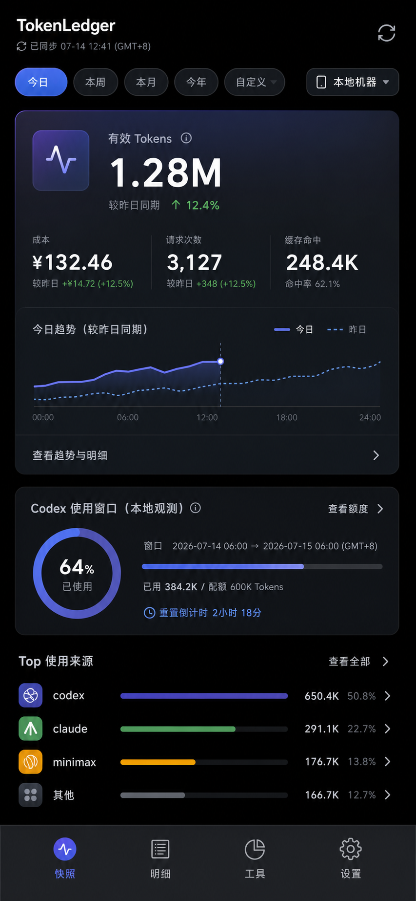

# Android 看板视觉基线 · Ledger Snapshot

> **实施状态（2026-10-17 按代码核对）**：已被取代。令牌与视觉方向以 `android-visual-refresh-v2.md` 为准；本文与配图保留，配图仍被 `apps/android/README.md` 引用。

> 状态：已选定，可进入实现 ｜ 日期：2026-07-14

## 1. 选择结论

本轮探索了三个 390×844 方向：以今日洞察为核心的深色快照、以月度预算为核心的浅色用量罗盘、以可追溯明细为核心的纸面账簿。用户已明确授权无人值守推进，因此由协调员依据真实数据能力自主选择 **Ledger Snapshot** 作为 Android 主线视觉目标。

选择理由：

- 首屏问题最清晰：今日用了多少、较昨天同期如何、额度窗口还剩多少、主要由哪些工具产生。
- 使用现有 `Summary/tools/trends/meta` 和本机 Codex `rate_limits` 观测即可落地，不要求先伪造 Claude 额度或月度预算。
- 深色 OLED、克制的蓝紫光谱和单一主 Hero 更符合用户要求的现代/Z 世代气质，同时可降级为 Light 与 E-ink 语义主题。
- 明细筛选和模型/设备下钻保留在“明细/工具”页面，不把所有功能塞进首屏。

## 2. 实现约束

### 信息层级

1. 顶栏：产品名、服务端真实数据时间、刷新与设置。
2. 高频筛选：范围 + 设备；范围横向滚动，不压缩触控目标。
3. 单一 Hero：有效 Tokens、同期变化、成本、请求、缓存，以及当前/上一周期两线趋势。
4. 额度窗口：首期只显示有可靠来源的 Codex 本地观测；Claude 显示“不支持自动读取”，不得绘制百分比。
5. Top 工具：Top3 + 其他，分母使用全部工具；行可下钻。
6. Material 3 导航：概览、趋势、明细、设置；工具/模型专属看板从内容进入。

### 视觉令牌

| 语义 | Dark 基线 | 说明 |
|---|---|---|
| background | `#080A0F` | OLED 近黑，不使用纯黑大面积层叠 |
| surface | `#11141B` | 主面与列表共享 tonal surface |
| surfaceElevated | `#171B25` | 只用于 Hero/额度两个主要区域 |
| primary | `#5B6CFF` | 操作、当前期、选中态 |
| secondary | `#8B6CFF` | 渐变末端，不作为小字颜色 |
| positive | `#4CCB78` | 只表示确定的正向变化 |
| warning | `#FFB23F` | stale/接近阈值，需文字说明 |
| textPrimary | `#F7F8FC` | 正文对比度优先 |
| textSecondary | `#B4BAC8` | 14sp 以上 |
| outline | `#2A3040` | 分组边界与图表网格 |

- 字体使用系统 Sans；数字/模型 ID 可使用系统等宽体。
- 主数字 40–44sp；标题 20–24sp；正文 14–16sp；辅助信息不低于 12sp。
- 8dp 间距基线；主要圆角 20–24dp，列表 12–16dp；避免卡片套卡片。
- 动效 180–240ms，只有范围切换、数字 crossfade、图表首次描线；reduced motion 与 E-ink 全部关闭。

### Material 3 与无障碍

- `Scaffold + SmallTopAppBar + LazyColumn + NavigationBar/NavigationRail`。
- edge-to-edge 统一消费 `WindowInsets.safeDrawing` 与 IME insets。
- 所有操作至少 48dp，使用 `FilterChip`、`NavigationBarItem`、标准 `Switch`。
- 图表提供语义摘要与“查看数据表”；当前实线、上一期虚线，颜色不是唯一标识。
- 进度组件带 `ProgressBarRangeInfo` 和文字；上限未知时不绘制 determinate progress。
- 200% 字体允许卡片增高与换行，不使用固定高度裁切。

## 3. 数据真实性

- Hero 的“较昨日同期”必须来自等进度 comparison，不使用完整昨日总量。
- Codex 额度标为“本地观测窗口”，包含来源时间、窗口时长与重置时间；本地事件缺失或过旧时显示 unavailable/stale。
- Claude 消费者订阅没有受支持的自动接口时只显示说明与手工入口。
- 云端全设备明细目前是小时聚合，页面必须标注粒度，不能伪装成逐请求记录。
- 同步时间使用 `meta.generatedAt/lastRefreshedAt`，不以页面渲染时刻代替。

## 4. 交付文件

- 视觉基线：`docs/design/android-ledger-snapshot-v1.png`
- 原始尺寸：853×1844，目标实现视口 390×844。
- SHA-256：`e4332d838476dd13fd31dcf0e7cb6ba09349c76bee747354f481921f7702633b`

实现完成后必须以相同 390×844 状态截图与本图做并排视觉 QA；文字/数据可以因真实实现调整，但层级、密度、主次与交互约束不得漂移。
