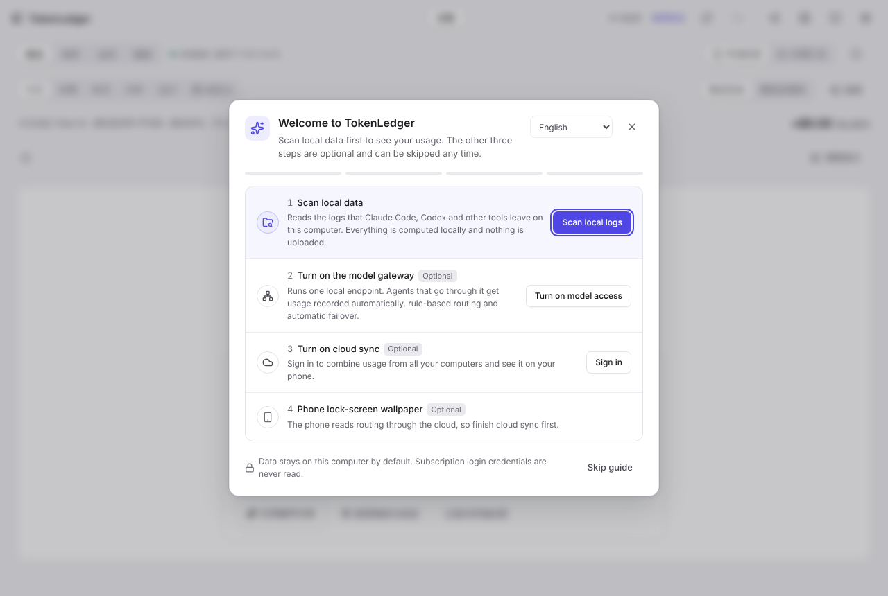
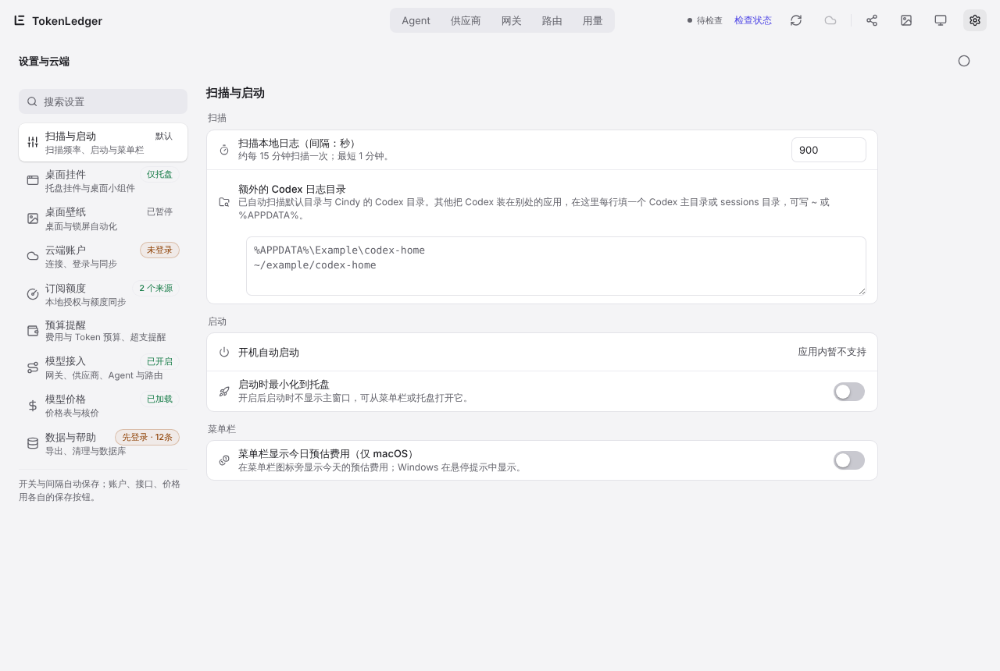

# 2. First-run guide

[← Install](01-install.md) · [Contents](README.md) · Next: [Usage pages →](03-usage.md)

The first time you open TokenLedger on a computer with no ledger data, the "Welcome to TokenLedger" guide opens on its own. Computers that already have data are not interrupted.

The guide has four steps. Only the first is required; the other three are optional:

| Step | What to do | Done when |
| --- | --- | --- |
| 1 Scan local data | Click **Scan local logs**. TokenLedger reads the logs that tools such as Claude Code and Codex keep on this computer and counts them locally | The ledger has records |
| 2 Turn on the model gateway (optional) | Turn on model access and add at least one provider so the gateway runs on this computer | The gateway is running with an enabled provider |
| 3 Turn on cloud sync (optional) | Sign in, check the connection and run the first sync | The first sync has finished |
| 4 Phone lock-screen wallpaper (optional) | Turn on "Sync live routing to the phone" | The switch is on; step 3 comes first |

- When you go to another page to finish a step, the guide shrinks into a progress chip in the bottom-right corner ("n/4"). Click it to expand.
- Esc, clicking the backdrop or the close button only **minimizes** the guide. **Skip guide**, or the close button on the chip, stops it from opening again.
- To see it again: **Settings › Data & help › Setup guide › Open setup guide**, or click "Open setup guide" in the empty Overview page.
- You can switch the interface language from the top-right corner of the guide.

The guide only reads the number of local records, the gateway switch and status, and the cloud sign-in and sync status. It never reads subscription login credentials.

## After the first scan

Once the scan finishes, **Usage › Overview** has data. From then on TokenLedger scans in the background about every 15 minutes. Change this in **Settings › Scan & startup (扫描与启动)**; the minimum is 1 minute.

If a tool's data does not appear:

- Make sure the tool has actually run sessions on this computer. TokenLedger only reads each tool's own logs and databases. The list of supported tools is in the repository [README](../../../README.md).
- If Codex lives in a non-default folder (for example, managed by another app), add one Codex home or `sessions` folder per line in **Settings › Scan & startup › Extra Codex log folders**.
- Click the refresh button in the top bar, or **Refresh scan** on the Overview page, to scan right away.

## Empty states

Before there is data, each page says what is missing and offers a next step, for example "Scan local logs" on Requests, "Add your first provider" on Providers and "Create your first routing group" on Routing.
