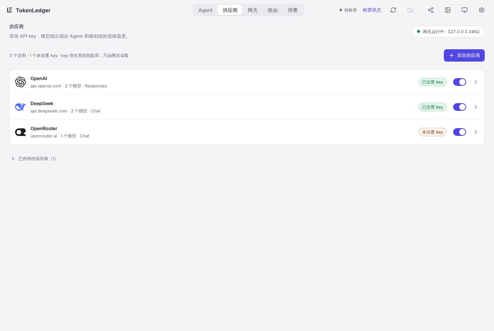
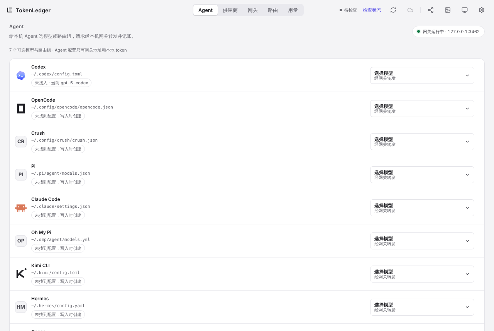
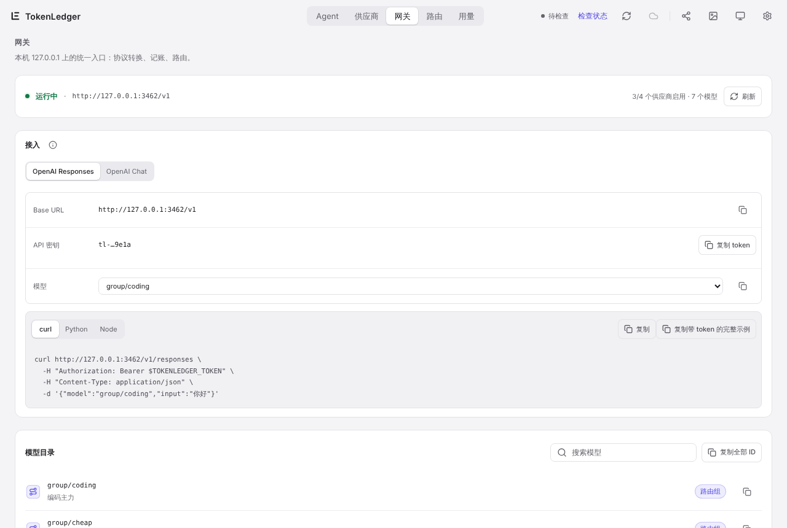
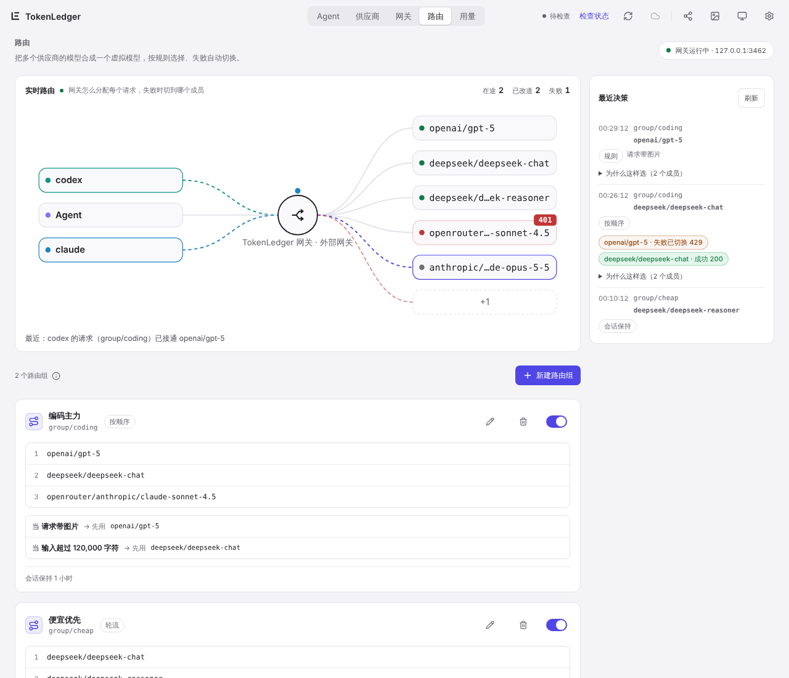

# 4. Gateway and routing groups

[← Usage pages](03-usage.md) · [Contents](README.md) · Next: [Budget alerts →](05-budget.md)

The model gateway is optional. TokenLedger runs a single endpoint on `127.0.0.1`; your agents send requests to it and it forwards them to the providers you configured. This gives you:

- one set of provider keys shared by every agent, stored once;
- metering for every request through the gateway, even for tools whose logs don't record usage;
- **routing groups** that combine models from several providers, pick one by rules and fail over automatically.

All of TokenLedger's usage tracking works without the gateway. If you already manage agent configs with another tool, leave it off.

## Turn on model access

**Settings › Model access (模型接入) › Main switch**. Once it is on, the Agents, Providers, Gateway and Routing pages appear in the top bar. The usual order is Providers, then Agents, then Routing.

When you turn model access off while some agents still point at the local gateway, TokenLedger lists them and offers "Restore original configs and turn off" so those agents keep working.

## Providers

A provider is where models come from: OpenAI, DeepSeek, OpenRouter, or any OpenAI-compatible relay or local model server.

- Click **Add provider**, pick a preset or enter the endpoint, protocol (Responses or Chat) and model list yourself, then enter the API key.
- **API keys are stored in the system keychain** (Windows Credential Manager or the macOS Keychain), read only by the gateway, never written to settings files and never uploaded.
- Models appear in the Agent and routing-group pickers as `provider/model`, for example `deepseek/deepseek-chat`.
- Disable a provider you are not using; it keeps its settings but no longer receives traffic.

### Health

Each enabled provider row has a 24-hour trend bar (bar height is request volume, the red top is the failure share) and a status badge. Hover over it for the last 24 hours' request count, success rate, P95 latency and reasons:

| Status | When |
| --- | --- |
| Down | The last 3 requests in a row failed, or a member that failed 3 times in a row is still cooling down |
| Degraded | The last request failed, a member is cooling down, or at least 5 requests with a success rate below 90% |
| Healthy | Has requests and is neither of the above |
| No traffic | No gateway requests in the last 24 hours |

Open a provider and the **Health** section at the bottom of the details shows success rate, P50 / P95 latency, rate-limit count, error reasons and status codes, members cooling down, a per-model comparison and the last 5 failures (key fragments in error text are masked).

Health only counts requests the gateway itself recorded. It **never sends extra requests to providers** to measure them, and it is not uploaded. It is display only: it does not remove a provider from routing groups. Requests the gateway stopped locally without sending (for example, no key yet) are counted separately and do not affect the success rate. The page refreshes every 30 seconds and pauses while the window is hidden.

## Agents

Lists the agents on this computer that can use the gateway (Codex, Claude Code, OpenCode, Gemini CLI, Kimi CLI and more), with each one's config file and current state.

- Pick a model or routing group in **Choose model**. TokenLedger **shows a preview of the change and only writes after you confirm**.
- The original file is backed up first. Only the gateway-related keys change; everything else, comments included, stays as it was. The agent config only gets the gateway address and a local token, never a provider key.
- To undo, use that agent's restore button to go back to the backup.
- A few agents keep their settings in an undocumented format or overwrite outside edits. For those, TokenLedger offers **Manual setup**: copy the gateway address and local token and paste them in yourself.

## Gateway

- **Connection details**: Base URL (default `http://127.0.0.1:3462/v1`), the local API key (a local token starting with `tl-`) and the available models, with curl, Python and Node examples to copy. The gateway serves both the OpenAI Responses and OpenAI Chat APIs.
- **Model catalog**: every available model and routing group ID; routing groups start with `group/`.
- **Recent requests**: time, agent, requested model, where it was actually sent, status code, tokens and latency. The "actually sent" column shows which member a routing group picked and whether a fallback was used.

The gateway only listens on the local address, so other computers on your network cannot reach it. If the port is taken, the Gateway page shows the error.

**No double counting**: a request can show up both in the agent's own log and in the gateway ledger. TokenLedger merges the two on this computer by time window and counts it once.

## Routing

### Live routing

The top of the page is a live stage: agents on the left, the gateway in the middle and upstream `provider/model` targets on the right. Lines animate as requests pass. When a member fails (for example with 429 or 401), the dot bounces back from it, the status code is shown, and the dot moves on to the next member. A sentence under the stage describes the latest request.

The stage only draws real records. With no requests it is idle, and when the gateway isn't running it says why. It never plays a demo animation. With the system's reduce-motion setting on, only the highlights and the text remain.

If another compatible external gateway is running on this computer, its in-flight requests show on the stage too.

### Routing groups

Click **New routing group** and give it a name (for example "coding"). It becomes a virtual model `group/<name>` that agents can pick like any other model.

| Strategy | Behavior |
| --- | --- |
| In order (按顺序) | Always use the first member; move to the next only on failure |
| Rotate (轮流) | Give new sessions to members in turn; move to the next on failure |
| Weighted (按权重) | Give new sessions to members by weight; on failure try members from highest weight down |
| Fixed (固定一个) | Use only the chosen member; rules are paused |

You can also:

- **Add rules**, such as "request has images → prefer a vision model" or "input over 120,000 characters → prefer a long-context model". A matching rule goes first; if that member fails, the strategy continues.
- **Keep sessions** on the same member for a while (for example 1 hour), which helps hit the provider's cache.
- **Nest** groups: a routing group can be a member of another. Cycles are rejected.
- **Cool down** failing members: after a failure (for example, rate limiting) a member is skipped for 30 seconds, longer after repeated failures, up to 5 minutes, and comes back after that or once it answers again. Cards mark members that are cooling down.
- Use the switch on a group's card to pause the whole group.
- The dot before each member is its provider's [health](#health). Nested-group members have no dot.

### Recent decisions

The right column lists the latest routing decisions: who was picked, why (rule match, session kept, in order, weighted pick…), and how each member did (success, failed and switched, rejected upstream, skipped, cooling down). Expand **Why this choice** to see why each member was not picked. It is the quickest way to answer "why does it keep using the fallback?".
