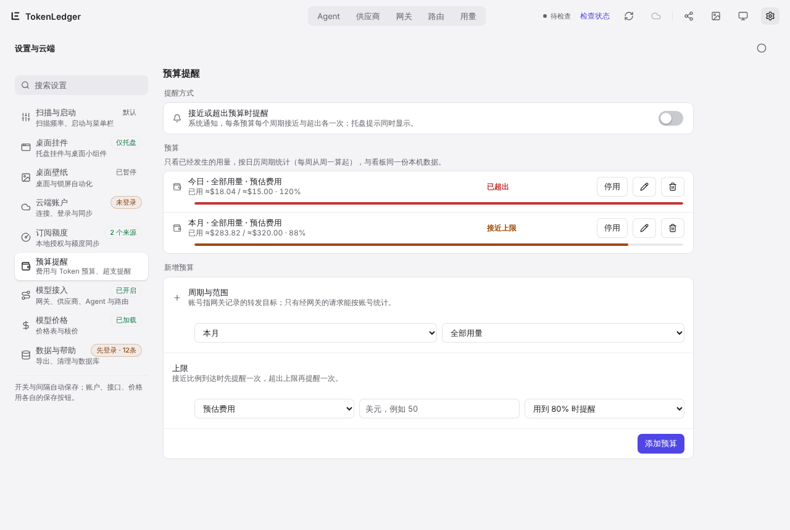

# 5. Budget alerts

[← Gateway and routing groups](04-gateway-routing.md) · [Contents](README.md) · Next: [Cloud sync and the phone app →](06-cloud-mobile.md)

In **Settings › Budget alerts (预算提醒)** you can set a cost or token limit for a period and scope, and get alerted when usage gets close to it or goes over.

## Add a budget

| Option | Values |
| --- | --- |
| Period | Today, This week (starting Monday), This month; the same calendar boundaries as the dashboard ranges |
| Scope | All usage, or one agent, one model or one account |
| Measure | Estimated cost (US dollars, same as the dashboard) or effective tokens (input + output, cache excluded) |
| Limit | Any number above 0 |
| Warn at | 50%, 70%, 80% (default) or 90% of the limit |

When you pick an agent or model, the box suggests names seen this month. An **account** is the forwarding target recorded by the model gateway (a provider), so only requests through the gateway count toward account budgets. Without gateway records, an account budget shows as unavailable.

You can have up to 32 budgets. Each one can be paused, edited or deleted. Changing the period, scope, measure or limit re-arms its alerts (it can alert for "close" and "over" again this period), but it does not reset usage: usage is always counted over the whole calendar period. So editing a budget that is already over can trigger another alert straight away.

## How you are alerted

- **System notifications**: turn on "Alert when a budget is close or over" at the top. Each budget notifies once for "close" and once for "over" in each period; if usage jumps straight past the limit you only get the "over" alert. At most 4 alerts per hour in total; anything held back is sent at the next check. This switch is off by default.
- **Tray tooltip**: whether or not notifications are on, the tray icon's tooltip gets a line such as "Budget: 1 over · 2 close to limit".
- **Settings page**: each budget has a progress bar with the amount used, the limit and the percentage.
- **Sync to phone (同步到手机)** (separate switch, off by default): once you are signed in to [cloud sync](06-cloud-mobile.md), every budget check uploads a redacted snapshot to your cloud. To get the alerts on your phone, turn on **Me › Preferences › Budget alerts (预算提醒)** in the Android app, signed in with the same account. The phone checks about every 30 minutes and notifies once for "close" and once for "over" per budget and period, at most 3 at a time. It skips snapshots more than 12 hours old, and when you first turn it on, budgets that are already close or over are not sent again. On Android 13 and later the app asks for notification permission. The snapshot only has the scope name, period, used percentage (rounded) and level. **It never includes amounts or limits.** The text under the switch shows the last sync time. If your cloud does not have this feature deployed yet, it says so; run `supabase db push` and syncing starts on its own. Turning the switch off deletes this computer's snapshot from the cloud, and the cloud also removes snapshots not updated for 3 days.

Notifications only name the scope, the period and the percentage, such as "Monthly cost budget 85% used". They never include amounts or account details, so nothing leaks if one pops up while you are sharing your screen.

## Period reports and webhook delivery

To send weekly or monthly report reminders to a chat, select a report under **Usage › Reports** and enable its reminder. Then open **Settings › Budget alerts › Send to chat and webhooks**, turn on delivery, add or edit a destination, select **Weekly and monthly reports**, and enable that destination. If both report reminders are off, the delivery settings show that the source is off.

Messages contain only the period and the effective-token percentage change when it can be calculated. They do not include costs, accounts, or paths. Each completed period is sent at most once, and enabling reminders does not send historical reports. The desktop app must remain running. Enabled webhook delivery can continue when system notifications are unavailable or fail.

## Limits worth knowing

- **Only usage that already happened counts.** There is no "you will go over by month end" forecast.
- If cost is incomplete because a model has no price yet, or an account budget has no gateway data, the budget shows as **unavailable**. It is not treated as 0 and does not alert.
- Budgets are checked when a background scan writes new records, on manual refresh and when the day changes. While you have budgets, they are also checked every 5 minutes so gateway-only usage alerts in time.
- Budget rules, amounts and limits stay on this computer. **Sync to phone** uploads only the percentage snapshot described above; the phone cannot see or change budget rules.
- Alerts for subscription quota windows running out are a separate feature under **Settings › Subscription quota › Quota alerts**; see [chapter 3](03-usage.md#quota).
