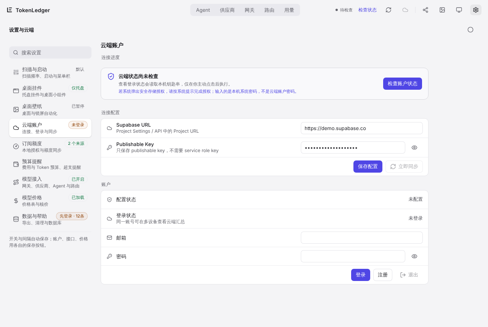
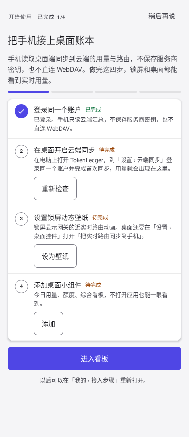
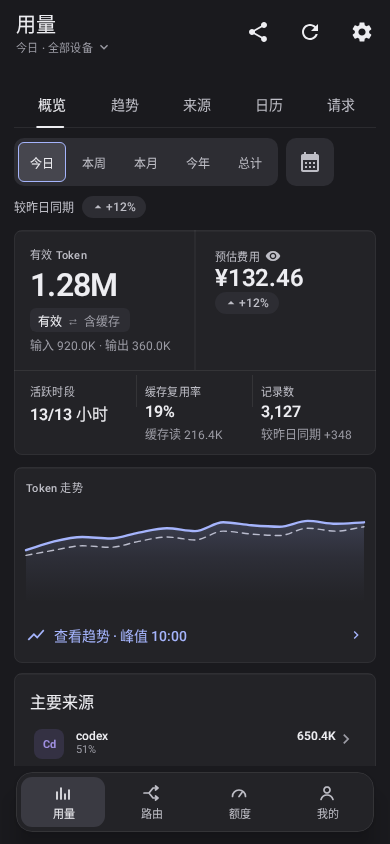
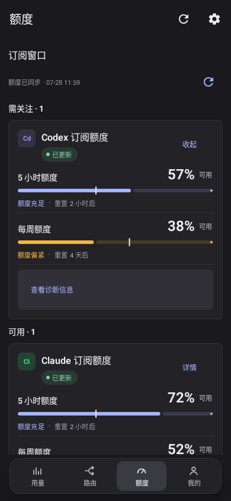
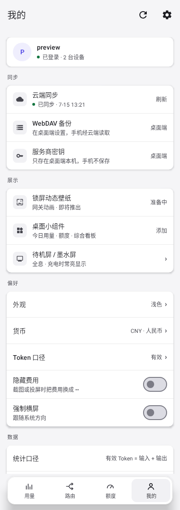

# 6. Cloud sync and the phone app

[← Budget alerts](05-budget.md) · [Contents](README.md) · Next: [Wallpapers and widgets →](07-wallpaper-widgets.md)

Cloud sync is optional and off by default. With it on, usage from several computers adds up in one place and your Android phone can show it.

TokenLedger has no public server of its own. The cloud is **your own Supabase project** (the free tier is enough), and your data stays in that project.

## Set up the cloud (once)

1. Create a project on [Supabase](https://supabase.com).
2. Deploy the migrations in this repository's `supabase/migrations/` with the Supabase CLI:

   ```bash
   supabase link --project-ref <your project ref>
   supabase db push
   ```

   Details and rollback notes are in [supabase/README.md](../../../supabase/README.md). When a new TokenLedger version ships new migrations, run `supabase db push` again.
3. In the Supabase dashboard, under Project Settings › API, note the **Project URL** and the **Publishable key**. You do not need, and should never enter, the service role key.

## Sign in and sync on the desktop

Open **Settings › Cloud account (云端账户)**:



1. Enter the Supabase URL and Publishable Key and click **Save config**.
2. Click **Check account status**. This reads the system keychain, so the OS may ask for permission. Enter **your computer's password**, not your cloud account password.
3. The first time, click **Register**; afterwards **Sign in** with the same email and password. One account can be used on several computers and phones.
4. Click **Sync now** for the first sync.

After that, syncing happens automatically whenever a background scan finds new records. Failures are retried later (at most every 15 minutes). Switch Usage to **Cloud total** to see all devices together, and use the Device split to see each computer.

To upload everything again, use **Settings › Data & help › Maintenance › Reset sync**; the next sync re-uploads all records. Signing out does not delete data already in the cloud.

## Android phone app

The Android app is a read-only dashboard. All data comes from the cloud; the phone does not scan anything and never stores provider keys.

### Install

The cloud an Android build talks to is set **when the APK is built**. If you deployed your own Supabase project, build the APK with the same Project URL and Publishable key; see [apps/android/README.md](../../../apps/android/README.md). Then sign in with the same email and password as on the desktop.

When you install an APK from a file manager, Android asks you to allow "Install unknown apps" for that file manager or browser. Allow it once.

### First-run guide

After the first sign-in, if the cloud has no desktop data yet, the phone shows a four-step guide: sign in to the same account, turn on cloud sync on the desktop, lock-screen live wallpaper, home-screen widget. Reopen it later from **Me › Help › Setup steps**.

<p>
  
  
</p>

### Four tabs

The phone app's screens are in Chinese for now. The bottom bar has four tabs:

| Tab | What it shows |
| --- | --- |
| Usage (用量) | Overview, Trend, Sources (split by agent, model, device or account), Calendar and Requests, with the same ranges as the desktop |
| Routing (路由) | Live routing from your desktop gateway; see [chapter 7](07-wallpaper-widgets.md#phone-lock-screen-live-wallpaper) |
| Quota (额度) | Available quota per subscription and provider (needs quota sync turned on on the desktop) |
| Me (我的) | Account and sync status, lock-screen wallpaper and widget entries, standby / e-ink screen, preferences |

<p>
  
  
</p>

Useful preferences under **Me**:

- **Currency**: the phone shows estimated cost in CNY by default; you can switch it.
- **Hide cost**: replaces amounts with asterisks for screenshots and screen sharing, widgets included. The underlying data does not change.
- **Token measure**: effective (default) or including cache.
- **Standby / e-ink screen**: a full-screen dashboard that stays on while charging, with a layout tuned for e-ink displays.
- Tablets, foldables and landscape switch to a two-column layout automatically.

Numbers reach the phone a little after the desktop: the desktop syncs first, then the cloud totals refresh.
