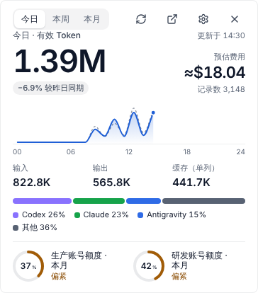

# 8. Tray and menu bar

[← Wallpapers and widgets](07-wallpaper-widgets.md) · [Contents](README.md) · Next: [Privacy →](09-privacy.md)

TokenLedger lives in the Windows system tray (bottom-right of the taskbar) or the macOS menu bar. Closing the main window only hides it to the tray; scanning, the gateway and sync keep running. To quit completely, use **Quit** in the tray menu.

## Tray icon

| Action | Result |
| --- | --- |
| Hover over the icon | After a short pause the tray widget pops up; it hides when you move away |
| Click | Opens or closes the tray widget; click the open widget to pin it so it stays |
| Double-click | Opens the main window |
| Right-click (Control-click on macOS) | Tray menu |

The tray menu has: Show window, Show / hide tray widget, Desktop widget (stays on desktop) and Quit.

The tooltip follows today's local usage and the tightest quota. With [budgets](05-budget.md) set, it adds a line such as "Budget: 1 over · 2 close to limit".

## Menu bar number and tray badge

In **Settings › Scan & startup › Menu bar and tray (菜单栏与托盘)**, enable **Show a number in the menu bar / tray (在菜单栏 / 托盘上显示数字)**, then choose the metric:

- **Today's estimated cost** shows a compact cost summary.
- **Tightest quota** shows the lowest available percentage among readable quota windows.

macOS displays the number beside the menu bar icon. Windows replaces the tray icon with a number badge. Numbers are abbreviated to fit; use the tooltip or widget for details. Unavailable data uses a placeholder rather than zero. Turning the number off restores the regular icon and keeps the tooltip available.

## Tray widget

A small window that pops up next to the tray icon. It takes no taskbar space and doesn't steal focus. Use the top to switch between today, this week and this month for the moment; the top-right buttons are refresh, open main window, settings and close.

In **Settings › Desktop widgets › Tray widget** you can set:

- **Pop up when pointing at the tray icon**: when off, only a click opens it.
- **Hover delay**: instant, 0.25 s, 0.45 s (standard) or 0.9 s, so passing the mouse over doesn't trigger it.
- **Pin the tray widget at startup**: show it right after login.
- **Layout, theme, default range, quota source**: the same options as the [desktop widget](07-wallpaper-widgets.md#desktop-widget-computer), set separately.

## Panel and quick switches

Choose **Panel (面板)** as the tray widget layout to see today's estimated cost, effective tokens and record count, quota percentages and reset countdowns, plus gateway status and recent routing activity. The live route view follows the gateway state. Missing quota or routing data is explained on the panel.

Three quick switches appear at the bottom:

| Switch | Effect |
| --- | --- |
| Gateway | Starts a configured gateway; turning it off takes you to the main window to check agents that still use it |
| Background sync | Controls automatic cloud sync after scanning; manual sync remains available while paused |
| Background scanning | Controls scheduled scans; manual refresh in the main window remains available while paused |

Starting the gateway requires at least one usable provider. If a prerequisite such as cloud login is missing, the panel explains the restriction. Pausing background work does not clear the ledger or quit the app.

## Startup

In **Settings › Scan & startup**:

- **Start minimized to tray**: the main window stays hidden at startup and TokenLedger waits in the tray.
- **Scan interval**: about 15 minutes by default, 1 minute minimum.

To force the main window to show for one launch, start with `--show` (macOS: `open -n /Applications/tokenledger.app --args --show`).
