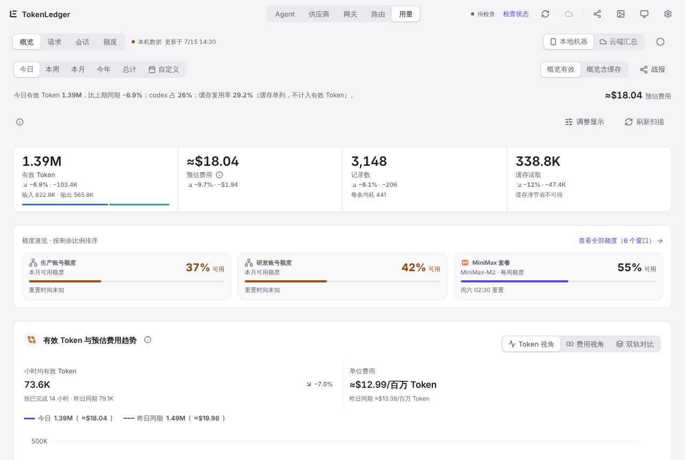

# TokenLedger User Guide

TokenLedger is a token ledger for AI tools. It reads the logs that AI coding tools leave on your computer and turns them into a dashboard of token usage, request counts and estimated cost. Optionally, it runs a model gateway on your machine so several agents can share providers, route by rules and get metered automatically. Also optionally, it syncs the totals to your own cloud project so your phone and other computers can see them.

Everything is counted on your computer first. Cloud sync, the model gateway and the phone app are all optional and off by default.

> The desktop UI is Chinese by default. Switch to English in **Settings › Data & help (数据与帮助) › Interface language**. The English UI is being filled in page by page, so some pages and screenshots in this guide still show Chinese. This guide gives the Chinese label in parentheses where it helps you find a control.

## Contents

1. [Install](01-install.md): which package to download, and how to allow the unsigned installers on Windows and macOS
2. [First-run guide](02-first-run.md): four steps to get the ledger running
3. [Usage pages](03-usage.md): Overview, Requests, Sessions, Quota
4. [Gateway and routing groups](04-gateway-routing.md): Agents, Providers, Gateway, Routing
5. [Budget alerts](05-budget.md): daily, weekly or monthly cost or token budgets
6. [Cloud sync and the phone app](06-cloud-mobile.md): multi-device totals and the Android dashboard
7. [Wallpapers and widgets](07-wallpaper-widgets.md): desktop wallpaper, lock screen, desktop widget, phone live wallpaper
8. [Tray and menu bar](08-tray.md): number badge, tray panel, background scan and sync switches
9. [Privacy](09-privacy.md): what goes to the cloud and what stays on your computer
10. [FAQ](10-faq.md)
11. [Request log](11-request-log.md): filter gateway requests, inspect failover attempts, follow live traffic and export

## Definitions used throughout

- **Effective tokens = input + output.** Cache reads and cache writes are listed separately and never added to effective tokens, otherwise caching would inflate totals many times over. The dashboard has an "including cache" view for comparison.
- **Estimated cost** comes from the local price table and is shown with `≈`. When a tool's own log records the real cost, that value is used instead. New models without a price go to the "needs pricing" list in **Settings › Model prices**.
- **Unknown stays unknown.** When a quota, cost or account breakdown cannot be read, TokenLedger shows "unavailable" instead of 0.
