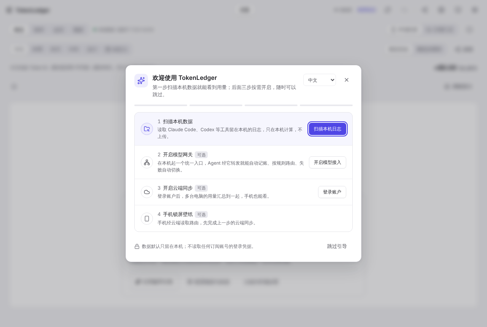

# 2. 首次启动引导

[← 安装](01-install.md) · [目录](README.md) · 下一章：[用量页面 →](03-usage.md)

第一次在一台没有账本数据的电脑上打开 TokenLedger，会自动弹出「欢迎使用 TokenLedger」引导。已经有数据的电脑不会弹。

引导一共四步，只有第一步是必需的，后三步按需开启：

| 步骤 | 做什么 | 完成的标志 |
| --- | --- | --- |
| 1 扫描本机数据 | 点「扫描本机日志」，读取 Claude Code、Codex 等工具留在本机的日志，只在本机计算 | 账本里出现记录 |
| 2 开启模型网关（可选） | 打开模型接入，添加至少一个供应商，让网关在本机运行 | 网关运行中且有启用的供应商 |
| 3 开启云端同步（可选） | 登录账户、检查连接、完成首次同步 | 首次同步完成 |
| 4 手机锁屏壁纸（可选） | 打开「把实时路由同步到手机」 | 开关已打开；需要先完成第 3 步 |

- 跳到别的页面去完成某一步时，引导会自动收成右下角的进度胶囊「开始使用 n/4」，点它可以展开。
- 按 Esc、点遮罩或右上角的关闭只是**收起**；点「跳过引导」或胶囊上的关闭才是不再自动出现。
- 想再看一次：**设置 › 数据与帮助 › 新手引导 › 打开新手引导**，或者在概览的空状态里点「打开新手引导」。
- 引导右上角可以直接切换界面语言。

引导只读取本机记录数、网关开关与运行状态、云端登录与同步状态，不读取任何订阅账号的登录凭据。

## 第一次扫描之后

扫描完成后「用量 › 概览」就有数据了。之后 TokenLedger 默认每 15 分钟在后台自动扫描一次，可在「设置 › 扫描与启动」里调整（最短 1 分钟）。

如果某个工具的数据没有出现：

- 先确认这个工具在本机真的产生过会话。TokenLedger 只读工具自己的日志与数据库，支持的工具清单见仓库 [README 的「核心功能」](../../../README.md#核心功能)。
- Codex 装在非默认位置（例如被其他应用托管）时，在「设置 › 扫描与启动 › 额外的 Codex 日志目录」里每行填一个 Codex 主目录或 `sessions` 目录。
- 点右上角的刷新按钮或概览里的「刷新扫描」立即重扫。

## 各页的空状态

还没有数据时，每个页面都会说明缺什么，并给出下一步按钮，例如请求页的「扫描本机日志」、供应商页的「添加第一个供应商」、路由页的「新建第一个路由组」。按按钮走就能把对应功能用起来。
