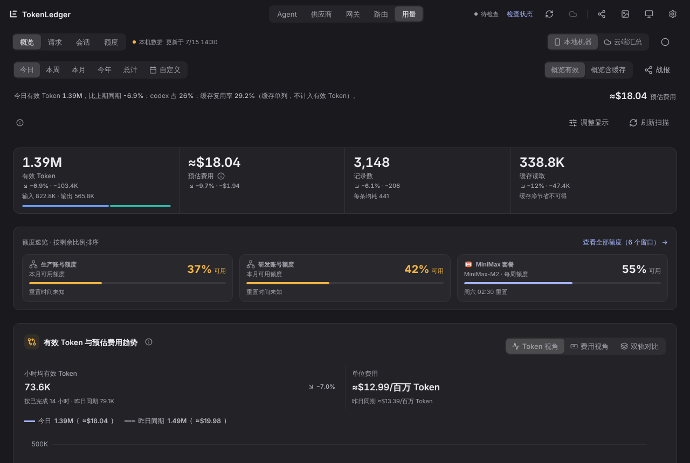
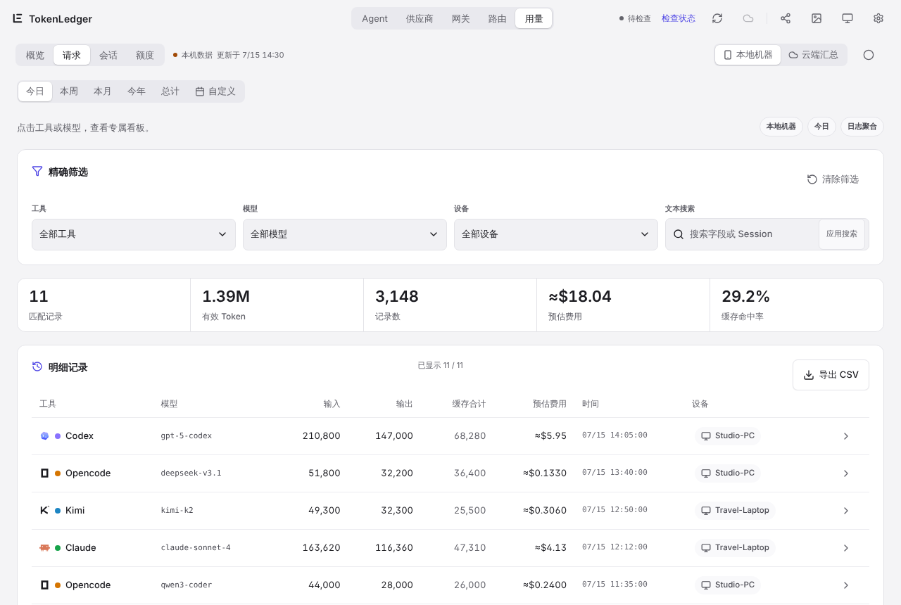
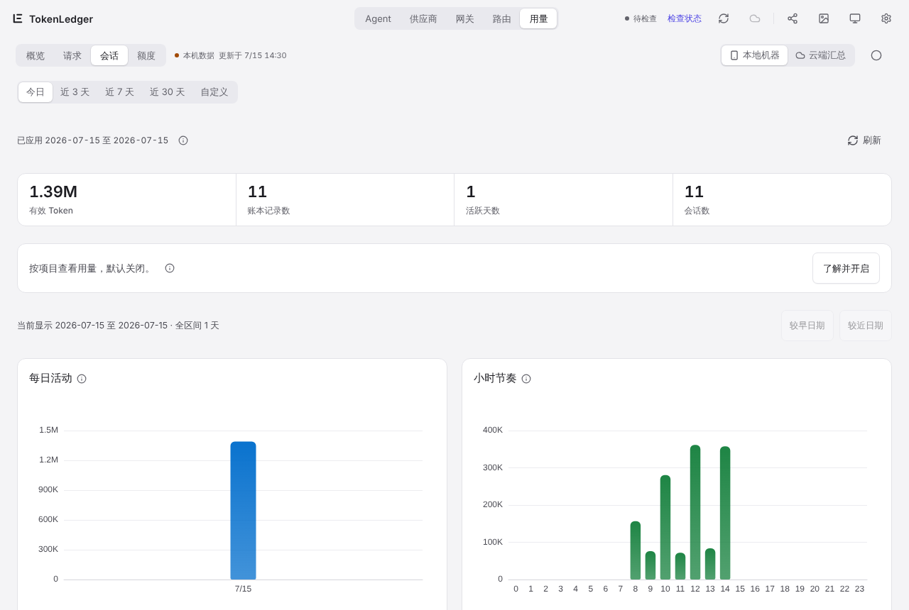
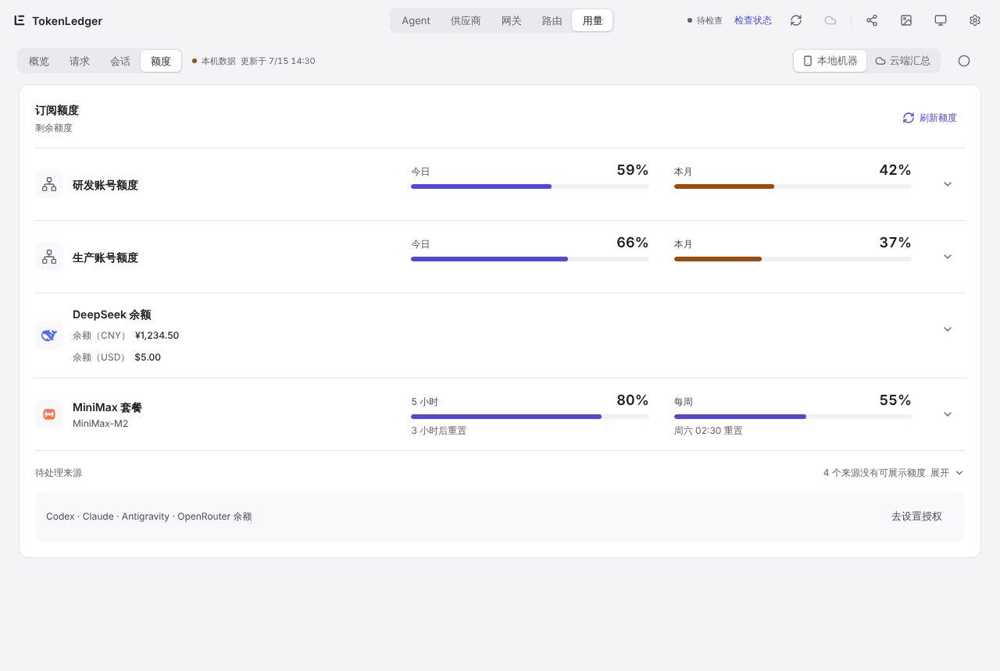
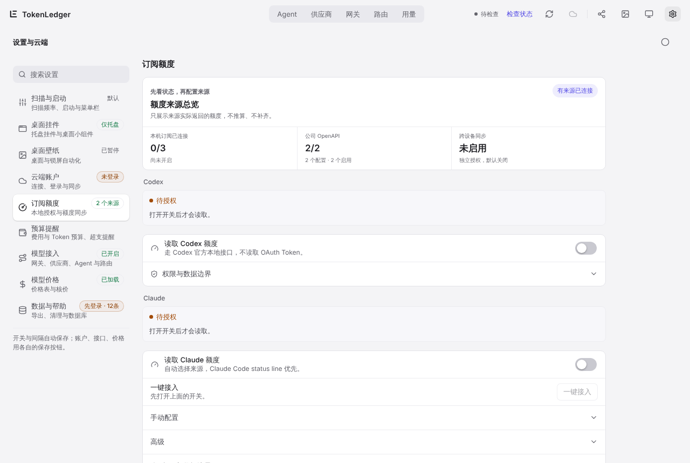

# 3. 用量页面

[← 首次启动引导](02-first-run.md) · [目录](README.md) · 下一章：[网关与路由组 →](04-gateway-routing.md)

顶栏中间是五个主页面：**Agent、供应商、网关、路由、用量**。前四个属于模型网关（见[第 4 章](04-gateway-routing.md)），本章讲「用量」。用量下面有四个子页：**概览、请求、会话、额度**。

顶栏右侧依次是：云端状态、刷新扫描、云端同步、分享战报、壁纸、桌面小组件、设置。

## 通用控件

- **时间范围**：今日、本周、本月、今年、总计、自定义。「今日」「本周」「本月」会和上一周期的**同一进度**比较，比如今天 14:30 只和昨天 0:00–14:30 比，不拿半天和一整天比。
- **本地机器 / 云端汇总**：本地机器只看这台电脑的账本；云端汇总看所有已同步设备的合计，需要先完成[云端同步](06-cloud-mobile.md)。
- **概览有效 / 概览含缓存**：切换主数字是否把缓存算进去。默认是有效 Token。
- **主题**：自动（跟随系统）、浅色、深色。

## 概览

从上到下：

1. **一句话摘要**：今天用了多少、比上期同期涨跌多少、哪个工具占比最大、缓存复用率。
2. **指标卡**：有效 Token（输入、输出拆分）、预估费用、记录数（每条均耗）、缓存读取。每张卡都带较上期同期的变化。
3. **额度速览**：按剩余比例排序的最紧几个额度窗口，点「查看全部额度」跳到额度子页。
4. **趋势**：有效 Token 与预估费用的曲线，可切 Token 视角、费用视角、双轨对比；虚线是上一周期同期。今日视图会按已完成的小时数给出小时均值与单位费用（每百万 Token 的费用）。
5. **用量拆分**：按 Agent、模型、设备或账号拆分，指标可选 Token、记录数、费用。选中一项后，下方热力图和列表都跟着收窄；「账号」维度只统计经过模型网关的请求。
6. **年度热力图**：每天一格，颜色越深用得越多，点某一天可以下钻到当天明细。

点任意工具名或模型名，会打开它的**专属看板**：单独的趋势、构成、设备分布、活跃度和相关明细。

「调整显示」可以隐藏或重排概览上的区块。顶栏的分享按钮可以生成一张「数据战报」图片或 HTML 简报，方便发给别人；导出前会预览，金额可以隐藏。

深色主题下的同一页面：

## 请求

逐条列出每次调用：工具、模型、输入、输出、缓存合计、预估费用、时间、设备。

- **筛选**：工具、模型、设备可以多选组合，还可以按文本精确搜索；「清除筛选」一键还原。
- **展开详情**：点一行查看完整的 Token 构成；有上下文构成信息的请求还会显示 Context 由哪些部分组成。
- **导出 CSV**：导出当前筛选下的明细。

## 会话

从会话的角度看用量，时间范围是今日、近 3 天、近 7 天、近 30 天或自定义。

- **每日活动 / 小时节奏**：日期 × 小时的热力图，看你一天里什么时候最常用 AI。
- **工具排行、会话排行**：哪个工具、哪次会话最耗 Token。会话可以「查看该会话明细」或「逐轮分析」，逐轮看每一轮对话的输入、输出与缓存。
- **按项目统计**（默认关闭）：在「设置 › 数据与帮助 › 按项目统计」开启后，按会话所在的项目文件夹分组。项目名只保存在本机、不上传；截图时可以打开「隐藏项目名」，显示成「项目 1」这类代称。

## 额度

集中显示各个订阅和供应商的剩余额度。TokenLedger 只展示来源实际返回的数字，不推算、不补齐：

- 百分比一律是**可用**比例。低于 50% 为偏紧，低于 20% 为告急。
- 每个窗口写明观测时间与重置时间；数据过期会标成历史数据，不冒充最新值。
- 「刷新额度」立即重新读取；「待处理来源」列出还没授权或读不到的来源，点「去设置授权」到设置里打开。

额度来源都在 **设置 › 订阅额度** 里逐项授权，默认全部关闭：

| 来源 | 读法 |
| --- | --- |
| Codex | 走 Codex 官方本地接口，不读 OAuth Token |
| Claude | Claude Code status line 优先，或内置 `/usage` |
| Antigravity | 实验性，只连接本机正在运行的 Antigravity |
| 编码套餐 | 实验性，读取若干国内编码套餐的用量，需要先在「供应商」页填入该家的 API key |
| 公司 OpenAPI | 填写公司额度接口地址与 API key；key 只写入本机系统安全存储 |
| 供应商余额 | 复用「供应商」页已保存的 key，读取官方余额接口，只显示余额与币种 |

额度快要用完时（剩余 50%、20%、5%），可以在「订阅额度 › 额度提醒」里打开系统通知。额度的跨设备同步是单独的开关，默认关闭。
