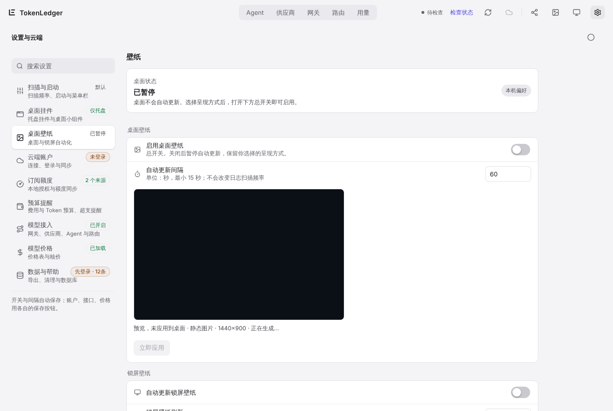
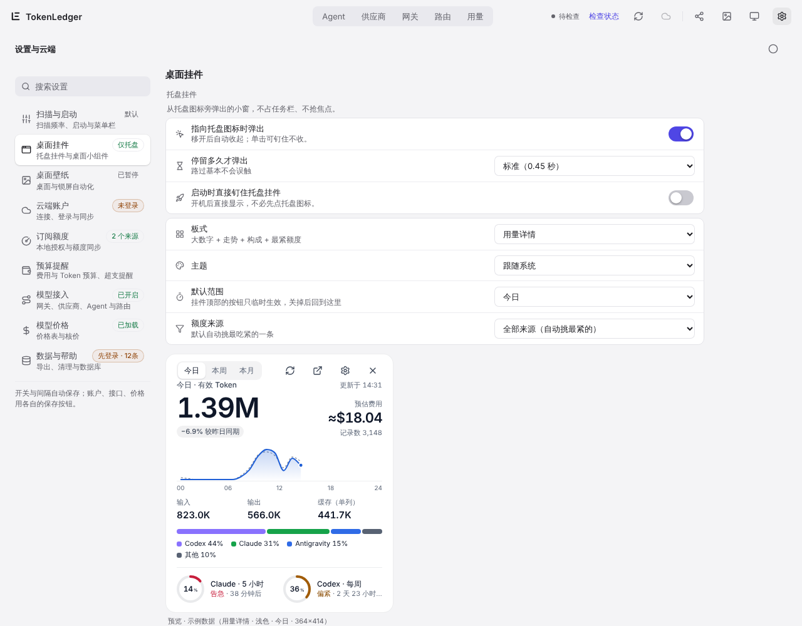
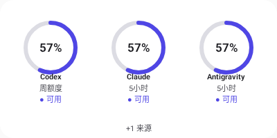
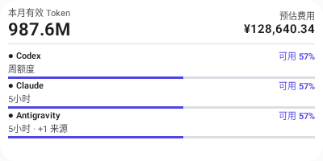
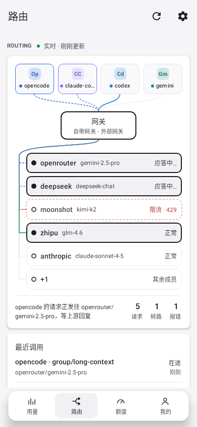

# 7. 壁纸与小组件

[← 云端同步与手机端](06-cloud-mobile.md) · [目录](README.md) · 下一章：[托盘与菜单栏 →](08-tray.md)

不打开主窗口也能看到用量：桌面壁纸、Windows 锁屏、桌面小组件、Android 桌面小组件与锁屏动态壁纸。

## 桌面壁纸与锁屏（电脑）

在 **设置 › 桌面壁纸** 里设置：

- **启用桌面壁纸**：总开关，默认关闭。关闭后暂停自动更新，保留你选的呈现方式。
- **呈现方式**：「静态图片」把用量画进一张壁纸图，按「自动更新间隔」（最短 15 秒）重画；macOS 另有「动态桌面」，在系统壁纸之上、桌面图标之下放一层实时卡片，鼠标可以穿透。
- **锁屏壁纸**（仅 Windows）：「自动更新锁屏壁纸」把同样的画面设为锁屏，刷新间隔最短 30 秒。macOS 不支持修改锁屏。
- **壁纸用量来源**：这台电脑，或云端汇总（需要先完成[云端同步](06-cloud-mobile.md)）；可以单独选统计哪些设备，与主看板的筛选互不影响。
- 设置页上方的预览只是预览，不会改动桌面。但总开关打开后，改呈现方式、数据来源等设置会自动生效：macOS 上保存即应用，Windows 上在下一次自动更新时应用；「立即应用」用来马上重画一次。想先看效果，就在总开关关闭时调好再打开。
- 「清理历史壁纸」只删除 TokenLedger 生成过的旧图片，保留当前图片和你原来的壁纸设置。

## 桌面小组件（电脑）

一块常驻桌面的卡片，可以拖到任何位置，位置会记住。在 **设置 › 桌面挂件 › 桌面小组件** 打开「在桌面上常驻小组件」，或者在托盘菜单勾选「桌面小组件（长驻桌面）」。

| 板式 | 内容 |
| --- | --- |
| 用量详情（默认） | 大数字有效 Token、较昨日同期、预估费用、当天走势、输入 / 输出 / 缓存、工具构成、最紧的两个额度 |
| 额度与用量 | 最紧的一个额度圆环 + 有效 Token 与费用 |
| 额度总览 | 最多 6 个额度圆环，按吃紧程度排序 |
| 单行消耗 | 一行：有效 Token 与预估费用 |
| 实时路由 | 网关实时路由舞台的紧凑版 |

主题（跟随系统、浅色、深色）、默认范围（今日、本周、本月）、额度来源都能单独设置，和托盘挂件各配各的。小组件平时没有按钮，鼠标移上去右上角才出现刷新、打开主窗口、设置、从桌面移除。

## Android 桌面小组件

在手机桌面长按空白处 › 小组件 › TokenLedger，可以添加四种：

| 小组件 | 主要尺寸 | 内容 |
| --- | --- | --- |
| 环形额度 | 2×2 | 两个额度来源的可用比例圆环 |
| 单行消耗 | 4×1 | 有效 Token、预估费用与数据时间 |
| 综合看板 | 4×2 | 额度圆环 + Token 与费用 |
| 额度条 | 4×3 | 每个额度窗口一行，可用百分比与多久后重置，可附最近一次网关路由 |

  
  

小组件里的百分比一律是**可用**额度；数据过期时写「待刷新」与观测日期。「我的」里打开「隐藏费用」后，小组件里的金额也会隐藏。

## 手机锁屏动态壁纸

Android 锁屏上实时显示这台电脑网关的路由：哪个 Agent 的请求正发往哪个供应商，失败时切到了谁。

开启步骤：

1. 先完成[云端同步](06-cloud-mobile.md)，并确认云端已经部署了最新迁移（`supabase db push`）。没部署时设置页会提示「云端尚未部署」。
2. 在电脑上打开 **设置 › 桌面挂件 › 手机动态壁纸 › 把实时路由同步到手机**。
3. 在手机上打开 **我的 › 锁屏动态壁纸**，在系统壁纸选择器里设为锁屏（或桌面与锁屏）。

说明：

- 桌面每隔几秒把一份实时路由快照传到你的云端，手机再读取，所以比电脑上晚几秒到一分钟。最近结束的请求会点亮 30 秒。
- 电脑离线、超过 90 秒没有新快照、云端没部署时，壁纸会写明原因，不会播放假动画。
- 快照里只有 Agent 名、`供应商/模型` 与状态码，没有会话、账号、密钥或请求内容。
- 关掉开关时，桌面不再上传，并会删除云端里这台电脑的那一份快照；云端也会定期清理过期快照。
- 手机底栏的「路由」分区显示同一份数据，方便不设壁纸时查看。
